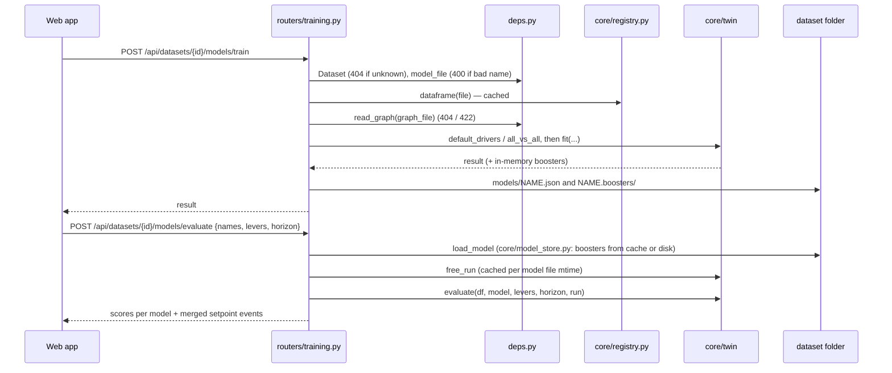

# Backend

The backend is a FastAPI app in `app/backend`. It has three parts with a strict direction of dependency: **routers** (HTTP) call **core** (computation) and **pid** (drawing reader); core and pid never import FastAPI.

---

## Module map

Paths relative to `app/backend/`.

| Module | Responsibility | Explained in |
|---|---|---|
| `main.py` | `app = create_app(DATA_DIR, WEB_DIST, DOCS_HTML)`, what `uvicorn backend.main:app` runs | — |
| `config.py` | Paths: `app/data`, `app/web/dist`, `docs/_build/html`; `ALLOWED_HOSTS` (override: `IDT_ALLOWED_HOSTS`) | {doc}`data-and-privacy` |
| `app.py` | `create_app(data_dir, web_dist, docs_html, allowed_hosts)`: registry on `app.state`, Host check and same-site Origin check on writes, includes the module-level `router` of every router module, `/health`, OpenAPI at `/api/docs`, static mounts (`/docs` redirects to `/docs/`), JSON responses with NaN/inf → `null` | {doc}`overview`, {doc}`data-and-privacy` |
| `deps.py` | Shared dependencies: `Dataset` (the dataset of the path, or 404), `Registry`, and helpers that turn core errors into status codes (`dataframe`, `graph_path`, `read_graph`, `model_file`) | below |
| `schemas.py` | All pydantic request/response models, with field descriptions (they appear in the OpenAPI page): datasets, graphs, lag discovery, training (`TrainRequest`, `EquationCheck`, `EvaluateRequest`, `Intervention`, `SimulateRequest`), site (`Building`, `HeatPoint`, `PidItem`, `Site`), `Project` | {doc}`api` |
| `routers/datasets.py` | Dataset list (with `dataset.json`), re-scan, time series, P&ID image | {doc}`api` |
| `routers/graphs.py` | Graph files: list, read, save, suggested drivers, lag discovery | {doc}`../concepts/causal-graph` |
| `routers/training.py` | Equations; train, list, read, evaluate, simulate models (saving, loading and the caches in `core/model_store.py`) | {doc}`../concepts/models`, {doc}`../concepts/evaluation`, {doc}`../concepts/scenarios-simulation` |
| `routers/site.py` | `site.json`: map, heat source and sinks, P&ID layout (model `Site`) | {doc}`data-and-privacy` |
| `routers/project.py` | Export, save (into the data folder's status folder, one file per save) and open a project (all files built on a dataset as one JSON document) | {doc}`data-and-privacy` |
| `routers/prepare.py` | Prepared variables and aggregated data files (Dashboard › Prepare variables, Aggregate data) | {doc}`../concepts/dashboard` |
| `routers/data_versions.py` | The user's data folder and its versions (the project), the examples, folder import | {doc}`data-and-privacy` |
| `routers/documents.py` | The user's documents about a data center's physical structure | {doc}`data-and-privacy` |
| `routers/live.py` | Working live with an assistant: the events of the open pages, `ui_state` / `ui_do`, pairing | {doc}`mcp` |
| `routers/waermeatlas.py` | Wärmeatlas buildings of a map box, the machine-local Site-map examples | {doc}`../concepts/district-demand` |
| `routers/components.py` | Components: check, graph, run, fit, the presets | {doc}`../concepts/components` |
| `routers/pid.py` | P&ID upload, extraction, preview, use as a data center's P&ID, the stored plant graph. A module-level `router` like the others; the upload limit is `MAX_BYTES` (= `limits.PID_MAX_BYTES`, the name tests patch) | {doc}`../concepts/pid-extraction` |
| `core/registry.py` | `DatasetRegistry`: scans the data folder, metadata from the first parquet file, thread-safe cache of data frames | below |
| `core/storage.py` | Every file location of a data folder (flat or structured); the one module to replace for a database | {doc}`data-and-privacy` |
| `core/summary.py`, `core/recommend.py` | The Dashboard's numbers and KPIs; the preprocessing recommendations | {doc}`../concepts/dashboard` |
| `core/prepare.py`, `core/resample.py`, `core/csv_data.py` | Prepared variables (and `write_prepared`: every file computed before any is written), aggregated data files and time windows (`time_bound`, `window`), big delivered CSVs listed without loading them | {doc}`../concepts/dashboard` |
| `core/components.py`, `core/component_library.py` | Components (a plant part as a small causal graph) and their presets | {doc}`../concepts/components` |
| `core/waermeatlas.py`, `core/map_examples.py`, `core/weather.py` | Wärmeatlas buildings from the local import, the machine-local map examples, Open-Meteo weather (cached) | {doc}`../concepts/district-demand` |
| `core/data_versions.py`, `core/import_folder.py`, `core/documents.py`, `core/live.py` | Data folder versions, a new data center from a folder, the user's documents, the live link with an assistant | {doc}`data-and-privacy`, {doc}`mcp` |
| `core/dataset_files.py` | Folder layout constants, graph read/write (both shapes), name validation, `NOT_GRAPHS`, `write_atomic` (every write to a data folder) and `read_json` | {doc}`data-and-privacy` |
| `core/derived.py` | Calculated columns (`dataset.json` → `derived`): `add_derived`, $Q = m \cdot c_p \cdot (T_{in} - T_{out})$; never modelled, computed from the predicted parts in simulate | {doc}`../concepts/simulated-heat-recovery` |
| `core/model_store.py` | Saved models and their boosters (save whole, load, content hash), one lock per model file, the booster, free-run and simulation caches | {doc}`../concepts/evaluation` |
| `core/limits.py` | Every memory and size limit, in one place | {doc}`../concepts/evaluation` |
| `core/causal_discovery.py` | `discover_lags`, `relag_graph` (tigramite PCMCI / PC + ParCorr) | {doc}`../concepts/causal-graph` |
| `core/physics.py` | The equation language (`Equation`) and `fit_equation` | {doc}`../concepts/models` |
| `core/symbolic.py` | `fit_symbolic`: linear base + gplearn rest, simplified by sympy | {doc}`../concepts/models` |
| `core/twin/graph.py` | Drivers, all-vs-all inputs, step order, lag convention | {doc}`../concepts/causal-graph` |
| `core/twin/learners.py` | Linear, XGBoost, TabPFN for one variable | {doc}`../concepts/models` |
| `core/twin/fit.py` | `fit`: one model per variable | {doc}`../concepts/models` |
| `core/twin/simulate.py` | `simulate` with interventions, noise and driver series put in (`drivers`), `free_run` | {doc}`../concepts/scenarios-simulation` |
| `core/twin/estimate.py` | The training-time estimate shown beside *Train* | {doc}`../concepts/models` |
| `core/twin/evaluate.py` | `nmae`, `r2`, `setpoint_changes`, `evaluate` | {doc}`../concepts/evaluation` |
| `pid/` | `read_drawing`, `sniff`, `components_of`, `plant_fractions` and the readers/extractors behind them; `pid/views.py`: the files of the P&ID's views (a picture and its construct each, their backups) | {doc}`../concepts/pid-extraction` |

`core/twin/__init__.py` re-exports the public API of the twin, so routers write `twin.fit(...)`, `twin.simulate(...)`.

**Router conventions.** Each module in `routers/` defines one module-level `router = APIRouter(prefix=..., tags=[...])`, and `create_app` includes them all in one loop: `(datasets, prepare, data_versions, live, graphs, training, site, project, pid, documents, waermeatlas, components)`. Each route has a `summary` and a docstring, and these become the OpenAPI page. Request bodies are models from `schemas.py`. Route handlers deliberately have **no return type annotation**: FastAPI would turn it into a response model and re-validate and re-serialise large payloads (time series, models), which costs time and could change bytes. The response shapes are documented in the docstrings and in {doc}`api` instead.

---

## Request flow: train and evaluate



Errors raised by core functions are `ValueError`s with a message meant for a human; routers turn them into `400` (bad request), `404` (missing file) or `422` (unreadable content). The web app shows FastAPI's `detail` message as is. Every file the app writes in a data folder goes through `dataset_files.write_atomic` (a temporary file in the same folder, then `os.replace`), so a crash or a full disk leaves the old file, never a cut-off one; `read_json` answers a file that is no JSON object with `BrokenFile` (a `ValueError`, 422 from an app-wide handler) naming it, and the dataset list shows such a data center with an empty `config` instead of failing as a whole. Any other exception is a bug: an app-wide handler logs it with its traceback and the request (`backend` logger; `main.py` sets `logging.basicConfig` at INFO) and answers 500 "Internal error: the app's log has the details". Train, evaluate, simulate and compare log how long they took (`routers/training.py` `_timed`).

<details>
<summary><b>Source code:</b> <code>backend/deps.py</code> (get_dataset, dataframe, graph_path)</summary>

```{literalinclude} ../../app/backend/deps.py
:language: python
:pyobject: get_dataset
```

```{literalinclude} ../../app/backend/deps.py
:language: python
:pyobject: dataframe
```

```{literalinclude} ../../app/backend/deps.py
:language: python
:pyobject: graph_path
```

</details>

---

## Caches

All caches are in-process dictionaries; they disappear when the server restarts.

| Cache | Key | Filled | Invalidated |
|---|---|---|---|
| Data frames (`DatasetRegistry._frames`) | (dataset, file id) | The first parquet file of each dataset at discovery; other files on first use | `POST /api/datasets/refresh` (re-scan) |
| Boosters (`core/model_store.py:_boosters`) | Model file path | On load or right after training | Model file's modification time changes |
| Free runs (`core/model_store.py:_free_runs`) | Model file path | First evaluate of a model | Model file's modification time changes |
| Simulations (`core/model_store.py:_simulations`) | Model file path + request | First run of a request | Model file's modification time changes; only the latest `SIMULATIONS_KEPT` stay |

The registry guards its cache with a lock, and only ever opens a dataset's *own* parquet files (the file id must be one of the dataset's files), never a path built from user input.

<details>
<summary><b>Source code:</b> <code>backend/core/registry.py</code> (DatasetRegistry)</summary>

```{literalinclude} ../../app/backend/core/registry.py
:language: python
:pyobject: DatasetRegistry
```

</details>

---

## JSON responses

Plain JSON has no NaN or infinity. Measurements have gaps and metrics can be undefined, so every response goes through `SafeJSONResponse`: when the normal encoder fails on a non-finite float, the content is walked once and every NaN / ±inf becomes `null`. Time series are returned with gaps as `null` and timestamps as ISO strings without zone (`2024-01-01T00:00:00`).

<details>
<summary><b>Source code:</b> <code>backend/app.py</code> (SafeJSONResponse)</summary>

```{literalinclude} ../../app/backend/app.py
:language: python
:pyobject: SafeJSONResponse
```

</details>
