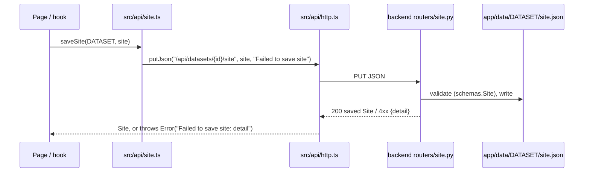

# Frontend

The web app is a single-page app in `app/web`: **React 19 + TypeScript (strict)**, built by **Vite**, with **uPlot** for time-series charts and **Leaflet** for the site map. Those are the only runtime dependencies (`app/web/package.json`). There is no router library, no state library and no CSS framework. Routing is the location hash, state lives in the components and their hooks, and styles are plain CSS on design tokens.

In production FastAPI serves the built app (`app/web/dist`) at `/`. During development the Vite dev server (port 7601) serves it and proxies `/api` to the backend on port 7600 (`app/web/vite.config.ts`).

---

## Module map

Paths relative to `app/web/src/`.

| Folder / file | Responsibility |
|---|---|
| `main.tsx` | Entry point: mounts `App` inside a last-resort `ErrorBoundary`, loads `index.css` and `ui/ui.css` |
| `app/App.tsx` | Shell: top bar, the active tab's sub-tabs (none on Home), the one page the route points to (lazy-loaded, behind an `ErrorBoundary` keyed by route) |
| `app/TopBar.tsx` | Brand (the DC2HEAT logo, its tooltip the app's name and `version` from `package.json`, the only place it is kept), in the middle one track: the whole twin's button (the tab marked `whole`, its name in the three parts' colours) and the three part tabs in the order the heat flows, with a raised pill under the page's tab; and the tools as pill buttons: Home (the house), Connect AI, the project picker with Save / Open project beside it, palette swatches, theme toggle, Help (`?`) |
| `app/routes.ts` | `TABS`, `HOME`, `HELP`, the `OLD` alias table, `resolveRoute`, `hrefOf` |
| `app/theme.ts` | Palette and light/dark: `usePalette`, `useThemeToggle`, `useThemeKey`, `currentTheme` |
| `app/ProjectPicker.tsx`, `app/DataCenterPicker.tsx`, `app/ProjectButtons.tsx` | Project select, top bar right, before Save / Open (a data folder version or the examples; Change data folder…) · the page's data center, right of the sub-tabs (grouped: Simulations / Testbed / Real data centers; Add a data center…) · Save / Open project |
| `dataset.ts` | `DATASET` (the current dataset), `switchDataset`, `datasetConfig()` (`dataset.json`, cached) |
| `api/` | The **only** HTTP client of the backend: `http.ts` (`getJson`, `postJson`, `putJson`, `postFile`, `postBlob`, `query`) plus one module per backend router (`datasets`, `graphs`, `models`, `site`, `project`, `pid`, `components`, `waermeatlas`), re-exported by `api/index.ts` |
| `lib/` | Pure logic shared by pages, a `*.test.ts` next to every non-trivial module: `demand.ts`, `demandStore.ts`, `matching.ts`, `sourceMap.ts`, `period.ts`, `format.ts`, `modelCatalog.ts`, `physicsLibrary.ts`, `plantLinks.ts`, `partKpis.ts` (the heat distribution's and the district's KPIs, the CO₂ factors), `weatherFit.ts` (a series' slope on the outdoor temperature, for what-if), `externalInputs.ts` (Heat Matching's weather and demand from another dataset), `profile.ts` + `profilePresets.ts`, `errors.ts` (`errorMessage`) |
| `ui/` | Shared components: `Card`/`Section`, `Field`, `NumberField`, `Slider`, `Segmented`, `Kpi`, `Dialog`, `ErrorBanner`, `ErrorBoundary`, `Switch`, `LineChart` (uPlot: `LineChart`, `useUplot`, `themedAxis`), `MaskIcon`; their classes in `ui.css` |
| `pages/district/` | Site map (`SitePage`, `useSiteMap`, `useSiteDocument` (the site, its draft, Save, Discard), `useLeavePrompt`, `useFloatingPanel` (the panel's width, place, minimised), `drawSite`, `osm.ts`, `bubbles.ts`, `siteEdits.ts`, the Wärmeatlas layer `WaermeatlasPanel` + `waermeatlas.ts`, the example data centers `frankfurtDataCenters.ts`, the Quick analysis window `QuickWindow` + `quickAnalysis.ts`, the heat network card `HeatNetwork` with `useNetworkData` (streets, a district's houses, heat lines) and `useNetworkLayer` (its Leaflet layer)), the district's dashboard (`DistrictDashboardPage`) and `structure/` (its Structure and Modelling) |
| `pages/heat/` | Heat distribution, the parts the twin's Heat matching (`pages/twin/HeatDistributionPage`) is made of: `useHeatSources`, `window.ts`, `parts.ts`, `points.ts`, `partComponents.ts` + `usePartComponents` (a component in place of a part's formula), `HeatFlowDiagram`, cards (`SourceCard`, `PlantCards`; `controls.tsx`: Model or Calculation, *More options*), the window chart (`HeatCharts`), `useExternalInputs` (another dataset's weather and demand, put into the data center's Model as `drivers`); `structure/`: its Structure and Modelling (`HeatStructurePage`: the data center's `PidPage` with a `StructureSetup`, and `TrainPage` under it) |
| `pages/datacenter/dashboard/` | Visualization and Scenarios of every part (`DashboardPage scope="dc" \| "heat" \| "district"`; `pages/heat/HeatDashboardPage`, `pages/district/DistrictDashboardPage` only set the scope): `partView.ts` (a part's variables, its summary cut to them, its KPIs by the same formulas on the data's statistics and on a twin's run), `WhatIfCard` (levers → KPIs of any part's twin), `VariablesTable`, `SeriesCharts` + `seriesPeriod.ts` (the period filter, the variable chips, the KPIs of the period), the other Explore views (`Shapes`, `ProfileHeatmap`, `MissingMap`), `Distributions`, `CorrelationMatrix`, `dashboard.ts` (formatting, sorting, correlation colours and ordering) |
| `pages/datacenter/structure/` | Structure (the top of Structure and Modelling): `PidPage` (state and layout) with `usePidViews` (the views), `useVariableOps` (what is done to the variables), `useConstructEdits` (the construct's shapes) and `usePidCommands` (the assistant's 25 commands, taking those three), `PidCanvas` and its layers (its props in four groups: `graph`, `selection`, `layers`, `handlers`), `usePidGraph`, `usePidSources`, `links.ts`, `layout.ts`, `geometry.ts`, `roles.ts` (each variable's colour by its approach, actuators in a square), `VariableMenu` + `NewVariableBar` (the Variables bar, *+ Variable*), `DiscoverControls` (the Causal discovery menu), `ConnectionPoints` + `connection.ts`, `PidImport` (P&ID import dialog) |
| `pages/datacenter/modelling/` | Modelling, under each structure: `TrainPage`, `useTrainSetup`, `useEquations`, settings / variables / equations / results cards, `ranking.ts`, `format.ts`, `inputs.ts` |
| `pages/datacenter/scenarios/` | Scenarios: `ScenariosPage`, `useScenarioModel`; `step/` (step-through replay and what-if) and `simulation/` (test-period Monte Carlo) |
| `pages/twin/` | The whole twin: `HeatDistributionPage` (Heat Matching, made of `pages/heat/`'s parts; its demand and supply pure in `matchingInputs.ts`, its run in `useMatchRun`, the three model-and-system folders in `SystemLoads.tsx`), `matchingSetup.ts` (what it keeps for Operation), `YearPicker` (the year to pick the window from), `PlanningPage` + `planning.ts` (Operation: design options), `HeatPumpOperation` + `operation.ts` (Operation: the heat pump's control strategies, heat-led, price rule, MPC; the worker's job `operationJob`, run by `useOperationRuns` in `operation.worker.ts`) |
| `pages/datacenter/shared/` | Used by Modelling and Scenarios: `CausalMiniMap` (the causal graph on the left, `minimap.css`), `causalGraph.ts` (map of a trained model or a graph file, downstream, layout), `useHexView` (which variables the selected heat-exchanger option shows) |
| `pages/help/` | `HomePage` + `SystemFigure` + `home.ts` (the landing page: the system figure with each part's pages under its box, a line per section and page; `home.test.ts` checks every page has one), `AboutPage` ("What is this?"), `GuidePage` + `guide.ts` ("How to use", the steps as data), `DocsCard` (link to `/docs/`) |

The physics behind `lib/matching.ts` and `lib/demand.ts` is explained in {doc}`../concepts/heat-distribution` and {doc}`../concepts/district-demand`.

---

## Routing

Pages are addressed by the location hash `#/<tab>/<sub>`. `app/routes.ts` lists the section tabs: the three parts, ordered as the heat flows (data center → heat distribution → district), and the whole twin (`whole`), plus Home (the landing page) and Help:

| Route | Page |
|---|---|
| `#/home` (`#/home/start`) | Home: the landing page and the default |
| `#/twin/map` | Intelligent Digital Twin: Site map, the overview (`#/district/map` forwards here) |
| `#/district/structure` | District: Structure and Modelling |
| `#/twin/matching` | Intelligent Digital Twin: Heat Matching (`#/heat/flow` forwards here) |
| `#/twin/planning` | Intelligent Digital Twin: Operation |
| `#/dc/dashboard` | Visualization and Scenarios: Historical or Scenarios mode |
| `#/dc/pid` | Structure and Modelling: the P&ID, and under it Modelling (`#/dc/train` forwards here) |
| `#/heat/dashboard`, `#/district/dashboard` | The heat distribution's and the district's Visualization and Scenarios |
| `#/heat/structure` | The heat distribution's Structure and Modelling (`#/heat/components` forwards here) |
| `#/dc/scenarios` | Forwards to `#/dc/dashboard` in Scenarios mode (the replay and the long period simulation) |
| `#/help/about`, `#/help/guide`, `#/help/assistant` | Help: What is this? / How to use / AI assistant |

`resolveRoute(hash)` turns any hash into a page, in this order:

1. an exact entry of the **`OLD`** alias table, which holds addresses from before the regrouping, such as `#/graph/pid` → `dc/pid` and `#/heat/matching` → `heat/flow`, so bookmarks keep working;
2. a **live tab id**: an unknown or missing sub opens the tab's first sub, so `#/dc` opens `dc/dashboard` (live tab ids win over aliases);
3. an old tab without its sub (`#/train`), through the first `OLD` key under it;
4. anything else, including an empty hash: **Home** (`home/start`). The section tabs run left to right as the heat flows: Data Center, Heat Distribution, District.

`App.tsx` maps each `"tab/sub"` to a page component in `PAGES` and loads it lazily. Only the active page is mounted, so switching tabs drops a page's unsaved state. Routes and aliases are a stable contract: never rename or remove one, add an alias instead.

<details>
<summary><b>Source code:</b> <code>web/src/app/routes.ts</code> (OLD, resolveRoute)</summary>

```{literalinclude} ../../app/web/src/app/routes.ts
:language: typescript
:start-at: export const OLD
```

</details>

---

## The current dataset

The app works in one **project**, the data folder version the backend has open (`/api/data-versions`, switched in the top bar, which reloads). A project holds many datasets (data centers), and **each page has its own**: `datasetOf(route)` is the page's choice (`localStorage["dataset:<tab>/<sub>"]`), else the last one chosen (`localStorage["dataset"]`), else `sim_1_modified`. The shell (`App.tsx`) fetches the project once, falls back to its first dataset when the remembered one is not in it, and calls `openDataset(id)` **before it renders the page**, keyed by route and dataset. `DATASET` is a live binding (`export let`), so every module reads the page's dataset without subscribing to changes. Choosing another one in the sub-tab bar (`chooseDataset(route, id)`) re-opens only that page, no reload; `switchDataset(id)` (a new data center, the assistant's `open_dataset`) sets it for the page on screen and reloads.

`datasetConfig()` returns the dataset's `dataset.json` (actuators, heat variables, levers, P&ID image, heat source), fetched once per dataset and cached. A failed fetch is not cached, so the next call retries. The Scenarios step-through also keeps a page-local dataset select (`useDatasetSelection`), as before the refactor.

<details>
<summary><b>Source code:</b> <code>web/src/dataset.ts</code></summary>

```{literalinclude} ../../app/web/src/dataset.ts
:language: typescript
:start-at: const KEY
```

</details>

---

## Theming

The look is **three palettes × light/dark**: *aurora* (default), *electric* and *emerald*. They are set as attributes on `<html>`:

- `data-palette="aurora|electric|emerald"`, saved in `localStorage["palette"]`;
- `data-theme="dark"` for dark mode, saved in `localStorage["theme"]`.

`index.html` applies the saved values **before the first paint**, so a dark-mode user never sees a light flash, using the same keys as `app/theme.ts`. All colours are CSS custom properties defined in `src/index.css`, one block per palette and theme (`:root`, `:root[data-theme="dark"]`, `:root[data-palette="electric"]`, …). They include `--background`, `--surface`, `--foreground*`, `--accent*`, the semantic `--heat`, `--hot`, `--cool`, `--ok`, `--warn`, `--danger`, the `--chart-grid` and `--chart-axis`, plus spacing (`--space-*`), radii and fonts. Components use only these tokens, so they follow both switches without any JavaScript.

**Canvas and tiles cannot read CSS variables live.** uPlot draws on a canvas, and Leaflet's tiles are images. For them `useThemeKey()` returns a key such as `"dark aurora"`. A `MutationObserver` on `data-theme` **and** `data-palette` changes the key, and an effect that has the key in its dependencies rebuilds the chart or swaps the tile layer. Every uPlot chart is built through `ui/LineChart.tsx:useUplot(make, deps)`. It creates the chart once per change of `deps` or of the theme key, never on every render, resizes it with its box and destroys it on unmount. `themedAxis()` reads the chart tokens with `getComputedStyle` when the chart is built. Line colours of the data series are fixed mid-tones, readable on both backgrounds.

<details>
<summary><b>Source code:</b> <code>web/src/app/theme.ts</code> (useThemeKey), <code>web/src/ui/LineChart.tsx</code> (themedAxis)</summary>

```{literalinclude} ../../app/web/src/app/theme.ts
:language: typescript
:start-at: export function useThemeKey
```

```{literalinclude} ../../app/web/src/ui/LineChart.tsx
:language: typescript
:start-at: export function themedAxis
:end-before: /**
```

</details>

**Styles.** `index.css` holds the reset, the tokens and the shell. `ui/ui.css` holds the shared classes: one card (`.card`), one field (`.field`, `.field--sm`), one button (`.btn` with `--primary`, `--pill`, `--ghost`, `--icon`, `--on`), captions (`.caps`), and the page frame (`.page`, `.page__title`, `.page__lead`). A page may add its own stylesheet next to it (`district.css`, `heat.css`, `pid.css`, `modelling.css`, `scenarios.css`, `help.css`) with classes prefixed by the page. Pages do not copy inline style objects between files.

---

## State and data loading

The conventions every page follows:

- **A page component holds the user's choices** (`useState`) and lays out its parts. Loading lives in a **hook next to the page**, such as `useHeatSources`, `useExternalInputs`, `usePidSources` / `usePidGraph`, `useTrainSetup` / `useEquations`, `useScenarioModel`, `useDatasetSelection` or `useWhatIf`. The hook returns data plus `loading` and `error`, and the page shows `error` in an `ErrorBanner`.
- **Pure logic goes in plain `.ts` modules** with no React and no fetching (shared ones in `lib/`, page-specific ones next to the page, e.g. `pages/heat/window.ts`, `pages/datacenter/structure/links.ts`, `pages/datacenter/modelling/ranking.ts`). These are the parts with unit tests.
- **Derived values are `useMemo`**, keyed on the inputs. Expensive per-item results are cached on the identity of their input.
- **Shared loads are de-duplicated, not cached.** `lib/period.ts:testPeriod` shares one in-flight request between the callers that ask at the same time (Heat distribution and its demand model). It keeps nothing afterwards, because training a model moves the split.
- **Saving is explicit.** Pages save on a button press (*Save site*, *Save*, *Train*). The exceptions are Heat distribution's choices, saved to `site.json` one after the other (each save reads, changes and writes the whole file): the heat-source column mapping 600 ms after an edit, the switched-on parts and each part's component at once.
- **A crashing page breaks only itself.** `App.tsx` wraps the page in an `ErrorBoundary` keyed by route.

## Talking to the backend

All HTTP to the backend goes through `src/api/`: no page calls `fetch` itself. Each function names what it does in the error message. A failed call throws `Error("<what>: <reason>")`, where the reason is FastAPI's `detail` (or the messages of a 422), so a page shows `errorMessage(e)` (`lib/errors.ts`) as it is. Calls are same-origin (`/api/...`). The only other network calls in the app go to the public OpenStreetMap and Esri services from the Site map (`pages/district/osm.ts`, `useSiteMap.ts`), see {doc}`../concepts/district-demand`.

<details>
<summary><b>Source code:</b> <code>web/src/api/http.ts</code></summary>

```{literalinclude} ../../app/web/src/api/http.ts
:language: typescript
:start-at: async function reasonOf
```

</details>

A typical call, from a component to the file on disk:



---

## Testing

| Layer | Where | Command (in `app/web`) |
|---|---|---|
| Types | everything under `src/` (`tsc --noEmit`, strict) | `npm run typecheck` |
| Unit (vitest) | `src/**/*.test.ts`, next to the module they test | `npm test` |
| End to end (Playwright, installed Chrome) | `e2e/*.spec.ts`, one file per area: `smoke`, `shell-help`, `dashboard`, `graph-side`, `district`, `heat`, `matching-inputs`, `components`, `structure`, `heat-structure`, `modelling`, `scenarios`, `assistant`, `api` ({doc}`../development/testing`) | `npm run e2e` (against a running app, `E2E_BASE_URL`, default `http://localhost:7600`) |

There is no DOM testing library (no new dependencies). Components stay thin, the logic they need is in pure modules that vitest can test directly, and the rest is covered end to end.

**E2E specs are read-only.** They run against the user's real app and data folder. Each spec sets `localStorage["dataset"] = "sim_1_modified"` (where it opens a page), and calls `readOnly(context)` from `e2e/readonly.ts` first, which **aborts every `/api` request that is not a GET before it is sent**, except the compute-only POSTs that write nothing (`models/evaluate`, `models/<name>/simulate`, `equations/check`, `graph/discover-lags`) and the live link (the page's reports and answers, and Connect AI's `live/pair-code` and `live/pair`). A spec that needs to see a write mocks it with `page.route` (page routes take precedence over the context route), for example the graph save and lag discovery in `structure.spec.ts`, the site save in `district.spec.ts` and Re-prepare (`models/train`) in `scenarios.spec.ts`. `smoke.spec.ts` opens every route and fails on any console error, page error or HTTP status ≥ 500. Details are in {doc}`../development/testing`.
