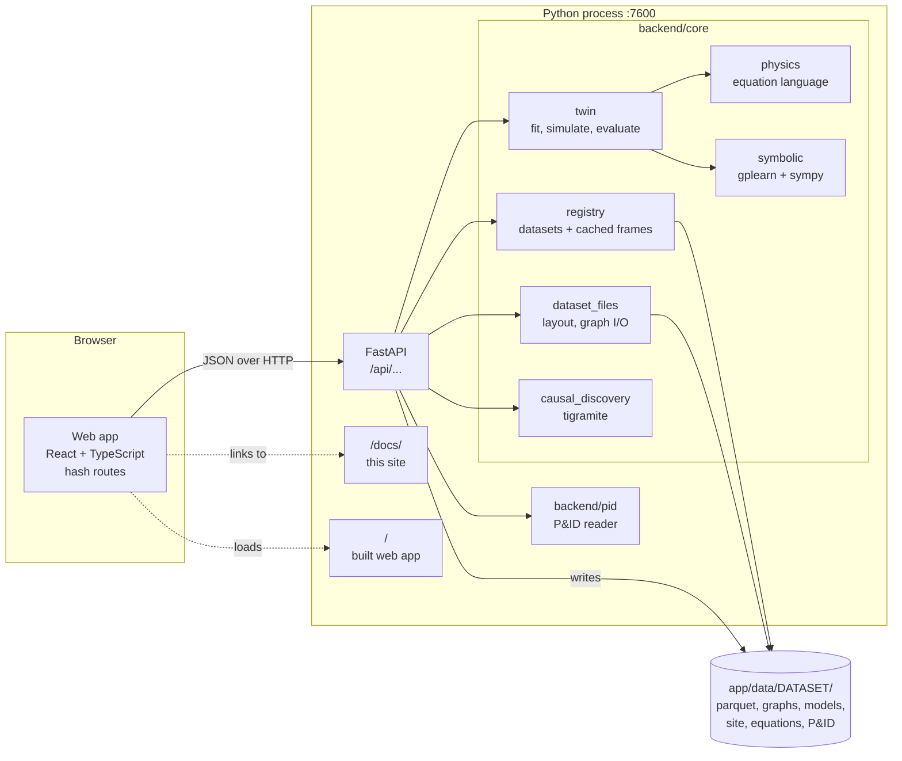

# Architecture overview

The app is deliberately small: **one Python process** that serves a single-page web app, a JSON API and this documentation, over a folder of datasets on the local disk. There is no database, no message queue and no cloud service.



| Layer | Where | Responsibility |
|---|---|---|
| Web app | `app/web/src` | All user interaction; talks to the backend only through `src/api/`. Built by Vite into `app/web/dist`. See {doc}`frontend`. |
| HTTP | `app/backend/app.py`, `routers/`, `deps.py`, `schemas.py` | Routes, request validation, status codes, file I/O of the dataset folder. No science. |
| Core | `app/backend/core/` | Pure computation on data frames and dicts: the twin, equations, symbolic regression, lag discovery, dataset files. No HTTP. |
| P&ID reader | `app/backend/pid/` | Drawing → plant graph. Standard library only. No HTTP. |
| Data | `app/data/<dataset>/` | One folder per data center. See {doc}`data-and-privacy`. |

---

## Design choices

**One process.** FastAPI serves the API under `/api`, the built web app at `/` and the built documentation at `/docs/` (when `docs/_build/html` exists at startup; the bare `/docs` redirects there). The interactive OpenAPI page is at `/api/docs`. In development the Vite dev server (port 7601) serves the web app and proxies `/api` to the backend on port 7600.

**Local only.** The data of a data center is sensitive, and P&ID drawings may be confidential. Everything is computed on the local machine; `start.sh` disables telemetry. The app answers only requests addressed to the local machine and accepts writes only from its own pages (Host and Origin checks). See {doc}`data-and-privacy`.

**2 GB memory budget.** The app is meant to run on an ordinary laptop beside other work. Every knob that drives memory — TabPFN context rows and inputs, prediction chunks, free-run length, symbolic-regression rows, request caps for simulation and evaluation, upload size, any request body's size (refused by its `Content-Length` before it is read; an upload is cut off while it arrives, `deps.read_body`) — is a named constant in `backend/core/limits.py`. Heavy libraries (torch / TabPFN, XGBoost, gplearn, sympy, tigramite, scipy) are imported inside the functions that need them, so the app starts without loading them. In development, servers and test runs are run under a watchdog that kills the process tree above 2 GB (see {doc}`../development/development`).

**Files, not a database.** Each dataset is a folder; graphs, equations, models and the site are small JSON files next to the data. They can be inspected and diffed, and a project is simply those files bundled into one JSON document.

**Synchronous computation.** Training, evaluation and simulation run inside the request (FastAPI runs plain `def` routes in its thread pool). A TabPFN fit or free run can take minutes; there is no job queue. P&ID extraction, which is CPU work inside an `async` route, is moved off the event loop explicitly.

<details>
<summary><b>Source code:</b> <code>backend/app.py</code> (create_app)</summary>

```{literalinclude} ../../app/backend/app.py
:language: python
:pyobject: create_app
```

</details>
