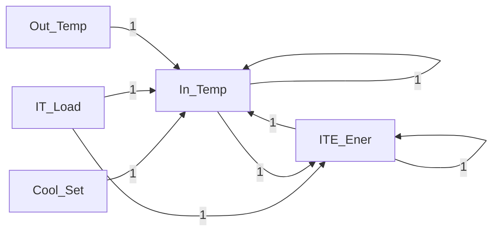

# Causal graph

The causal graph is the backbone of the twin. It says, for every variable, **which other variables influence it and with which time delay**. The twin then learns one small model per variable, and that model may only use the inputs the graph allows. This is what makes the twin usable for what-if questions: a change to a setpoint can only reach the variables that the graph connects to it, in the direction and with the delays the graph states.

---

## Variables

A dataset is a table of time series: one row per time step (hourly in the simulations), one column per measured variable, plus a `time` column. Every numeric column except `time` is a **variable** of the twin.

Each variable plays one of two roles in a trained model:

| Role | Meaning | Examples |
|---|---|---|
| **Modelled** | Predicted by the twin from its parents. In a free run or a scenario it is computed step by step from the twin's own previous predictions. | Room temperature `In_Temp`, IT energy `ITE_Ener`, heat-exchanger outlet `HEX_Cond_T_out` |
| **Driver** | Taken from the data, never predicted. Drivers are the boundary conditions of the twin: weather, clock, setpoints, IT load. In a scenario a driver can be intervened on (set, shifted, scaled). | `Out_Temp`, `Hour`, `Cool_Set`, `IT_Load` |

Which variables are drivers is chosen when training. The app suggests as drivers every variable whose only parents are its own past (or that has no parents at all) — a variable the graph does not explain from other variables cannot be predicted from them. In addition, **any parent that is not itself modelled becomes a driver automatically**.

<details>
<summary><b>Source code:</b> <code>backend/core/twin/graph.py</code> (default_drivers)</summary>

```{literalinclude} ../../app/backend/core/twin/graph.py
:language: python
:pyobject: default_drivers
```

</details>

---

## Parents and lags

A link of the graph is a triple *(parent, target, lag)*. For a modelled variable $y$ with parents $x^{(1)}, \dots, x^{(m)}$ at delays $\tau_1, \dots, \tau_m$, the twin learns a function

$$
\hat{y}_t = f_y\left(x^{(1)}_{t-\tau_1},\; x^{(2)}_{t-\tau_2},\; \dots,\; x^{(m)}_{t-\tau_m}\right)
$$

A variable may appear several times with different delays (e.g. `In_Temp` at $t-1$ and $t-2$), and a variable may be its own parent (its own past, the autoregressive part: a room's temperature now depends on its temperature an hour ago). The form of $f_y$ depends on the model kind — see {doc}`models`.

### The lag sign convention

Two conventions exist in the code, and mixing them up is the most common mistake:

| Where | Convention | "one step back" |
|---|---|---|
| Graph files (`causal_graph*.json`), the graph API (`GET/POST .../graph`), saved models (`models/*.json` → `inputs[].lag`) | **negative** lag, $\text{lag} = -\tau$ | `-1` |
| Inside the twin (`core/twin/*`), the equation language (`Var[t-1]`) | $\tau = \lvert \text{lag} \rvert \ge 0$ steps back | `1` |
| Lag discovery request (`POST .../graph/discover-lags`: `min_lag`, `max_lag`) and its result (`lags`) | **positive** step counts, $\ge 1$ | `1` |

A lag of `0` means *the same time step*. The backend accepts same-step links: inside one time step the variables are evaluated in an order where every lag-0 parent comes first (a topological sort), and a cycle of lag-0 links is rejected with an error. The app's own graphs use lags of at least 1 (every effect takes at least one step), and lag discovery only ever tests lags $\ge 1$.

<details>
<summary><b>Source code:</b> <code>backend/core/twin/graph.py</code> (module docstring, step_order)</summary>

```{literalinclude} ../../app/backend/core/twin/graph.py
:language: python
:lines: 1-5
```

```{literalinclude} ../../app/backend/core/twin/graph.py
:language: python
:pyobject: step_order
```

</details>

---

## The graph file format

A graph is stored as a JSON file in the dataset folder. Current files have two keys: `targets` (for each modelled variable, its list of `[parent, lag]` pairs) and `link_strengths` (optional labels for the editor: a strength value per link). This is the default graph of the `sim_1` simulation (`app/data/sim_1/causal_graph.json`), shown compactly:

```json
{
  "targets": {
    "In_Temp":  [["In_Temp", -1], ["Cool_Set", -1], ["ITE_Ener", -1], ["IT_Load", -1], ["Out_Temp", -1]],
    "ITE_Ener": [["IT_Load", -1], ["ITE_Ener", -1], ["In_Temp", -1]]
  },
  "link_strengths": []
}
```

Read it as: *the room temperature `In_Temp` at hour $t$ depends on itself, the cooling setpoint, the IT energy, the IT load and the outdoor temperature, all at hour $t-1$.* `Cool_Set`, `IT_Load` and `Out_Temp` have no parents, so they are suggested as drivers.



An older shape without the wrapper, `{"In_Temp": [["In_Temp", -1], ...]}`, is still read. Variable names are stripped of surrounding spaces when read (some source graphs pad them).

<details>
<summary><b>Source code:</b> <code>backend/core/dataset_files.py</code> (parse_graph, write_graph)</summary>

```{literalinclude} ../../app/backend/core/dataset_files.py
:language: python
:pyobject: parse_graph
```

```{literalinclude} ../../app/backend/core/dataset_files.py
:language: python
:pyobject: write_graph
```

</details>

### Graph variants

A dataset may hold several graphs. Every `*.json` file of the folder is listed as a graph, except the files that are known not to be graphs (`site.json`, `dataset.json`, `equations.json`, `pid_plant.json`), the legacy `graph_manual.json` and old `*.canvas.json` layouts.

| File | Content | Written by |
|---|---|---|
| `causal_graph.json` | The default graph: what the app opens first. | The import scripts; the user (Save on the Structure and Modelling page) |
| `causal_graph_manual.json` | The domain-knowledge graph drawn by experts, kept unchanged as the reference. | the local import scripts (`app/data/_local/scripts/`) |
| `causal_graph_pcmci.json` | Same variables and links as the manual graph, each link's lags (1..5) discovered with PCMCI. Modelling trains on this one by default. | the local import scripts (`app/data/_local/scripts/`), `scripts/make_sim_1_modified.py` |
| `causal_graph_pc.json` | The same with the PC algorithm (on the last 5000 rows for the imported data centers, because PC is slow on long series). | same |
| `causal_graph_discovered.json` | `sim_1` and `sim_1_modified` only: a graph found by full causal discovery with tigramite (PCMCI by default, over all variables and lags, with `link_strengths`), kept for comparison with the manual graph. In `sim_1` it was the default graph until the manual graph replaced it. | The first version of the app (its full causal discovery, since removed); not reproduced by a script |
| any other name | Graphs saved by the user. | the user |

Old folders that have `graph_manual.json` but no `causal_graph.json` get it renamed to `causal_graph.json` when the app scans the data directory.

<details>
<summary><b>Source code:</b> <code>backend/core/dataset_files.py</code> (graph_files, graph_name, migrate_legacy_graph)</summary>

```{literalinclude} ../../app/backend/core/dataset_files.py
:language: python
:pyobject: graph_files
```

```{literalinclude} ../../app/backend/core/dataset_files.py
:language: python
:pyobject: graph_name
```

```{literalinclude} ../../app/backend/core/dataset_files.py
:language: python
:pyobject: migrate_legacy_graph
```

</details>

---

## Discovering the lags of a drawn graph (Causal discovery, TempCaFe)

On the Structure and Modelling page this is the **Causal discovery** button (TempCaFe, Temporal Causal Feature Selection, the project's framework for choosing a model's inputs by their causal lags). It opens a menu with the method, the significance level $\alpha$, the lag range and the start: *Refine the drawn graph* (below) or *Blind, no links*.

Engineers usually know *which* variables influence which — the cooling setpoint drives the room temperature — but not *how long* the effect takes. The app therefore keeps the structure that the user drew and lets the data decide only the **lags** of each link. It uses the causal-discovery library **tigramite** with one of two algorithms:

- **PCMCI** (Runge et al., 2019): a condition-selection step (PC$_1$) finds a small set of likely parents for every variable, then the **MCI** test (momentary conditional independence) tests each candidate link conditioned on the parents of both ends. This keeps false positives low on autocorrelated time series.
- **PC** (the classic PC algorithm, time-lagged): removes a link as soon as some conditioning set makes the two ends independent.

Both use the **ParCorr** test (partial correlation): to test whether $x_{t-\tau}$ influences $y_t$ given a conditioning set $Z$, both are linearly regressed on $Z$ and the correlation $\rho$ of the two residuals is tested for being zero:

$$
\rho\left(x_{t-\tau},\, y_t \mid Z\right) = \operatorname{corr}\left(x_{t-\tau} - \hat{x}_{t-\tau}(Z),\;\; y_t - \hat{y}_t(Z)\right)
$$

A lag $\tau$ of a link is **significant** when the test rejects independence at the level $\alpha$ (default $0.01$).

What is tested is restricted with tigramite's `link_assumptions`: for every drawn link $a \to b$, the lags $\tau \in [\tau_{min}, \tau_{max}]$ of $a$ for $b$, plus every variable's own past at those lags. Nothing else is a candidate, so discovery can never add a link the user did not draw.

**Blind discovery** (*Blind, no links* in the menu) uses no drawn graph as a prior: the page sends every ordered pair of the drawn variables with data as `links`, so every pair is a candidate, and the links among those variables are replaced by the significant ones (own past included). Links to a variable that was not tested (no data, not drawn) are kept. It is the same endpoint; with $n$ variables it tests $n(n-1)$ pairs, so it takes longer on many variables.

| Parameter | Default | Meaning |
|---|---|---|
| `method` | `pcmci` | `pcmci` or `pc` |
| `min_lag`, `max_lag` | 1, 5 | Lags tested, in steps back; $1 \le$ `min_lag` $\le$ `max_lag` $\le 24$ |
| `alpha` | 0.01 | Significance level (PCMCI: both `pc_alpha` and `alpha_level`) |
| `data_fraction` | 1.0 | Use only the first fraction of the rows (at least 10), for speed |

The result lists, per link, the significant lags and the p-value of every tested lag, the significant own-past lags of every variable, and the links that were skipped because a variable is not in the data. Rows with a missing value in any of the involved variables are dropped before the test.

```{important}
Lag discovery **never changes a graph file on its own**. The endpoint returns the result and writes nothing. With the lags it also returns their **strengths** (`link_strengths`: the ParCorr statistic, a partial correlation, of every significant lag, own-past lags included, with negative lags as in a graph file), so that saving after a discovery keeps a strength for each new lag. On the Structure and Modelling page the discovered lags are put into the editor, links without a significant lag are kept and marked so the user can decide whether to delete them, and only the user's **Save** writes a file.
```

<details>
<summary><b>Source code:</b> <code>backend/core/causal_discovery.py</code> (discover_lags)</summary>

```{literalinclude} ../../app/backend/core/causal_discovery.py
:language: python
:pyobject: discover_lags
```

</details>

### Re-lagging a whole graph file

The dataset scripts produce `causal_graph_pcmci.json` and `causal_graph_pc.json` with `relag_graph`: it keeps every variable and link of a graph and replaces each link's lags by the discovered ones. Own-past lags are re-discovered only for variables that already have an own-past link. A link with no significant lag keeps its old lags and is reported as *without evidence*, so a human decides whether to drop it.

<details>
<summary><b>Source code:</b> <code>backend/core/causal_discovery.py</code> (relag_graph)</summary>

```{literalinclude} ../../app/backend/core/causal_discovery.py
:language: python
:pyobject: relag_graph
```

</details>

---

## Causal graph or all vs all

A model can also be trained **without** a graph ("all vs all"): every modelled variable gets every variable as a parent at every lag $1..L$ (default $L = 5$). This is the baseline the causal graph has to beat. It usually fits the training data as well or better, but it learns correlations that do not hold when a setpoint is moved, which shows in the free run and the setpoint-change scores (see {doc}`evaluation`). With 16 variables and $L=5$ it also means 80 inputs per variable, which is why TabPFN is not offered all vs all.

<details>
<summary><b>Source code:</b> <code>backend/core/twin/graph.py</code> (all_vs_all)</summary>

```{literalinclude} ../../app/backend/core/twin/graph.py
:language: python
:pyobject: all_vs_all
```

</details>
