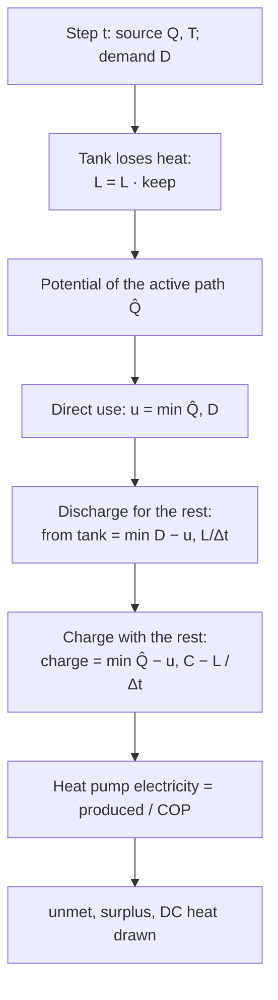

# Heat distribution

The **Heat Matching** page of the Intelligent Digital Twin, the whole twin (`#/twin/matching`, formerly *Heat distribution*, `#/heat/flow`) follows the data center's waste heat to the district. It asks one question: *step by step, how much of the district's heat demand can the data center's heat cover, and at what cost in heat-pump electricity?*

The page has the key figures on top, then three columns, in the flow diagram and in the cards set into the feet of its boxes: **Data center** | **Heat distribution** | **District heat**. The middle column holds the three units between the two: the **direct heat exchanger**, the **heat pump** and the **thermal storage**. Each of them can be switched off; the data center and the district heat are always there.

Each of the three parts runs its **Model** or a **Calculation** (see [the parts](#two-logics)). The Model is what the part's own Structure and Modelling delivers at its [connection points](#connection-points); the Calculation is the simple formulas of this page.

The calculation runs **in the browser**, in plain TypeScript, so every slider answers at once. It takes four inputs:

1. the **source**: heat (kW) and its temperature (°C) at one extraction point of the data center, per step;
2. the **district demand** (kW per step) and the network supply and return temperatures, from the District section (see {doc}`district-demand`) or from a demand column of the data;
3. the **recovery**: which of the direct heat exchanger and the heat pump are on, with their efficiencies;
4. the **storage**: on or off, tank size and standing loss.

It then walks through the evaluated period one step at a time. In each step it delivers what it can, charges the tank with any surplus, and discharges the tank when there is a deficit.

| Code | Role |
|---|---|
| `app/web/src/lib/matching.ts` | The step-by-step matching (`matchHeat`), the Carnot COP, the physics source (`physicsSource`) |
| `app/web/src/lib/sourceMap.ts` | Which data columns are the heat source when `dataset.json` names none |
| `app/web/src/lib/period.ts` | The evaluated period, its step length, loading columns measured or from the model, binning |
| `app/web/src/lib/demandStore.ts` | The district demand over the same period (`districtYear`) |
| `app/web/src/lib/ports.ts` | The connection points between the parts and how each of their variables is delivered |
| `app/web/src/pages/datacenter/modelling/PortsCard.tsx` | Modelling › Connection points of each part, and the heat distribution's plant models |
| `app/web/src/pages/heat/parts.ts` | The parts: Model or Calculation, the district's source, the units' on/off switches, the loop temperatures |
| `app/web/src/pages/heat/partComponents.ts` | A part run by a component instead of its built-in formula ({doc}`components`) |
| `app/web/src/pages/heat/` | The page: data loading (`useHeatSources.ts`), the zoom window (`window.ts`), the flow diagram, cards and charts |

---

## The evaluated period

Heat distribution and District demand work on the same stretch of time: the dataset's **test period**, at the data's own resolution (`lib/period.ts:testPeriod`).

- If the `linear` model has been trained (Modelling, causal graph structure), the period starts at that model's split row (`split_index`) and uses the model's data file.
- Without a trained model it is the last 50 % of the rows of the dataset's first file.
- It is capped at `MAX_STEPS = 20000` steps. A year of hourly data is 8760 steps.

The step length $\Delta t$ (hours per step) is the **median** spacing of the timestamps, so one missing row does not change it. Energies are sums of power times step length: $E\,[\text{kWh}] = \sum_t P_t\,[\text{kW}] \cdot \Delta t$. The page calls the period **"Year"** when it spans at least 360 days, and **"Test period"** otherwise.

<details>
<summary><b>Source code:</b> <code>web/src/lib/clock.ts</code> (stepHoursOf), <code>web/src/lib/period.ts</code> (testPeriod, periodColumns)</summary>

```{literalinclude} ../../app/web/src/lib/clock.ts
:language: typescript
:start-at: /** Median spacing of the timestamps
```

```{literalinclude} ../../app/web/src/lib/period.ts
:language: typescript
:start-at: export function testPeriod
:end-before: /** kW per step -> MWh
```

</details>

---

(connection-points)=
## Connection points

The parts are joined at fixed **connection points**, whatever model each part has inside (`lib/ports.ts`). Each point is **two temperatures and the heat or the mass flow**; $Q = \dot m\, c_p\, (T_{supply} - T_{return})$ gives the other:

| Point | From → to | Variables |
|---|---|---|
| **Waste heat**, one per extraction point | data center → heat distribution | supply and return temperature of the hot side, heat $Q$, mass flow $\dot m$ (`dataset.json` → `heat_source`: `t_in`, `t_out`, `q`, `m`; the heat distribution's `T_dc_supply`, `T_dc_return`, `Q_dc`, `m_dc`) |
| **District heat** | heat distribution → district | the demand $Q$ (`kpi.heat_demand`, or `Q_houses`), the network's `T_dh_supply`, `T_dh_return`, `m_dh` |
| **Weather** | shared by all three | outdoor temperature (needed: free cooling, the network, the demand), humidity (the tower's wet bulb), solar radiation (the buildings' gains); wind is a second-order effect, left out |

The top of each part's Modelling (*Connection points*, `PortsCard`) lists its points and how each variable is made there: by its approach (data-driven, physical, profile), *measured* (a data column left as data), *calculated* ($Q$ from $\dot m$ and the two temperatures), a *setting* (the district's supply and return on the Site map, until they are modelled) or *missing*, marked red. A data center without `heat_source` picks its columns there (*Columns of the waste heat*, saved as `site.json` → `heat_source_map`). The weather's columns are always listed under the Variables of the heat distribution and the district too.

Every part's structure always has these variables, whatever its graph file says: the variables of its connection points and the shared weather (`portVars`, `StructureSetup.ports`). A saved graph without them gets them back on the drawing, unlinked, and Save writes them. They take the data's names where it has a column for them (`bindSetup`), and the generic names otherwise. A data center without `heat_source` uses the heat distribution's names: `T_dc_supply`, `T_dc_return`, `Q_dc`, `m_dc`. The data center also always has its **inputs and outputs** (`DC_INTERFACE`, each bound to the data's column where it has one, in `bindSetup`): the IT load that drives it (input, `IT_load`, e.g. `IT_Load`), its IT electricity (`IT_power`, e.g. `ITE_Ener`) and cooling electricity (`Cooling_power`, e.g. `HVAC_Ener`), and the heat its cooling rejects to the environment (`Heat_rejected`) (outputs). Nearly all the electricity becomes heat, recovered at the extraction points or rejected, so `Heat_rejected` ≈ `IT_power` + `Cooling_power` − the heat recovered. The names read as what they are and fit the drawing's labels (16 characters), so none is shortened. They are standard variables to model, like the weather; in some data they are measured, in others they follow from the others. Its *Connection points* card shows it in a row of its own, and with a picture or no drawing it starts under the connection point. A variable without data is marked *no data* and has to be made in Modelling.

**On every drawing.** The built-in drawings have their connection points drawn in: the neighbour's box (the heat distribution's on the data center's drawing, the data center's and the district's on the heat distribution's, the heat distribution's on the district's), the supply (red) and the return (blue) between it and the part, at y 200 and 240 of the drawing. With an imported P&ID picture, or on a structure with no drawing yet (a new project), the page draws the same connection points itself (`connection.ts`, `ConnectionPoints.tsx`), in a margin beside the picture so they never cover it: on the data center's right, on both sides of the heat distribution, on the district's left. The pipes run from the picture's edge to the neighbour's box. Their variables start in the margin between them, the supply's above its pipe and the return's below (`portSpots`), until they are placed by hand. One put back in the tray stays there. The picture keeps its own coordinates, so variables already placed on it stay where they were. The weather is there the same way on every structure, built-in drawing or not: a *Weather* box at the top, above the neighbour's box (the heat distribution's on the data center's right, the data center's or the heat distribution's on the left of the other two; `weatherBox`, `weatherSpots`). The outdoor temperature, the humidity and the solar radiation are always in it, in the same three slots, under the data's names where it has them and otherwise as variables to model. On a built-in drawing it also holds the wind, its direction and the hour, where the structure has them. They start in their box; moved by hand, they stay where they were put.

---

## Extraction points and the source heat

An **extraction point** is a place in the data center where heat can be taken out. The simulation `sim_1_modified` has two (see {doc}`simulated-heat-recovery`):

| Point | Medium | Typical temperature |
|---|---|---|
| `hall`: Hall HEX | hot-aisle air behind the racks | close to the room temperature plus the rack temperature rise |
| `condenser`: Condenser HEX | cooling water on the condenser side of the chiller | follows the outdoor air (cooling tower) |

The plant cases of `scripts/make_sim_cases.py` (both with free cooling, see {doc}`simulated-heat-recovery`): `sim_1_air` has the same two points, but its condenser carries heat only while the chiller runs (in free cooling the heat goes through the plate HEX to the tower). The water-cooled `sim_1_water` has the same plant outside, so the same condenser point (with the rear doors' share only), and its facility water:

| Point | Medium | Typical temperature |
|---|---|---|
| `liquid`: Liquid cooling HEX | facility water back from the CDUs: the cold plates' 75 % of the IT heat | 40–45 °C supply (the tower through a plate HEX), about 50 °C back at full load |
| `condenser`: Condenser HEX | condenser water of the chiller, for the rear doors' share, while it runs | as the air-cooled one's |

The flow diagram lists every point in the data-center box, and clicking one selects it (first the liquid point, the hottest, else the condenser). The **Data center** card then runs its *Model* or its *Calculation* (see [the parts](#two-logics) below).

### The data center's Model (its connection points)

The points and their columns come from one of three places, in this order:

1. **`dataset.json` → `heat_source`**: `{point: {q, t}}` names a heat column (kW) and a temperature column (°C) for each point. Only points whose two columns exist in the data are used. For `sim_1_modified` these are `hall` and `condenser`: the recovered heat `HEX_*_Q` and, as the source temperature, the hot side's inlet temperature `HEX_*_T_in`; the outlet `HEX_*_T_out` (`t_out`) is the loop's measured return temperature. `HEX_*_Q` is a calculated column (`dataset.json` → `derived`): the *AI modelled* series is offered when the trained model predicts its parts, and the free run computes $Q = \dot m\, c_p\, (T_{in} - T_{out})$ from them (see {doc}`simulated-heat-recovery`).
2. **The saved mapping** `site.json` → `heat_source_map`, which is used when the dataset names no heat source. It is one point, called `mapped`, of one of two kinds:
   - **heat column**: $Q_t = f \cdot x_t$, where $x$ is a heat or power column and $f$ a factor;
   - **temperature difference**: $Q_t = f \cdot \left|T^{hot}_t - T^{cold}_t\right|$, where $f = \dot m\, c_p$ in kW/K (water: 1 kg/s ≈ 4.19 kW/K).

   In both kinds, $T_t$ is a column the user picks. Edits are saved to `site.json`, debounced by 600 ms.
3. **A first guess**, when nothing is saved (`guessHeatSourceMap`). If a column name looks like power or heat (`heat`, `power`, `_q`, `kw`, `ener`, and not `temp`), that column is used, preferring IT power, with factor 1. Otherwise the difference of the first two temperature-like columns is used.

**Model or measured, column by column.** Each column of the point comes from the trained model's **free run** over the period when the model predicts it or takes it as a driver (`POST …/models/{name}/simulate` from the split row with one draw; the model is the one picked under *More options* › *Trained model*, `linear` by default, see {doc}`scenarios-simulation`), and as measured otherwise: a column the data center does not model is delivered by its measurements (`useHeatSources`). The card lists each variable with *model* or *measured*. Gaps (`null` or NaN) and a series that ends early are filled with the last valid value (`periodColumns`).

### Calculation

When the data has the four driver columns `ITE_Ener`, `HVAC_Ener`, `In_Temp` and `Out_Temp`, the card also offers **Calculation** (otherwise it is disabled, with the missing columns as the hint). The heat at each point is then computed from IT and HVAC power and the temperatures of the **previous** step ($k = \max(0, t-1)$). It is a simple estimate of the heat **available** at the point, with no demand limit. The simulation's `HEX_*` columns are different: they are the heat actually **recovered** for the simulation's own heat demand, with literature-based exchanger limits (see {doc}`simulated-heat-recovery`). Expect *From physics* to be higher than the data, mostly in summer:

$$
\begin{aligned}
\text{hall:}\quad & Q_t = \eta\, P_{IT,k}, & T_t &= T_{in,k} + \Delta T_{rack} - \Delta T_{app} \\
\text{condenser:}\quad & Q_t = \eta \left(a\, P_{IT,k} + P_{HVAC,k}\right), & T_t &= \operatorname{clip}\!\left(T_{out,k} + \Delta T_{tower},\ T_{min},\ T_{max}\right) - \Delta T_{app} \\
\text{liquid:}\quad & Q_t = \eta\, f\, P_{IT,k}, & T_t &= \operatorname{clip}\!\left(T_{out,k} + \Delta T_{fac},\ T_{facility},\ 45\right) + \Delta T_{liquid} - \Delta T_{app}
\end{aligned}
$$

with $a = 1$ for an air-cooled data center and $a = 1 - f$ for a liquid-cooled one, which has a `liquid` point in its `heat_source`: its cold plates take the share $f$ on facility water, whose supply follows the outdoor air up to W45, and only the rest reaches the chiller. The Calculation knows no free cooling: its condenser point is the chiller-always estimate.

| Parameter | Default | Slider | Meaning |
|---|---|---|---|
| $\eta$ | 0.8 | 10–100 % | Share of the heat the extraction HEX recovers |
| $\Delta T_{rack}$ | 12 K | 4–25 K | Air temperature rise across the racks (hall) |
| $\Delta T_{tower}$ | 8 K | 0–20 K | Condenser water above the outdoor air (condenser) |
| $T_{min}$, $T_{max}$ | 15 °C, 40 °C | 0–40, 20–60 °C | Clip of the condenser water temperature |
| $\Delta T_{app}$ | 3 K | 0–15 K | Approach of the extraction HEX |
| $f$ | 0.75 | 10–100 % | Share of the IT heat the cold plates take (liquid) |
| $\Delta T_{fac}$ | 0 K | −10–15 K | The facility water above the outdoor air when it is warm (liquid) |
| $T_{facility}$ | 40 °C | 15–50 °C | Lowest facility water into the racks (liquid) |
| $\Delta T_{liquid}$ | 10 K | 3–20 K | Its rise across the racks (liquid) |

The sliders are under the card's *More options* › *Settings*. *Compare with the Model*, which is on by default, draws the Model's heat of the same point next to the calculated heat in both charts (the year and the window chart).

**Scale.** Finally the source heat is multiplied by *Scale (× data centers)* (default 1), for example to ask what several such data centers would supply. The temperature is not scaled.

<details>
<summary><b>Source code:</b> <code>web/src/lib/sourceMap.ts</code> (mapping), <code>web/src/lib/matching.ts</code> (physicsSource)</summary>

```{literalinclude} ../../app/web/src/lib/sourceMap.ts
:language: typescript
:start-at: export type HeatSourceMap
```

```{literalinclude} ../../app/web/src/lib/matching.ts
:language: typescript
:start-at: export interface SourcePhysics
```

</details>

---

(two-logics)=
## The parts: Model or Calculation

Every part has the same control (`WayPicker` in `pages/heat/controls.tsx`, the logic in `pages/heat/parts.ts`):

- **Model**: what the part's Structure and Modelling delivers at its connection points. The card says where it comes from, with a link to that page.
- **Calculation**: the simple formulas of this page (for the district, the demand generator of the Site map's heat sinks).

A Model that cannot run yet is **disabled**, with the reason under it, and the page runs the Calculation (`wayOf`). Every part starts on its Model.

| Part | Model | Calculation |
|---|---|---|
| **Data center** | Its connection point, column by column: the trained model's free run, else measured (above). Disabled when it delivers no waste heat | The physics source (above), when the driver columns exist |
| **Heat distribution** | The **plant models** picked under Heat Distribution › Structure and Modelling › Connection points (`site.json` → `heat_components`): a component per unit (heat exchanger, heat pump, thermal storage), the built-in formula for a unit without one. Disabled when none is picked | The built-in formulas of the three units (below) |
| **District heat** | Its demand as District › Structure and Modelling makes it (`districtSource`): the demand variable's **profile** (its generator, kept in this browser, over the period's own outdoor temperature; it starts as one), or its **measured** column when it is not modelled. Supply and return: the district settings | The demand generator of the Site map's heat sinks ({doc}`district-demand`) |

**A component instead of the formula.** A plant model runs over the period and gives the matching its numbers per step: the heat pump's COP and capacity, the heat exchanger's heat and outlet temperature (direct if the outlet reaches the supply temperature), the storage's capacity and standing loss. Details: {doc}`components`.

<details>
<summary><b>Source code:</b> <code>web/src/pages/heat/parts.ts</code> (wayOf, districtSource)</summary>

```{literalinclude} ../../app/web/src/pages/heat/parts.ts
:language: typescript
:start-at: export function wayOf
:end-before: /** The trained model:
```

</details>

---

## Recovery: direct heat exchanger or heat pump

In each step **one** recovery path runs. The unit chips of the *Heat distribution* card (under its *More options*) choose it (`recoveryOf`):

| Heat exchanger | Heat pump | Path in each step |
|---|---|---|
| on | on (default) | Direct when the source is hot enough, the heat pump in the other steps (*auto*). |
| on | off | Heat exchanger only. Steps where the source is too cold deliver nothing (*direct*). |
| off | on | Always the heat pump (*heat pump*). |
| off | off | Nothing is delivered; the page says so in the card and in the diagram (*none*). |

The switches are saved in `site.json` → `heat_parts` (`{hex, hp, tank}`). A missing key, or an older `site.json` without it, means *on*.

*Use physical formulas* (on by default, under the card's *More options* › *Settings*) switches between two sets of assumptions.

### With physical formulas

Only the share $\eta_{HEX}$ (*HEX efficiency*, default 0.9) of the source heat can be used:

$$
Q^{use}_t = \eta_{HEX}\, \max(0, Q_t)
$$

**Direct condition.** A heat exchanger can only pass heat downhill. The source must be warmer than the network supply by at least the approach $\Delta T_{dir}$ (*Direct HEX approach*, default 5 K):

$$
\text{direct possible} \iff T_t \ge T_{supply} + \Delta T_{dir}
$$

**Heat pump COP.** The heat pump lifts the source heat to the supply temperature. Its coefficient of performance is a share $\eta_C$ (*Carnot efficiency*, default 0.5) of the ideal Carnot COP. The temperature lift is at least 5 K, and the result is clamped:

$$
\mathrm{COP}_t = \operatorname{clip}\!\left(\eta_C \cdot \frac{T_{supply} + 273.15}{\max\!\left(T_{supply} - T_t,\ 5\right)},\ 1.1,\ 8\right)
$$

The 5 K floor keeps the COP finite when the source is almost as hot as the supply. The upper clamp ($\mathrm{COP_{MAX}} = 8$) keeps it realistic, and the lower clamp (1.1) keeps the formula below defined.

### Without physical formulas (simple factors)

A share $\eta$ (*Usable share*, default 0.8) of the source is usable, there are **no temperature checks** (so with both paths on the heat exchanger always runs), and the heat pump runs at a fixed COP (*Heat pump COP*, default 3.5, at least 1.1).

### What a path can deliver

The heat pump's output is its heat source plus its electricity. With $Q^{use}$ entering the evaporator, it delivers $Q^{use} \cdot \mathrm{COP} / (\mathrm{COP} - 1)$, up to its thermal capacity $C_{HP}$ (*Capacity*, default 150 kW). The **potential** of a step, meaning what the active path could deliver, is therefore:

$$
\hat Q_t =
\begin{cases}
\min\!\left(C_{HP},\ Q^{use}_t \dfrac{\mathrm{COP}_t}{\mathrm{COP}_t - 1}\right) & \text{heat pump} \\[1ex]
Q^{use}_t & \text{direct, condition met} \\
0 & \text{direct, condition not met}
\end{cases}
$$

**The heat pump's time lag.** A heat pump cannot jump to a higher output: the compressor starts, the condenser's water warms up. On the heat-pump path the potential rises from the last step's output $Q^{HP}_{t-1}$ (0 after a step without it: a cold start) towards $\hat Q_t$ by a first-order lag with the time constant $\tau$ (*Heat pump time constant*, default 0.5 h; 0: at once):

$$
\hat Q^{lag}_t = Q^{HP}_{t-1} + \left(\hat Q_t - Q^{HP}_{t-1}\right)\left(1 - e^{-\Delta t/\tau}\right) \quad\text{when } \hat Q_t > Q^{HP}_{t-1}
$$

Going down is at once (it switches off or throttles). On hourly data and τ = 0.5 h a cold start gives 86 % in its first hour; the heat pump plant models carry the same lag (`Q_heat`, their `tau_h`).

<details>
<summary><b>Source code:</b> <code>web/src/lib/matching.ts</code> (MatchOptions, DEFAULT_OPTIONS, carnotCop)</summary>

```{literalinclude} ../../app/web/src/lib/matching.ts
:language: typescript
:start-at: export type Recovery
:end-before: export interface MatchResult
```

</details>

---

## Matching each step, with storage

The district demand $D_t$ (kW) is the sum of the included heat sinks of the District section, over the same timestamps. The network supply temperature $T_{supply}$ is that of the hottest included sink (see {doc}`district-demand`), fixed; or, with *What if… › Supply follows the outdoor temperature*, a **heating curve** (`lib/networkTemps.ts`): the winter supply at the design outdoor temperature (−12 °C) and below, the summer supply at the heating limit (15 °C) and above, straight in between, so $T_{supply,t}$ moves with the weather (a weather-compensated controller, the straight-line form of a DIN EN 12828 heating curve). `matchHeat` takes either a fixed supply or one per step.

Each step does the following, in order. $L$ is the tank level (kWh), $C_{tank}$ its capacity (*Capacity*, default 500 kWh; 0 or the storage switched off = no storage, so only direct delivery) and $\lambda$ the standing loss in % per hour (default 0.1 %/h, 2.4 % a day, as on Operation):



$$
\begin{aligned}
L &\leftarrow L \cdot \left(1 - \tfrac{\lambda}{100}\right)^{\Delta t} \\
u_t &= \min(\hat Q_t,\ D_t) \\
s^{out}_t &= \min\!\left(D_t - u_t,\ L / \Delta t\right), \qquad L \leftarrow L - s^{out}_t\, \Delta t \\
s^{in}_t &= \min\!\left(\hat Q_t - u_t,\ (C_{tank} - L) / \Delta t\right), \qquad L \leftarrow L + s^{in}_t\, \Delta t \\
p_t &= u_t + s^{in}_t \\
E_t &= p_t / \mathrm{COP}_t \quad (0 \text{ in direct steps}) \\
\text{unmet}_t &= D_t - u_t - s^{out}_t, \qquad \text{surplus}_t = \hat Q_t - p_t, \qquad \text{drawn}_t = p_t - E_t
\end{aligned}
$$

From the period's last step with a demand on, $s^{in}_t = 0$: heat put into the tank then is never drawn, only lost
(and, through the heat pump, paid for in electricity). A period with no demand at all charges nothing.

| Symbol | Meaning |
|---|---|
| first line | Standing loss: per hour, compounded over the step |
| $u_t$ | Delivered straight to the network |
| $s^{out}_t$, $s^{in}_t$ | Discharged from / charged into the tank (kW) |
| $p_t$ | Produced by the active path |
| $E_t$ | Heat-pump electricity |
| $\text{drawn}_t$ | Data-center heat actually used |

The tank is charged only with what the *active path* produces beyond the demand. In a heat-pump step that includes the electricity share. The tank never charges and discharges in the same step: discharging happens only when $u_t < D_t$, which means all of $\hat Q_t$ was used. The tank starts empty.

<details>
<summary><b>Source code:</b> <code>web/src/lib/matching.ts</code> (matchHeat)</summary>

```{literalinclude} ../../app/web/src/lib/matching.ts
:language: typescript
:start-at: export function matchHeat
:end-before: /**
```

</details>

---

## The new form and its KPIs

On a framed data center (`dataset.json` `"frame": true`, the *Box* examples, and the blank one) the heat distribution's structure is a box of its own (`StructureSetup` `frame`: its name and its outputs, here the heat pump's electricity `P_el_hp`), with its built-in drawing inside (`HeatDrawing` `framed`: without the data center's and the district's boxes, its water piped to the box's edges) and both connection points on the margins, each variable in one column beside its pipes (`portSpots`). The district does the same with its one connection point on the left. The *KPI variables* button gives each part three KPIs (`lib/partKpis.ts`): the heat distribution's COP, waste heat used and electricity use, the district's demand covered, energy used and CO₂ saved against gas (factors in `CO2`: gas 0.201 kg CO₂/kWh, boiler 90 %, grid 0.38 kg CO₂/kWh).

## What if: the year, the weather and each part's lever

On the page, under the heat flow: **the year** (`YearPicker`): the outdoor temperature and the heat as daily means on one time axis, the window a band on both, picked by a click or a drag on either (the same window as under the window chart). Under the heat flow, *What if…* opens the levers: the outdoor temperature **shift** moves the weather every part runs on, from −10 to +10 K, and under each part's box (in the columns' widths, `alignedCards`): **IT load** scales the data center's waste heat (50 to 150 % of the data's, the same as the source card's scale), **Heat pump** sets its Carnot share (or its fixed COP), the same as the heat distribution card's, and off while a plant model gives the COP, and **Heat demand** scales the district's demand (50 to 150 %). Each part follows that weather its own way:

- the data center's *Calculation* runs on it (its tower water, `physicsSource` on the shifted `outT`); from its *Model* (the data), the waste heat and its water temperature move by their slopes on the outdoor temperature, fitted from the period's data (`lib/weatherFit.ts` `withWeather`: least squares, never below 0);
- the district's demand from a *profile* runs on the shifted temperature (`profileKw`); a measured demand moves by its fitted slope;
- the heat distribution follows from both: a warmer source raises the heat pump's COP, a lower demand needs less.

Everything is worked out again at once (one `matchHeat` run), the diagram, the KPIs and the charts.

**Inputs from another dataset.** Under the shift, *Weather from* and *Heat demand from* put in another dataset's series in place of the data center's own (`lib/externalInputs.ts`, `pages/heat/useExternalInputs.ts`): any other dataset with an outdoor temperature (`Out_Temp`, else `temperature_2m`) for the weather, any with a measured demand (`dataset.json` → `kpi.heat_demand`, e.g. the separate district simulation `sim_district_heat`) for the demand, matched to the evaluated period by timestamp (one that does not cover it is refused). The weather becomes the shared weather (the demand profile and the data center's Calculation run on it), the demand replaces the district's. Both also go into the data center's **Model**: its free run (`POST .../models/{name}/simulate` with `drivers`) takes them in place of its own drivers of the same names (its outdoor temperature and its `kpi.heat_demand` column), so its learned pattern gives the heat it delivers for that weather and that demand. Which trained model runs is picked under the Data center card's switch (*Trained model*; LR · Causal graph when none is kept). The shift and the scales still apply on top.

**The temperatures.** Under the weather: the network's supply and return (the Site map's at first), the heating curve with its summer supply, and the data center's source water shifted (K, e.g. higher cooling setpoints). A hotter supply makes the lift bigger and the COP lower and needs a hotter source for the direct heat exchanger; a warmer source does the opposite.

**A model per part.** Under each part's Model / Calculation switch, which model it runs: the data center's *Trained model*, the heat distribution's *Heat pump model* (a heat pump plant model or the built-in formula; the other units' under *More options*), the district's *Demand from* (its own profile or measured demand, its own trained model's free run, `useDistrictModel`: `POST .../models/{name}/simulate?scope=district` with the shared weather as its `Out_Temp`, or another dataset's demand). Each choice is kept in that part's own `site.json` (`twin_model`; the heat pump's in the data center's `heat_components`), and a project file holds all three structures, so it reopens with one model per system.

## Key figures

The seven KPI tiles sum over the whole evaluated period. Below, $\sum$ runs over all steps, and an energy is a sum of kW times $\Delta t$, converted to MWh.

| Tile | Definition |
|---|---|
| **Coverage** | $100 \cdot \sum (u_t + s^{out}_t) \,/\, \sum D_t$ (%), with "*x* of *n* h with demand fully met": of the *n* hours with a demand $D_t > 0$, those whose unmet demand is at most $10^{-6} \max(1, D_t)$ |
| **Heat delivered** | $\sum (u_t + s^{out}_t)\,\Delta t$ (MWh), "of" the demand $\sum D_t\,\Delta t$ |
| **HP electricity** | $\sum E_t\,\Delta t$ (MWh) |
| **SPF** (seasonal performance factor) | $\sum_{\text{HP steps}} p_t \,/\, \sum E_t$: the heat pump's heat (to the network and into the tank) over its electricity, so the period's mean COP weighted by energy. "–" when the heat pump never ran |
| **Unmet** | $\sum \text{unmet}_t\,\Delta t$ (MWh), with "DC heat used" $= 100 \cdot \sum \text{drawn}_t / \sum \max(0, Q_t)$ (%), the share of the (scaled) source heat that left the data center usefully |
| **Surplus** | $\sum \text{surplus}_t\,\Delta t$ (MWh): what the active path could have delivered but nobody took (demand met and tank full) |
| **CO₂ saved** | the heat delivered had a gas boiler made it, minus the heat pump's grid electricity (t): $\text{delivered} \cdot 0.201 / 0.9 - E \cdot 0.38$ with both in MWh (`lib/partKpis.ts` `co2SavedT`, factors `CO2`) |

Note that heat still in the tank at the end of the period counts as produced but not as delivered.

---

## The flow diagram and the window picker

The diagram has three columns, **DATA CENTER**, **HEAT DISTRIBUTION** and **DISTRICT HEAT**. The middle one stacks the direct heat exchanger, the thermal storage and the heat pump (with its electricity); a part that is switched off is dimmed and marked *off*, and its connections are not drawn.

**Supply and return.** Each connection in use is a **pair of lines**: the supply (hot, towards the district) and the return (cool, back), both as wide as the mean flow, labelled with their window-mean temperatures:

| Connection | Supply | Return |
|---|---|---|
| extraction point → HEX / heat pump | the source temperature $T_t$ (from data: the HEX's `T_in` when the heat exchanger runs from data) | the measured outlet: `t_out` of `heat_source` (or the HEX's `T_out`), or the cold column of a temperature-difference mapping; otherwise **assumed** (marked ≈): $T - \Delta T_{rack}$ for the physics hall point (the air returns cooler by the rack temperature rise), $T - 5$ K for the other points (`LOOP_DT`, a typical cooling-water ΔT) |
| HEX / heat pump / storage → district, HEX / heat pump → storage | the network supply temperature $T_{supply}$ | the network return temperature $T_{return}$ (both from the District settings) |

The labels are the temperatures the model uses or the settings: the balance itself works with $T_t$ and $T_{supply}$ only (the return temperatures are shown, not used; see *Limits*).

**Connection points on the pipes.** Each pipe in use also shows its mass flow, $\dot m = Q / (c_p\,(T_{supply} - T_{return}))$ in kg/s, next to its kW. Whichever of the two follows from the other is grey: $\dot m$ normally, $Q$ when the data center's heat is a calculated column (`dataset.json` → `derived`, $Q$ from $\dot m$). The data center's pipes use its data's $c_p$ (the hall point: air, 1.006 kJ/(kg·K)). Every other pipe uses the water's $c_p$, 4.18 kJ/(kg·K) by default and changeable under the Heat distribution card's *Settings*. The value is for the view only: the matching works with $Q$.

**Weather.** A band over the three columns shows the window means of the weather the parts share: the outdoor temperature the demand runs on, and the data's humidity and solar radiation (– without a column).

**The parts' Model views.** The three columns are equally high and alike. A part running its *Model* shows its title, its numbers, its Structure and Modelling's drawing and a foot line, with *Model ›* linking to that page (`PartViews.tsx`). Each drawing is cropped to the part, so its neighbours' boxes fall at the crop's edges. Every structure's drawing has its connection point at the same height, supply at y 200 and return at y 240 of its frame (`PORT_Y`): the data center's heat exchangers send their water to the heat distribution's box there, the heat distribution takes it from its data-center box and gives it to its district box there, and the district's network leaves its heat-distribution box there. The three drawings are drawn at one scale and one vertical crop, so the pipes between them run straight. The columns are flat in either way. The diagram is as wide as its card, and the three part cards, in the same card (*Data center*, *Heat distribution*, *District heat*: each only its Model or Calculation, the rest under *More options*), take its columns' widths and gaps (`alignedCards`). From 1101 px wide they are set into the feet of the boxes (`FOOT`), without their titles and growing with the diagram, and *More options* opens as a panel under its box, over what follows, so the other boxes' switches stay where they are; on a narrower screen they sit under the diagram and open in place:

| Part | Its numbers | Where the pipes meet its drawing |
|---|---|---|
| Data center (a built-in drawing: air-cooled, with free cooling, liquid-cooled) | IT power, extraction points | the picked heat exchanger's supply (red) and return (blue) pipes, where they reach the heat distribution; click a heat exchanger to pick it |
| Heat distribution | heat delivered, COP; electricity and heat-pump capacity at its foot | the water from the data center (left) and to the district (right) |
| District | demand, share met; supply and return at its foot | the buildings' network supply and return (left) |

The heat distribution's *Model* is offered once its Modelling has a trained model or plant models are picked under its Connection points. Its trained model is not run in Heat Matching yet: the units run the picked plant models or their built-in formulas, and the card says so.
A part running its *Calculation* has the same column, title, numbers and foot line, with the formulas' parts as compact rows in place of the drawing: the data center's extraction points (click one to extract there), the heat distribution's direct heat exchanger, storage and heat pump (the pipes go from the data center into the exchanger's and the heat pump's rows, and from each row on to the district), the district's heat demand, what the heat distribution delivers (its share met as a bar; every pipe from the heat distribution ends there) and the unmet rest, which other heat has to cover. A data center with its own P&ID shows its extraction points in both.

The diagram shows the **mean** flows over a window (`pages/heat/window.ts:windowOf`). The window is a week when the period is longer than 14 days, a day when it is longer than 2 days, and otherwise the whole period. A week is $\operatorname{round}(7 \cdot 24 / \Delta t)$ steps, and only whole windows are offered. The page opens on window index 2 (the third week), clamped to the windows that exist. A click or drag on the year moves it (the arrow keys too, with the year focused), and so do the ‹ › buttons and the slider of the window chart.

The edges of the diagram are as wide as their mean flow over the window (`windowFlows`):

| Edge | Mean over the window |
|---|---|
| source → direct HEX | direct delivery + tank charging in direct steps |
| source → heat pump | heat-pump delivery + its tank charging − electricity (never below 0) |
| electricity → heat pump | $E_t$ |
| HEX / heat pump → district | $u_t$ in direct or heat-pump steps |
| HEX / heat pump → tank | $s^{in}_t$ in direct or heat-pump steps |
| tank → district | $s^{out}_t$ |

The heat-pump box shows the mean COP of the window's steps in which the heat pump actually produced heat. The data-center box shows the window mean $Q$ and $T$ of **every** extraction point, so the points can be compared before you pick one.

**Charts.** *The year* (`YearPicker`, under the heat flow) shows the outdoor temperature on top and the source heat, the demand and the heat delivered below, over the whole period, with the window as a band on both. It uses daily means from 20 days of data on, hourly means from 2 days on, and otherwise every step (`lib/period.ts:binned`). The *window* chart, last on the page, shows the selected window at full resolution, with the three delivery paths (direct HEX, heat pump, from tank).

<details>
<summary><b>Source code:</b> <code>web/src/pages/heat/window.ts</code> (windowOf, windowFlows)</summary>

```{literalinclude} ../../app/web/src/pages/heat/window.ts
:language: typescript
:start-at: export function windowOf
:end-before: /** A timestamp (unix s, UTC)
```

</details>

---

## Limits

- **One path per step.** A step is either direct or heat pump, never a mix. With *Auto*, a source just below $T_{supply} + \Delta T_{dir}$ goes fully through the heat pump.
- **Constant supply temperature.** $T_{supply}$ is one number for the whole period (the hottest included sink). Weather-compensated supply curves and the return temperature are not used in the balance; the return temperatures on the diagram are labels (an assumed one is marked ≈).
- **The heat distribution's Model is its plant models.** Its own equations and trained models (on its Structure and Modelling) are not run here yet, only the components picked per unit.
- **The district's Model is a profile or the measurements.** A data-driven or physical district demand is not run here yet: the card says so and the Calculation runs.
- **No network losses.** Pipe losses between the data center and the district, and pump power, are not modelled.
- **Heat pump at steady state.** The COP depends only on the two temperatures of the step (with the built-in formula; a component may model more). Part-load behaviour, minimum run times and start-up are not modelled.
- **Tank as a single number.** The tank is one energy level with a constant relative loss. It has no stratification and no temperature: heat put into it is assumed to be usable at the supply temperature.
- **Physics source.** The formulas reproduce how the simulation's HEX data was built. For a real data center they are an assumption to check against measurements (*Compare with the Model*).
