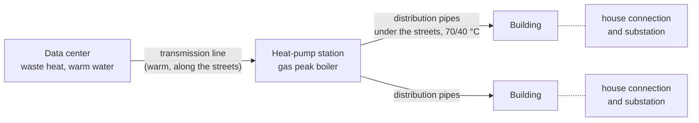

# Heat network planning

The Site map's **Heat distribution** card (`#/twin/map`, in the panel under the Quick analysis) plans how the data center's heat would reach the buildings: which streets the pipes follow, which buildings they supply, how large each pipe is, and what it all costs and earns for the city that builds it. It is a fast first estimate on the typical year, to see whether a network is worth a feasibility study. It does not replace one.



| Code | Role |
|---|---|
| `web/src/pages/district/network.ts` | The routing, pure: the street graph, the buildings chosen, the station, every pipe run (`planNetwork`, `buildingsOf`, `simultaneity`, `streetBox`) |
| `web/src/pages/district/hpSizing.ts` | The heat pump's size, pure, shared with the Quick analysis: what the data center's heat allows (`stationCapacity`) and the size under it (`heatPumpKw`) |
| `web/src/pages/district/networkCost.ts` | The money, pure: pipe sizes, the heat-pump station, the hourly year, the investment, BEW, the cash flows, NPV, break-even, cost of heat; every assumption with its source (`PARAMS`, `DEFAULT_PARAMS`) |
| `web/src/pages/district/HeatNetwork.tsx` · `NetworkCosts.tsx` | The card and its map layer · the *Costs and assumptions* dialog |
| `web/src/pages/district/osm.ts` (`streetsIn`) | The streets from OpenStreetMap (Overpass), on a click only |
| `GET /api/datasets/{id}/site/streets` (`backend/routers/site.py`) | The streets stored with a dataset (`streets.json`); 404 when it has none |

Tests: `network.test.ts` (including a speed test: 150 buildings with their hourly years on 3,120 street segments in well under a second), `hpSizing.test.ts`, `networkCost.test.ts`, `networkView.test.ts`, `e2e/network.spec.ts`.

---

## The streets

The pipes run only along mapped streets and paths. An example stores them: `streets.json` in the dataset folder, `{about, source, bbox, ways}`, each way a line of `[lat, lon]` points rounded to 6 decimals (about 0.1 m), so that ways meet where they share a point. *Recovery · air cooled* has 750 ways over its heat sinks' box plus 150 m, from one Overpass query (© OpenStreetMap contributors, ODbL 1.0; the attribution is in the file's `source`).

For a data center without stored streets (the route answers 404), *Plan the heat network* shows **Load streets from OpenStreetMap** instead. Only that click sends anything: the box of the heat sinks plus 150 m (south, west, north, east, `streetBox`) to `overpass-api.de`, with a 45 s timeout. A box over 3 km across is refused before it is sent. The streets stay on the page and are never written to the dataset ({doc}`../architecture/data-and-privacy`).

Which ways count: every road rank except motorways (fenced, never dug up for a house), service roads and pedestrian areas (into courtyards and campuses), footways, paths, cycleways and tracks. Steps, indoor corridors and platforms are left out, and so are road tunnels (the pipe runs in the street above). Bridges stay: pipes are hung on them.

<details>
<summary><b>Source code:</b> <code>web/src/pages/district/osm.ts</code> (PIPE_HIGHWAYS, streetsIn)</summary>

```{literalinclude} ../../app/web/src/pages/district/osm.ts
:language: typescript
:start-at: const PIPE_HIGHWAYS =
:end-at: const MAX_STREETS_KM
```

```{literalinclude} ../../app/web/src/pages/district/osm.ts
:language: typescript
:start-at: export async function streetsIn
:end-before: /** The one building under a clicked point
```

</details>

---

## The route and the buildings

**The street graph.** Ways are split where they share a point; each segment is an edge, its length the great-circle distance of its ends (`distanceM`). Sidewalks and crossings mapped beside a road are left out: a street's pipe runs once, under the road. In the choice of a way (never in the metres) a footpath's metre counts 1.3 times, so the main keeps to the road; with the Wärmeatlas' heat line density loaded, a dense street's metre counts less (*Prefer dense streets*). The network uses the connected part of the streets most of the demand is near.

**Joining the graph.** The data center, every building and a station placed by hand join it at the nearest point of the nearest street segment, which splits that segment there. From that point a **house connection** (service pipe) runs straight to the nearest point of the building's outline (to the building's point when it has no outline; the next street when that line would cross another building). A building more than 150 m from every street is not reached.

**The transmission line** runs from the data center straight across its own grounds (at most 150 m) to the street, then along the streets to the station. A data center with no street within 150 m gets one straight line to the station, whatever its length: the plan is made and costed, and the card says in red that a real line would follow the streets and be longer.

**Which buildings.** The buildings are the site's included heat sinks, each with its hourly demand over the typical year (the Quick analysis's `sinkKw`), its peak hour and its annual demand. A district drawn as one area is planned as the Wärmeatlas buildings inside it where those are loaded, else as one building. A tree is grown from the station along the shortest paths (Dijkstra). Each step adds the building with the most annual demand per metre of pipe it adds (its way to the tree plus its house connection), as long as

- it is within the station's **reach** along the streets (500 m by default), and
- the largest heat pump the data center's heat allows ($P_{HP,max}$, below) still gives at least a share of the network's yearly heat, the buildings' demand plus the pipes' losses (25 W per metre of trench while choosing), hour by hour on the typical year:

$$
\sum_h \min\left(D_h + L,\ P_{HP,max}\right) \ \ge\ s \cdot \sum_h \left(D_h + L\right), \qquad s = 75\ \%
$$

75 % is the share BEW asks of a new network (*Heat from the heat pump, at least*). The metres counted are the pipes' own: a footpath's routing weight is no metre.

**Too thin a branch.** After the tree has grown, a pass from the leaves up cuts every branch (and every single house connection) that carries less than the **minimum heat density**, 1.5 MWh per metre and year by default: its annual demand over the metres of pipe below it. Then the tree **grows again** without the buildings cut (at most three rounds), so the heat they freed goes to others.

**The tree.** The chosen buildings are joined by the shorter of two Steiner trees (each building by its shortest path to the tree; Mehlhorn's), cleaned up (the streets' minimum spanning tree between their nodes, dead ends cut). No building is fed the long way round a loop of streets: its way along the tree is at most 1.5 times its shortest way from the station plus 50 m, measured in metres.

**The station.** Unless you drag it, the station is placed on the street path from the data center towards the demand-weighted centre of the reachable buildings: 8 places along that path are tried, and the one whose network needs the least pipe per MWh supplied wins. On a tie the one nearer the load wins, since the hot distribution pipes lose more heat than the warm transmission line. A dragged station is moved onto the nearest street; *Plan again* puts it back.

**The pipes.** The distribution tree is cut into runs between its branch points, so each run serves a fixed set of buildings. Its design peak is their design peaks times the simultaneity $g(n)$ of their number (Winter, Haslauer and Obernberger 2001): about 1 for one building, 0.53 for 150, towards 0.45 for many. A building's design peak is its largest hour on a **design day**: the typical year's coldest day (16 January) with the outdoor at −12 °C all day and the three days before (Frankfurt's design temperature, DIN EN 12831; `networkTemps.ts` `DESIGN_OUTDOOR`), its profile scaled as on the typical year, at least the typical year's largest hour (`quickAnalysis.ts` `designKw`): on the example's buildings about 1.7 times the typical year's peak (its coldest day has a mean of 1 °C).

$$
g(n) = a + \frac{1 - a}{1 + (n/b)^{c}}, \qquad a = 0.4497,\ b = 53.84,\ c = 1.762
$$

**Two other ways to plan** (switches): *Heat pump for the full peak* sizes the heat pump for the whole peak (the larger of the design peak and the peak hour with the pipes' losses) and supplies only the buildings it then covers, with no boiler hours; *All the data center's heat* (the card's *Plan for*) takes the heat pump as large as the data center allows, no reach, and buildings join while each still takes a tenth of its heat from the data center.

**Heat density** is the annual demand supplied over the metres of distribution and house-connection pipe (the transmission line is not counted).

**Unreached buildings** get a reason: "N m from the nearest street", "its street is not connected to the network's", or "N m along the streets from the station" (beyond the reach). There is no network at all when there are no streets.

<details>
<summary><b>Source code:</b> <code>web/src/pages/district/network.ts</code> (simultaneity)</summary>

```{literalinclude} ../../app/web/src/pages/district/network.ts
:language: typescript
:start-at: const GLF_A = 0.449677646;
:end-at: export const simultaneity
```

</details>

---

## Sizes

**What the data center's heat allows.** The data center's heat is the heat used (the Data center card's power × the share it draws × the share used): all of it reaches the heat pump, no exchanger share comes off it again. Lifted to the network's supply at a Carnot COP at 50 % of the ideal (Heat Matching's default):

$$
\text{COP}_h = \frac{0.5\,(T_{sup,h} + 273.15)}{\max(T_{sup,h} - T_{src},\ 5)}\ \ (1.1 \ldots 8), \qquad
P_{HP,max} = \max_h\ P_{DC} \cdot \frac{\text{COP}_h}{\text{COP}_h - 1}
$$

**The supply follows a heating curve**, hour by hour on the typical year's outdoor temperature (`lib/networkTemps.ts`, the curve of Heat Matching's *heating curve* switch at its defaults; the site has no setting for it): the hottest supplied building's supply at −12 °C outside and below, sliding linearly to 15 K less (at least 10 K above the return) at 15 °C and above. For 70/40 °C that is 70 °C down to 55 °C. The COP is each hour's, so the ceiling $P_{HP,max}$ is the coldest hour's (the highest supply: 65 °C on the typical year, whose coldest hour is −3 °C).

**The heat pump** is sized to a share of the network's peak hour (*Heat pump size*, 50 %: on the typical year that gives about 86 % of the heat, a gas peak boiler the rest), raised until it gives the 75 % of the year's heat, and never above $P_{HP,max}$ (`hpSizing.ts` `heatPumpKw`; the Quick analysis on the same page sizes its heat pump by the same rule). A source hot enough to need no heat pump (at least 5 K above the supply) goes through the exchanger alone and gives at most the station's size; the card then says "direct, no heat pump". Such a station is costed as an *Exchanger station*: KWW Tab 40's substation curve $a \cdot P^{0.38}$ at its size (the house substations', extrapolated above 500 kW), with no grid connection and no heat-pump O&M.

**The pipes.** Each run gets the smallest DN that carries its largest hour of the typical year (its buildings' hours summed), at least its design peak, from a table of steel twin pipes (KWW-Technikkatalog, table 36; the capacity at 150 Pa/m, Nussbaumer and Thalmann 2017), scaled to the network's ΔT:

$$
P_{DN}(\Delta T) = P_{DN}(30\ \text{K}) \cdot \frac{\Delta T}{30\ \text{K}}
$$

The distribution pipes and house connections run at the buildings' design supply and return (70/40 °C, ΔT 30 K: the heating curve does not change their size or loss). The transmission line carries the most the heat pump draws from the data center in an hour of the year, at most all of its heat, in its own loop's ΔT (10 K by default), so it is larger than its load alone would suggest. A pipe that carries more than the largest size (DN 300) does is priced as $n = \lceil P / P_{DN300} \rceil$ DN 300 pipes side by side, its cost and heat loss × $n$ (and the water's speed over $n$ cross-sections); the costs dialog says so in red, the map's tooltip names $n$.

**Heat losses.** The table's losses (W/m of trench, a supply and return pair) hold at 55 °C mean in 10 °C ground; they are scaled to each pipe's mean temperature above the ground: $(T_{sup} + T_{ret})/2 - T_{ground}$ for the hot pipes, $T_{src} - \Delta T_{loop}/2 - T_{ground}$ for the transmission line.

<details>
<summary><b>Source code:</b> <code>web/src/pages/district/networkCost.ts</code> (PIPE_DNS, pipeDn) and <code>hpSizing.ts</code> (stationCapacity, heatPumpKw)</summary>

```{literalinclude} ../../app/web/src/pages/district/networkCost.ts
:language: typescript
:start-at: export const PIPE_DNS
:end-before: export interface NetworkParams
```

```{literalinclude} ../../app/web/src/pages/district/hpSizing.ts
:language: typescript
:start-at: export function stationCapacity
```

</details>

---

## The year

A fast heat-pump integration: the app's own hourly typical year (`matchHeat`, as in Heat Matching and the Quick analysis) runs on the chosen buildings' demand profiles plus the pipes' heat losses (constant), through a heat pump of the station's size and no tank, the supply on the heating curve. The data center's heat is flat (the Data center card's heat used at its °C) less the transmission line's loss. It gives the heat pump's heat and electricity, its **seasonal COP** (the year's heat over its electricity: the "seasonal COP" the card shows), and what it cannot cover: the **gas peak boiler**'s heat, and its size as the largest uncovered hour, at least the design hour (the network's design peak, at least its largest hour, with the losses) less the heat pump, rounded up to 10 kW. The buildings' profiles are summed as they are (each a typical building's hour, sharing one weather), so the boiler and the pipes are sized for the network's own largest hour.

The hour by hour view (the card, the map's dials, *Details*) names its days and hours on Frankfurt's clock, as the buildings' profiles: "18:00" is 18:00 there. On the clock changes the 02:00 that spring skips is shown as 03:00 (a played day steps on), and the 02:00 autumn repeats is the first of the two.

---

## Investment

| Item | How |
|---|---|
| Heat-pump station | its kW × €/kW |
| Grid connection | the heat pump's largest hour of electricity in the typical year (each hour's COP) × €/kW (Baukostenzuschuss) |
| Transmission line, distribution pipes, house connections | each run's metres × its DN's € per trench metre (inner city or suburban, times the pipe cost factor) |
| House substations | per building $a \cdot P_{kW}^{0.379}$ (KWW table 40) |
| Network pumps | the design peak's kW × €/kW |
| Gas peak boiler | its kW × €/kW |
| Planning | a share of the pipes, pumps and substations (the heat pump's price has its engineering) |
| Contingency | a share of everything above |
| Feasibility study | a sum |

## BEW: the federal funding of heat networks

The *Bundesförderung für effiziente Wärmenetze* (BEW) is applied as its guideline sets it for a new network:

- **Conditions.** More than 16 buildings or more than 100 dwellings, and at least 75 % of the heat (sold plus the losses) from the heat pump (the data center's heat and the heat pump's electricity). Otherwise no BEW, and the card says why, with both numbers ("74,6 % of the heat from the heat pump (BEW: at least 75 %)").
- **Modul 1** pays half the feasibility study.
- **Modul 4**, the operating aid, pays for 10 years per MWh of the heat pump's heat, by its seasonal COP: $(5.5 - (6.8 - 17/\text{SCOP}) \cdot 0.75)$ ct/kWh of heat, at most 9.2 ct per kWh of waste heat, none below SCOP 2.5; in any year at most 90 % of the heat pump's electricity cost (where that cuts it, the costs dialog shows the amount paid in year 1 beside the rate). At a seasonal COP of 4.05 that is 35.5 €/MWh.
- **Modul 2** pays up to 40 % of the eligible investment (all but the gas boiler and the study).
- **At most the funding gap.** State-aid law limits the aid to the project's *Wirtschaftlichkeitslücke*. Here the gap is what the NPV over the horizon lacks without BEW (with Modul 1 only). The Modul 2 investment grant comes first, up to its 40 % and at most the gap; the operating aid covers only what of the gap is left, cut to close it. A network that pays without BEW gets no aid but Modul 1. The NPV with aid is then at most 0 wherever there was a gap.

<details>
<summary><b>Source code:</b> <code>web/src/pages/district/networkCost.ts</code> (bewOperatingEurPerMwh, the funding gap)</summary>

```{literalinclude} ../../app/web/src/pages/district/networkCost.ts
:language: typescript
:start-at: export function bewOperatingEurPerMwh
:end-before: /** The network's typical year hour by hour
```

```{literalinclude} ../../app/web/src/pages/district/networkCost.ts
:language: typescript
:start-at: "// BEW: Modul 1 half the study."
:end-at: "const flows = gap ? cashFlows(invest, aid) : none;"
```

</details>

---

## Cash flows, NPV, break-even and cost of heat

All in € of each year, net of VAT, from the city's side: no taxes, no financing. The discount rate is therefore a **nominal** one. The horizon and the lives count in whole years. Year 0 is the investment after grants $I_0$. In year $y = 1 \ldots N$ prices rise by $e$ a year and the demand falls with renovation by $\delta$ a year: $f_y = (1+e)^{y-1}$, $d_y = (1-\delta)^{y-1}$.

$$
\begin{aligned}
R_y &= Q_{sold}\, d_y\, p_{heat}\, f_y \\
E_y &= \left(W_{HP} + W_{pump}\right) d_y\, p_{el}\, f_y + G_y\, p_{gas}\, f_y + G_y \cdot 0.201\, (p_{CO_2} + \Delta p_{CO_2}\,(y-1)) + Q_{DC}\, d_y\, p_{waste}\, f_y,
\qquad G_y = \frac{Q_{boiler}\, d_y}{\eta_{boiler}} \\
O_y &= \left(k_{HP} I_{HP} + \frac{P_{design}}{1000}\, c_{net} + n\,(c_{sub} + c_{meter}) + (Q_{HP}\, c_{HP} + Q_{sold}\, c_{net,var})\, d_y\right) f_y \\
\text{NPV} &= -I_0 + \sum_{y=1}^{N} \frac{R_y + A_y - E_y - O_y - \text{Ren}_y + \text{Res}_y}{(1+r)^y}
\end{aligned}
$$

$W_{pump}$ is the network pumps' electricity in the typical year, from the hydraulics: each hour's flow, the heat sent out over $\rho c_p \Delta T$ ($\Delta T$ the hour's supply on the heating curve less the return), against the head of the longest way from the station to a building (its pipes, supply and return, at the DN table's 150 Pa/m, plus a fixed head for the station and the house substation, 1 bar), over the pumps' efficiency (70 %): $W_{pump} = \sum_h \dot V_h\, \Delta p / \eta_{pump}$. The pumps hold that head all year (no lower head at part load: on the safe side); the data center's own loop to the station is pumped by the data center. $A_y$ is the operating aid, $\text{Ren}_y$ an asset renewed at the end of its life within the horizon (at that year's price), and $\text{Res}_N$ what is left of the pipes, the heat pump and the substations at the end, straight-line over their lives (none when a life ends exactly at year $N$; planning, contingency and the study have none). The gas factor is 0.201 t CO₂ per MWh (UBA), as in Heat Matching.

- **Break-even** is the first year in which the cumulative discounted cash flow, from year 0, reaches 0. The card also gives the **simple payback**: the year in which the undiscounted yearly flows (aid and renewals in, what is left of the plant at the end not) have summed to the investment; none when they never do within the horizon.
- **Cost of heat** (levelised, LCOH) is the first year's heat price at which the NPV is 0, with that price rising like the others: the discounted costs over the discounted heat sold, so that $\text{NPV} = (p_{heat} - \text{LCOH}) \sum_y Q_{sold}\, d_y f_y / (1+r)^y$. A heat price above it pays.

---

## Defaults and their sources

Every number is a field in *Costs and assumptions…*, with its source linked there (`PARAMS` in `networkCost.ts`); *Back to the defaults* resets them. Your values are kept in this browser (`localStorage` `site-network`), a station dragged by hand per data center (`site-network-station:<dataset>`); nothing is written to `site.json`. "estimate" marks a value set without a source.

| Group | Assumption | Default | Source |
|---|---|---|---|
| Investment | Where the pipes are laid | Inner city | KWW-Technikkatalog Wärmeplanung 1.1 (dena, 2026), table 36: paved, inner city or suburban |
| Investment | Pipe cost factor | 1 × | KWW; ~0.5 is the Danish level (DEA) |
| Investment | Heat-pump station | 950 €/kW of heat | Danish Energy Agency, Technology Data, waste-heat heat pump 3 MW (2025); KWW ~940 €/kW at 5 MW |
| Investment | House substation, $a$ in $a \cdot P^{0.38}$ | 2,070 € | KWW table 40: ~5,000 € at 10 kW, 12,000 € at 100 kW |
| Investment | Network pumps | 100 €/kW | KWW table 39 |
| Investment | Gas peak boiler | 100 €/kW | KWW table 20 (140 at 0.5 MW, 60 at 10 MW, interpolated) |
| Investment | Grid connection (BKZ) | 130 €/kW el | Netze Duisburg, Baukostenzuschuss 2026 (142 €/kW; Stuttgart 88) |
| Investment | Planning | 15 % | Danish Energy Agency, Technology Data for Energy Transport (2025) |
| Investment | Contingency | 10 % | estimate (KWW gives its costs ±25–30 %) |
| Investment | Feasibility study | 100,000 € | estimate |
| Investment | BEW grant (Modul 2) | 40 % | BEW guideline (BAnz AT 18.08.2022 B1) |
| Investment | ΔT of the data center's loop | 10 K | estimate |
| Investment | Reach of the station along the streets | 500 m | estimate (0: no limit) |
| Investment | Minimum heat density of a branch | 1.5 MWh/(m·a) | City of Würzburg, Quartierskonzept Heidingsfeld II (rule of thumb > 1.5; QM Holzheizwerke 1.8; the Frankfurt study 2.9) |
| Investment | Prefer dense streets | 50 % | estimate (only with the Wärmeatlas' heat line density) |
| Investment | Heat pump size | 50 % of the peak hour | Danish Energy Agency, waste-heat heat pump (85 % of the heat with peak units) |
| Investment | Heat from the heat pump, at least | 75 % of the year | BEW guideline |
| Operation | Heat price to the buildings | 130 €/MWh | AGFW price platform via ZfK, district-heating prices 2026 (15.7 ct/kWh with VAT) |
| Operation | Heat of one apartment | 9 MWh/a | estimate (~70 m² × 130 kWh/(m²·a)); a building's apartments where its data gives none |
| Operation | Electricity price | 179 €/MWh | BDEW Strompreisanalyse, October 2026 (industry, medium voltage, net) |
| Operation | Price paid for the waste heat | 0 €/MWh | Jürgens et al. 2024 (free; Stockholm pays ~20 €/MWh) |
| Operation | Gas price (peak boiler) | 60 €/MWh | Jürgens et al. 2024 (without the CO₂ price) |
| Operation | Peak boiler efficiency | 95 % | KWW |
| Operation | CO₂ price, first year | 60 €/t | Deutscher Bundestag, BEHG corridor 55–65 €/t (2026) |
| Operation | CO₂ price rise | 8 €/(t·a) | estimate (the Frankfurt study +15 €/a) |
| Operation | Heat pump O&M, fixed | 3 % of its investment a year | KWW |
| Operation | Heat pump O&M, per MWh | 2 €/MWh | KWW |
| Operation | Network O&M | 1,000 €/(MW·a) of the design peak | Danish Energy Agency, energy transport |
| Operation | Network O&M, per MWh | 2 €/MWh delivered | Danish Energy Agency, energy transport |
| Operation | Substation O&M | 170 €/a each | KWW table 40 |
| Operation | Metering and billing | 150 €/a each | estimate |
| Operation | Network pumps' fixed head | 1 bar (the station's exchangers and the farthest house substation with its control valve; on top of the longest path's pipes at 150 Pa/m) | estimate |
| Operation | Network pumps' efficiency | 70 % (pump and motor) | estimate |
| Operation | Ground temperature | 10 °C | estimate |
| Operation | Demand decline (renovation) | 1.3 %/a | KWW table 55 (observed 2016–2025) |
| Money | Discount rate | 5 %/a | KWW-Technikkatalog, accompanying document (DEA 3.5 %; the Frankfurt study 3 %) |
| Money | Price rise (heat, power, gas, O&M) | 2 %/a | estimate (the Frankfurt study 3 %/a) |
| Money | Horizon | 20 years | estimate |
| Money | Pipes' life (also the pumps' and the grid connection's) | 40 years | Danish Energy Agency, energy transport (45, 30–60) |
| Money | Heat pump's life | 25 years | Danish Energy Agency, waste-heat heat pump |
| Money | Substations' life | 25 years | KWW |
| Switches | BEW grant · BEW operating aid (Modul 4) · Residual value at the end · Heat pump for the full peak | on · on · on · off | BEW guideline; BAFA, Merkblatt BEW Modul 4 (2023) |

Fixed in the code: the boiler's life (30 years, KWW table 20), the substation exponent (0.379), the BEW thresholds (more than 16 buildings or 100 dwellings, 10 years of operating aid), the simultaneity constants, the heating curve (−12 °C and 15 °C outside, 15 K), 150 m as the farthest house connection and across the data center's grounds, 1.3 as a footpath's routing weight, 1.5 times (plus 50 m) as the longest way round and 8 places tried for the station. The study is Jürgens et al. 2024, data-centre waste heat in Frankfurt, *International Journal of Sustainable Energy Planning and Management* 41. The guideline runs until 2028: check its successor for later projects.

---

## The example

*Recovery · air cooled* with the defaults (its 3,202 kW of waste heat used at 19 °C on the map, 150 buildings at 70/40 °C, 30,223 MWh a year; no Wärmeatlas heat lines), as of 2026-11-24:

| | |
|---|---|
| Buildings supplied | 145 of 150 (4 beyond the 500 m reach, 1 on too thin a branch); 21,502 MWh a year sold; 2,391 apartments; 51 % of the data center's heat used (14,353 of 28,051 MWh) |
| Pipes | 4,516 m: 196 m to the station (DN 250), 2,825 m under the streets (DN 200 down to DN 32), 1,494 m into the buildings (DN 65 to DN 32) |
| Heat pump | 4,223 kW, half the peak hour of 8,446 kW (the data center's heat allows 4,399 kW); seasonal COP 4.05; 19,064 MWh a year (85.6 % of the heat) with 4,711 MWh of electricity |
| Gas peak boiler | 4,320 kW, 3,206 MWh a year (14.4 % of the heat) |
| Heat density, losses | 5.0 MWh/(m·a); 768 MWh a year, 3.4 % |
| Investment | 17.55 M€: heat pump 4.01, grid 0.15, transmission 0.87, distribution 5.12, house connections 1.29, substations 1.67, pumps 0.84, boiler 0.43, planning 1.47, contingency 1.59, study 0.10; 17.50 M€ after the Modul 1 grant |
| BEW | no funding gap: no Modul 2 grant and no operating aid |
| NPV, 20 years at 5 % | +2.76 M€ (+0.72 M€ without the residual value); the network pumps' electricity 100 MWh a year (0.5 % of the heat; the longest way 536 m, a head of 2.6 bar) |
| Break-even | year 19 (simple payback 12.0 years) |
| Cost of heat | 120 €/MWh, against the 130 €/MWh it is sold at |

How the result moves when one assumption changes:

| Case | BEW aid | NPV | Break-even | Cost of heat |
|---|---|---|---|---|
| BEW off | none (no Modul 1 either) | +2.71 M€ | year 19 | 120 €/MWh |
| Heat price 110 €/MWh | a gap of 2.89 M€, closed by the Modul 2 grant alone; no operating aid | 0 | year 20 | 120 €/MWh |
| Heat price 90 €/MWh | a gap of 8.55 M€: the full 40 % grant (6.81 M€) and the operating aid cut to 12.5 €/MWh | 0 | year 20 | 120 €/MWh |
| Heat price 70 €/MWh | the full 40 % grant and the full operating aid (35.5 €/MWh) | −2.44 M€ | none | 120 €/MWh |
| Pipe costs × 0.6 | none | +5.90 M€ | year 14 | 109 €/MWh |
| Suburban pipe prices | none | +5.05 M€ | year 15 | 112 €/MWh |
| Discount rate 3 % | none | +7.29 M€ | year 16 | 109 €/MWh |
| Heat price 160 €/MWh | none | +11.25 M€ | year 11 | 120 €/MWh |
| Heat pump for the full peak | a gap of 0.13 M€, closed by the Modul 2 grant | 0 | year 20 | 131 €/MWh (36 buildings, 1,249 m, 4,399 kW: the most the data center allows, under the design peak) |

The cost of heat does not follow the heat price: it is counted without the aid that is sized to close the gap at that price (Modul 1 only).

The Quick analysis on the same page (all 150 heat sinks, a tank, the same sizing rule but for the data center's heat alone): a heat pump of 4,399 kW (the ceiling: 75 % of the year would need more), 21,957 MWh delivered, 72.6 % of the demand, 5,441 MWh of electricity, 2,836 t of CO₂ saved a year.

Compared with the literature: the Frankfurt data-center study (Jürgens et al. 2024) gives a cost of heat of 105 €/MWh with BEW and 138 €/MWh without, at 3 % and 2.9 MWh/(m·a). The example's pipes cost about 1,410 €/m on average with the DN 250 transmission line (KWW's inner-city paved prices), above that study's ~1,000 €/m; the pipe cost factor lowers them. Its losses, 3.2 %, are below the Danish Energy Agency's 7 % for cities, which fits its higher density.

---

## Limits

- **A heuristic, not an optimum.** The buildings are chosen greedily by demand per metre, and the tree by shortest paths. A planner would compare route variants and trench sharing. The heat pump's size is a rule (a share of the peak hour), not the cheapest: that is a sweep of the size by the cost of heat (Operation's design options do it).
- **Doubled pipes.** Sidewalks and crossings are left out, but OpenStreetMap also maps separate carriageways and paths beside roads, so a distribution pipe sometimes runs beside another one, or beside the transmission line. In practice they would share one trench: the metres are overstated.
- **Sizing.** The pipes, the network pumps and the peak boiler are sized on a design day (the buildings' design peaks at −12 °C × simultaneity), at least the typical year's largest hour; the year itself and the heat pump's share run on the typical weather (its coldest hour is −3 °C). The profiles share one weather, so their summed hour adds up in full: on the example it still decides for the trunk, the pumps and the boiler (the design peaks × 0.53 fall 9 % short of it), the design peak for the house connections and the shorter runs. A design day for the summed hour too (no simultaneity) would be larger again.
- **The heating curve has no setting here**: Heat Matching's defaults.
- **The funding gap is an approximation**: the NPV over the horizon at the city's discount rate, with the residual value. BAFA's own calculation differs (a comparison case, asset lives). Whether a heat pump on data-center waste heat gets Modul 4, and whether its heat counts in full toward the 75 %, is not checked against the guideline's text. The BEW guideline runs until 2028.
- **Not modelled**: a connection rate below 100 %, connection charges paid by the buildings, and storage.
- **One heat price** for every building, and a flat data center on the typical year.
