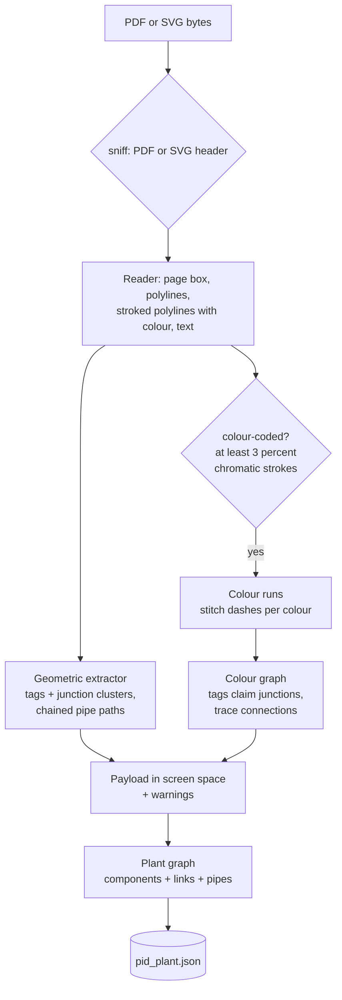

# P&ID extraction

A P&ID (piping and instrumentation diagram) is the engineer's map of a data center's cooling plant: pumps, heat exchangers, chillers, valves, and the pipes between them. The app reads a P&ID drawing to get a **plant graph** — the named components and which of them the pipes connect — and shows it on the Structure and Modelling page next to the causal graph, so the two can be checked against each other.

The reader works on **vector** drawings (PDF or SVG exported from CAD), not on scans: it needs the drawn lines and text, not pixels. It is heuristic: it recovers what a drawing states clearly and reports what it could not.

---

## Pipeline



| Step | What it does | Module |
|---|---|---|
| Sniff | Picks the reader from the file's first bytes (`%PDF-` or an `<svg>` element), never from the file name | `backend/pid/extract.py:sniff` |
| Read | Page box, all polylines, stroked polylines with their colour, text items with positions. PDF: raw content streams (FlateDecode, object streams, Form XObjects), every point through the current transformation matrix, curves flattened, text decoded through ToUnicode maps. SVG: nested transforms, `<use>`, curves flattened, y flipped to PDF's bottom-left origin. Standard library only. | `pdf_reader.py`, `svg_reader.py` |
| Geometric extractor | Always runs. Nodes are equipment tags (text like `P4711`) and junctions where 5 or more path ends meet within 15 pt; edges are pipe paths chained through bends from one node to the next. | `geometric.py:assemble_topology` |
| Colour extractor | Runs when the drawing colour-codes its pipework. Named components from tags, pipe segments, and component-to-component connections traced through the pipe network. | `color_runs.py`, `color_graph.py:build` |
| Payload | Both results flipped to screen space (y down), with statistics and quality warnings | `extract.py:read_drawing` |
| Plant graph | One graph from whichever extractor found named components; positions as fractions of the page | `plant.py:components_of`, `plant_fractions` |

<details>
<summary><b>Source code:</b> <code>backend/pid/extract.py</code> (sniff, read_drawing)</summary>

```{literalinclude} ../../app/backend/pid/extract.py
:language: python
:pyobject: sniff
```

```{literalinclude} ../../app/backend/pid/extract.py
:language: python
:pyobject: read_drawing
```

</details>

---

## Colour-coded drawings

Many schematics draw each circuit in its own colour (supply red, return blue, …). When they do, colour separates pipework from everything else in one step — frames, title blocks, room outlines and symbol bodies are black or grey.

**Does colour apply?** A stroke is *chromatic* when $\max(r,g,b) - \min(r,g,b) \ge 0.15$. The drawing is treated as colour-coded when at least **3 %** of its strokes are chromatic; below that, colour is a few highlighted annotations, not a convention.

**Runs.** Chromatic strokes are grouped by quantised colour (buckets of 0.3 per channel, so slightly different CAD layer colours of one circuit stay together) and chained greedily, nearest free end first, within **14 pt** (a dashed line is one polyline per dash). Chains shorter than **25 pt** are dropped as stray dashes or leader lines.

**Components.** Text that looks like an equipment tag becomes a component: one to three capitals, optionally a lower-case letter, then a number (`P4711`, `TV4750.03`, `M1.1`, `WT 4a`). Prefixes that name a property rather than a thing (`DN`, `PN`, `kW`, floor numbers like `OG`, nozzles `N`) are excluded. A repeated tag (drawing and datasheet table) becomes one component at the occurrence nearest the pipework. The kind is read from the prefix (ISA-5.1 and common practice: `P` pump, `E`/`H`/`WT` exchanger, `TV`/`PV`/… valve, `TI`/`PT`/… instrument; unknown prefixes stay "equipment"). Tags far from any pipe (more than 25 % of the pipework's extent) are dropped and reported: their coordinates are from an unresolved form, not the drawing.

**Connections.** Tolerances scale with the extent of the pipework:

| Tolerance | Value | Purpose |
|---|---|---|
| Tee | $\max(5,\; 0.016\,S)$ | A run's end landing on another run's body splits that run there |
| Merge | $\max(8,\; 0.025\,S)$ | Run ends this close are one junction |
| Claim | $\max(12,\; 0.037\,S)$ | A tag this close to a junction, or to a run's body, names it |
| Symbol touch | 3 pt | A run end touching a grey equipment outline (spanning less than $0.2\,S$) is joined through the symbol |

($S$ = the larger side of the bounding box of all run ends.) Every run end becomes a junction; the nearest tag within the claim radius names it, otherwise it is an unnamed terminal. A component can claim several junctions — a pump has a suction and a discharge — which is what makes it a hub. Finally, each named component is **traced** through the pipe network: the walk passes through unnamed terminals and stops at the first named component in every direction. Each pair found is a connection, with the number of pipe segments (hops) between them.

<details>
<summary><b>Source code:</b> <code>backend/pid/color_runs.py</code> (applies), <code>backend/pid/color_graph.py</code> (build)</summary>

```{literalinclude} ../../app/backend/pid/color_runs.py
:language: python
:pyobject: applies
```

```{literalinclude} ../../app/backend/pid/color_graph.py
:language: python
:pyobject: build
```

</details>

---

## Drawings without colour

When a drawing does not colour-code its pipes, the plant graph comes from the geometric extractor. Its thresholds (pipe length between 15 and 900 pt, junction = 5+ path ends within 15 pt, path ends within 18 pt are one bend, …) were measured on **one** reference sheet of about 2900 pt across; on a drawing of very different scale or style expect missing junctions and edges.

From the geometric nodes and edges, the plant graph is built like this:

1. **Components** are the equipment tags (text of one or two capitals followed by 3–5 digits, e.g. `P4711`).
2. **Attach tags to the pipework.** A tag is written beside its symbol, not on the pipe. A tag with no edge of its own is attached to the **nearest node that has an edge**, if that node lies within **5 % of the page diagonal**:

$$
d(\text{tag}, \text{node}) \le 0.05 \sqrt{w^2 + h^2}
$$

3. **Link components** by walking from each tag through **unnamed junctions only**, stopping at the first tag in every direction. Two tags are linked when the pipes join them without passing another named component.

<details>
<summary><b>Source code:</b> <code>backend/pid/plant.py</code> (_tag_graph, components_of)</summary>

```{literalinclude} ../../app/backend/pid/plant.py
:language: python
:pyobject: _tag_graph
```

```{literalinclude} ../../app/backend/pid/plant.py
:language: python
:pyobject: components_of
```

</details>

---

## What is stored: `pid_plant.json`

`plant_fractions` turns the plant graph into what the Structure and Modelling page loads: positions divided by the page width and height (so they overlay the rendered PNG at any size), and the pipes to draw (the colour runs, or the geometric edge routes when there are none).

```json
{
  "components": [{"id": "P4711", "label": "P4711", "x": 0.31, "y": 0.42}],
  "links": [["E4710", "P4711"]],
  "pipes": [[[0.30, 0.42], [0.36, 0.42], [0.36, 0.55]]]
}
```

(Illustrative values.) `links` are sorted pairs of component ids. A drawing without a usable page size raises an error instead of producing a graph.

<details>
<summary><b>Source code:</b> <code>backend/pid/plant.py</code> (plant_fractions)</summary>

```{literalinclude} ../../app/backend/pid/plant.py
:language: python
:pyobject: plant_fractions
```

</details>

## Three levels: picture, construct, variables

The Structure and Modelling page draws the P&ID in three levels, each shown or hidden with **Show: Picture · Construct · Variables**:

1. **Picture**: the drawing as delivered (`pid.png`), or the app's own drawing for the simulations.
2. **Digital construct**: the drawing as shapes the user and an assistant edit (`pid_construct.json`), in two layers. First **the sheet itself, all digital**: every stroked line in its own colour and every text, role `drawing`, so the P&ID is complete without its picture (the *Picture* level then starts hidden). On it, what is **recognised**: named components as rectangles, each the outline of its symbol found in the drawing's own lines near its tag (a closed outline of symbol size, 0.3 to 4 % of the sheet's diagonal, not an instrument bubble; a tag with no symbol there gets no box, its text stays in the drawing), **instrument bubbles** as circles, pipe runs as lines; a first guess to correct. A large sheet has thousands of drawing shapes (the limit is `PID_CONSTRUCT_MAX_SHAPES`); `ui_snapshot` counts them and lists only their texts, `get_construct` gives all of them. **Edit construct** opens the tools: Select (drag to move, the corner handle resizes), Rectangle, Circle, Line and Text (drag to draw, a click gives the default size). The side panel edits the selected shape's label and role (component, instrument, pipe, note) and puts a variable on it.
3. **Variables**: the instruments of the causal graph. *Put a variable on it* moves a variable onto a shape (adding a new one named after the label when chosen), and an instrument bubble's ISA code becomes its tag.

A shape also holds **values**: name and number or text, the component's design data (`capacity_kW` = 50, `medium` = water), edited under *Values* in the side panel (an empty value removes it) and shown when the pointer rests on the shape; an assistant sets them with `edit_shape {shape, props: {name: value}}` (`null` removes one).

**Viewing the drawing.** The mouse wheel (or a pinch) over the drawing zooms it around the pointer, as do the buttons in its corner, and **Fit** shows all of it again; dragging the empty drawing pans. **Lock** keeps everything on the drawing where it is: instruments and shapes cannot be dragged, a drag only pans and a click only selects. **Remove picture** deletes the P&ID picture with its construct and plant graph, after a backup (below). The assistant's `ui_snapshot` picture always shows the whole drawing, whatever the zoom, so its 0..1 grid stays the drawing's.

Construct edits are unsaved until **Save**, which writes the graph, the layout and the construct. An assistant does the same over MCP: `ui_do` `add_shape`, `edit_shape`, `delete_shape`, `select_shape`, `match_variable` and `set_layers` on the open page, or `get_construct` / `save_construct` for the whole file. Positions are fractions of the P&ID picture (0..1, y down). Only variables placed on the picture are drawn; the others wait in the Variables menu. `place_instruments` {placements: [{variable, x, y}, ...]} places many variables in one call. Unsaved page work is kept in the browser as a draft until Save or Discard: `ui_state` reports it (`page.draft`: exists, dataset, graph file), `ui_do` `save_draft` keeps it at once and `discard_draft` drops it.

```json
{"shapes": [
  {"id": "comp:P4711", "kind": "rect", "x": 0.31, "y": 0.42, "w": 0.04, "h": 0.03, "label": "P4711", "role": "component"},
  {"id": "inst:0", "kind": "circle", "x": 0.30, "y": 0.23, "w": 0.015, "h": 0.02, "label": "TI 101", "role": "instrument"},
  {"id": "pipe:0", "kind": "line", "points": [[0.30, 0.42], [0.36, 0.42]], "label": "", "role": "pipe"}
]}
```

(Illustrative values.) A new drawing replaces `pid_construct.json` with its own first guess; a PNG removes it. Before a drawing is replaced or removed, `pid.png`, `pid_plant.json`, `pid_construct.json` and `site.json` are copied to `.backup/<time>-pid/` in the data center's folder, and the instruments placed on the old picture go back to the tray: their spots were fractions of that picture and would land anywhere on a new one.

## Reading only an area

A sheet carries more than the plant: the legend (example bubbles and symbols), instrument and equipment tables, the title block. Read with the plant, their circles and tags become instruments and components that are not there. *Import P&ID…* first shows the chosen file's preview and asks for the area: a drag over the plant (or *Whole page*), and only then is that rectangle read: `crop=x0,y0,x1,y1` (fractions of the page, y down) on `POST /api/pid/extract` and `POST /api/datasets/{id}/pid`. `pid/crop.py` clips every polyline to the area (a pipe that leaves it is cut at the border), leaves out the texts outside it and moves the rest so the area starts at (0, 0): the extractors see a smaller page. Instrument bubbles keep the size bounds of the whole sheet. "Use as the P&ID" keeps the same area as the picture. *Whole page* reads all of it again; a DEXPI file is always read whole.

<details>
<summary><b>Source code:</b> <code>backend/pid/crop.py</code> (crop)</summary>

```{literalinclude} ../../app/backend/pid/crop.py
:language: python
:pyobject: crop
```

</details>

## DEXPI: the standard, machine-readable P&ID

A PDF only *shows* a plant; reading it is a guess. **DEXPI** (an XML exchange format built on Proteus and ISO 15926, exported by the common P&ID CAD tools) *says* it: every piece of equipment with its tag and extent, every pipe with its centre line and the nozzles it joins, every instrument function with its ISA letters and loop number, all with coordinates on the sheet. *Import P&ID…* reads a `.xml` whose root is `<PlantModel>` with `pid/dexpi.py`, into the same payload the PDF and SVG readers give, so the plant graph, the construct and the preview work unchanged:

| DEXPI | becomes |
|---|---|
| `Equipment` (tag: `TagNameAssignmentClass` or `TagName`; centre and size from `Extent`) | a component (rectangle of its size) |
| `PipingNetworkSegment` `CenterLine` | a pipe run (line) |
| `Connection FromID / ToID` (nozzles → their equipment), per `PipingNetworkSystem` | a link between the equipment |
| `ProcessInstrumentationFunction` (category + functions + number, e.g. `TIC 4750`) | an instrument bubble (circle) |

The picture level is drawn from the file's own graphics (lines, polylines, shapes, circles, ellipses, texts, and `ShapeCatalogue` symbols placed at their `Position`, turned by its `Reference`) and rendered to `pid.png`. A file with a `DOCTYPE` or `ENTITY` is refused: a P&ID needs none, and that rules out entity expansion. Coordinates run y up in DEXPI; the reader turns them to y down from the top of the sheet like the others.

<details>
<summary><b>Source code:</b> <code>backend/pid/dexpi.py</code> (read_dexpi)</summary>

```{literalinclude} ../../app/backend/pid/dexpi.py
:language: python
:pyobject: read_dexpi
```

</details>

### Instrument bubbles

An instrument is drawn as a small circle with its ISA code inside (TI, PT, FIC; a loop number such as 101 below or beside it). `instrument_bubbles` keeps a closed, round outline (12 or more points, farthest and nearest point within 15 % of each other) whose diameter is 0.2 to 3 % of the sheet's diagonal and which has an ISA code inside. A legend draws its example bubbles on a lattice (same row and same column as another one), so those are left out; a circle drawn twice counts once. A bubble's tag is not also kept as a component.

<details>
<summary><b>Source code:</b> <code>backend/pid/instruments.py</code> (instrument_bubbles)</summary>

```{literalinclude} ../../app/backend/pid/instruments.py
:language: python
:pyobject: instrument_bubbles
```

</details>

### The endpoints

| Endpoint | Body | Stores | Returns |
|---|---|---|---|
| `POST /api/pid/extract` | PDF, SVG or DEXPI bytes (raw body) | nothing | The full payload (both extractors, stats, warnings) plus `components` and `links` |
| `POST /api/pid/preview` | PDF, SVG or DEXPI bytes | nothing | The first page as PNG (`pdftoppm` / `rsvg-convert`, 503 if not installed) |
| `POST /api/datasets/{id}/pid` | PDF, SVG, DEXPI or PNG bytes | `pid.png` (a PDF rendered at 200 dpi), `pid_plant.json`, `pid_construct.json`, `pid_image` in `dataset.json`; the old ones backed up | `{pid_image, bytes, components, backup}` |
| `DELETE /api/datasets/{id}/pid` | — | removes them (backed up first) | `{removed, backup}` |
| `GET /api/datasets/{id}/pid/plant` | — | — | `pid_plant.json`, or an empty graph |
| `GET /api/datasets/{id}/pid/construct` | — | — | `pid_construct.json`, or a first guess from `pid_plant.json` (`saved` false) |
| `PUT /api/datasets/{id}/pid/construct` | `{shapes}` | `pid_construct.json` | the checked construct |

"Use as P&ID" with a **PNG**, or with a drawing whose graph cannot be read, deletes an older `pid_plant.json`: it belonged to another drawing. Uploads are limited to 50 MB.

---

## Privacy

P&IDs can be confidential. The app treats them that way:

- **Local only.** The drawing is parsed in the server process on this machine; there are no network calls in the reader.
- **Temp files deleted.** Extraction writes the bytes to a temporary file (the readers take a path) and deletes it in a `finally` block, also on error. Rendering to PNG streams the bytes through the converter's stdin/stdout, without another copy on disk.
- **Only "use as P&ID" stores anything**, and only in the data center's own folder: `pid.png` and `pid_plant.json`. Both are ignored by git for every dataset, simulations included (see {doc}`../architecture/data-and-privacy`).

<details>
<summary><b>Source code:</b> <code>backend/routers/pid.py</code> (_read, use_as_pid)</summary>

```{literalinclude} ../../app/backend/routers/pid.py
:language: python
:pyobject: _read
```

```{literalinclude} ../../app/backend/routers/pid.py
:language: python
:pyobject: use_as_pid
```

</details>

---

## Limits

- **Vector only.** Scanned drawings (or PDFs that embed a raster image) have no lines to read; the reader warns when it finds fewer than 10 vector paths.
- **First page only** is rendered to PNG.
- **Tuned on few drawings.** The geometric thresholds come from one DEXPI reference sheet; the colour thresholds from that sheet and a real German hydraulic schematic. Each threshold is documented next to its measurement in the code.
- **No symbol recognition.** There is no template library: components are only what the drawing *names* with a tag. An untagged pump is an unnamed terminal. The import dialog always shows this as a warning.
- **Off-page geometry.** When more than 2 % of the points fall outside the page box, the coordinates are reported as unreliable (a misread transform).
- **Heuristic tag attachment** in drawings without colour: the nearest-node rule within 5 % of the diagonal can attach a tag to the wrong pipe where pipes run close together.
