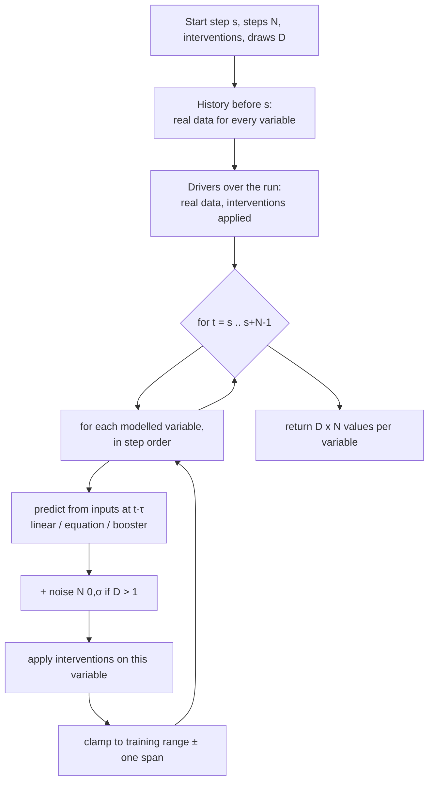

# Scenarios and simulation

A **scenario** runs the twin forward from a chosen moment with one or more **interventions** — "from hour 10 on, raise the cooling setpoint by 2 K" — and shows how every modelled variable responds, next to the same run without the intervention (the *baseline*) and the measured data. With Monte-Carlo noise it also shows how certain the answer is.

The Scenarios page uses the `linear` model (causal graph). The simulation itself, `POST /api/datasets/{id}/models/{name}/simulate`, works with every model kind.

---

## How a run works



1. **History.** Before the start step $s$, every variable takes its real values. The start is moved to at least the model's largest lag $L_{max}$ (there must be enough history), and the run is cut where the data ends.
2. **Drivers follow the data.** Weather, load and setpoints over the run are the *recorded* ones — the scenario is a replay of a real period with something changed, not a forecast of an unknown future. Interventions on drivers are applied to that recorded series. A request can put other series in for drivers (`drivers: {name: [values]}`, one value per step from the start on; a shorter one leaves the rest as recorded): Heat Matching does so with the weather and the heat demand of another dataset ({doc}`heat-distribution`). Interventions apply on top; a name that is not a driver of the model is refused (400).
3. **Modelled variables are predicted** step by step, in step order, from their inputs at $t - \tau$, which are real values (before $s$), driver values, or the twin's own earlier predictions:
   - linear: $\hat y_t = \beta_0 + \sum_i \beta_i x^{(i)}_{t-\tau_i}$
   - physics and symbolic: the equation with its fitted coefficients
   - XGBoost and TabPFN: the saved booster / regressor
4. **Noise** (when more than one draw is requested, see below).
5. **Interventions** on the variable (see below).
6. **Clamping.** Each modelled value is clipped to $[\min - \Delta,\; \max + \Delta]$, where $\min$, $\max$ are the variable's range over the training period and $\Delta = \max - \min$. A model that blows up is stopped from producing absurd numbers; a value at the clamp is a sign the model left the region it knows. A value the user *sets* on a modelled variable is kept as set, outside that range too (only what the model predicts from it is clipped).

<details>
<summary><b>Source code:</b> <code>backend/core/twin/simulate.py</code> (simulate)</summary>

```{literalinclude} ../../app/backend/core/twin/simulate.py
:language: python
:pyobject: simulate
```

</details>

---

## Interventions

An intervention is `{"variable", "kind", "value", "start", "end"}`. `start` and `end` are step offsets from the run's start (`end` exclusive; `null` = to the end of the run), so a step change, a pulse or a temporary override can be expressed.

| Kind | On a driver | On a modelled variable |
|---|---|---|
| `set` | The driver's value is $v$ in the window | The prediction is replaced by $v$ in the window (noise removed); downstream variables see $v$ |
| `shift` | $u_t + v$ | $\hat y_t + v \cdot g$ |
| `scale` | $u_t + (v - 1)\,\bar u$ | $\hat y_t + (v - 1)\,\bar y \cdot g$ |

Here $\bar u$ is the driver's mean over the run's data window, $\bar y$ the modelled variable's mean over the training period, and $g$ a gain explained next.

A **calculated** column (`dataset.json` → `derived`, a heat exchanger's $Q = \dot m\, c_p\, (T_{in} - T_{out})$) is no variable of the model, so it cannot be intervened on. It can be plotted: the run computes it per draw from the predicted $\dot m$, $T_{in}$ and $T_{out}$, so its band is the band of the product, not the product of the bands. On the Scenarios page the causal map, the signals and the intervention lists show only the selected heat exchanger's three variables (`site.json` → `hex_option`), like the Structure and Modelling page.

**Scale is a level change, not a multiplication.** Scaling by $v = 1.1$ adds 10 % of the variable's *mean level*, at every step of the window; it does not multiply each value by 1.1. The two differ for a variable that swings strongly (a daily load profile keeps its amplitude).

**Why the gain $g$.** A modelled variable usually depends on its own past. If a shift $\delta$ were simply added to the prediction at every step, the next step would carry it forward through the own-lag coefficient and add $\delta$ again, so the change would compound. For a linear model with own-lag coefficients $a_1, \dots, a_k$, adding $\delta \cdot g$ with

$$
g = 1 - \sum_j a_j
$$

makes the variable settle exactly $\delta$ above where it would otherwise be: at steady state $\Delta y = \sum_j a_j\,\Delta y + \delta g$, so $\Delta y = \delta$.

<details>
<summary><b>Source code:</b> <code>backend/schemas.py</code> (Intervention, SimulateRequest)</summary>

```{literalinclude} ../../app/backend/schemas.py
:language: python
:pyobject: Intervention
```

```{literalinclude} ../../app/backend/schemas.py
:language: python
:pyobject: SimulateRequest
```

</details>

---

## Monte-Carlo uncertainty

With $D > 1$ draws (at most 200), the run is repeated $D$ times in parallel and every prediction gets an independent Gaussian error with the variable's one-step residual standard deviation from training:

$$
\hat y^{(d)}_t = f_y\left(\cdot\right) + \varepsilon^{(d)}_t, \qquad \varepsilon^{(d)}_t \sim \mathcal{N}\!\left(0, \sigma_y^2\right)
$$

Because each draw feeds its own noisy values forward, the spread grows over the run the way the uncertainty of a free run does. The API returns the 5th, 50th and 95th percentile per step (`p05`, `p50`, `p95`); with one draw it returns the single run without noise. The random generator is seeded (seed 0), so the same request gives the same answer, and the baseline run (`baseline: true`, the same run without interventions) draws the same noise, so the difference between scenario and baseline is the effect of the interventions only.

---

## KPIs of a run

The Scenarios page shows the data center's KPIs (PUE, ERF, ERE, the IT and cooling energy and the reused heat) of every run, the step-through what-if and the long period simulation, with the same formulas as the Visualization (`kpisOf`, `dashboard/whatIf.ts`, the backend's `core/summary.kpis`). The KPI variables are the summary's `kpi_columns` (`dataset.json` `kpi`). A run asks the twin for the KPI columns it gives: its drivers, its predicted variables, and the calculated columns whose parts it predicts. Each KPI is computed three times over the run's steps: on the measured data, on the baseline (the run without the change; with no change, the run itself) and on the scenario. A KPI column the twin does not give is the measured one in all three, and with draws the series is the per-step median `p50`, so a KPI of the median run, not the median of the runs' KPIs. Only the data center's twin has these KPIs; the heat distribution's and the district's Scenarios show none.

---

## Known limitations

Be aware of these when reading a scenario:

```{warning}
**Shift and scale compound for models without coefficients.** The gain $g$ uses the stored coefficients of the variable's own-lag inputs. Only linear regressions store coefficients; XGBoost and TabPFN models, and every variable defined by an equation (physics, symbolic), store $0$ for every input, so for them $g = 1$. A shift on a modelled variable of such a model is then added at every step *and* carried forward through the variable's own past, and the settled change can be larger than the requested $\delta$ (for an equation like $y_t = a\,y_{t-1} + \dots$ it approaches $\delta / (1-a)$). `set` is not affected; shifts and scales of **drivers** are not affected either.
```

- **Replay, not forecast.** Drivers are the recorded series. The scenario answers "what would have happened in that period if…", not "what will happen next week".
- **Causal validity rests on the graph.** The twin can only propagate an intervention along links the graph contains. A missing link, or a confounder that is not measured, makes the answer wrong in a way no score on observational data reveals. The setpoint-change scores in {doc}`evaluation` are the best available check.
- **Extrapolation.** A setpoint pushed outside the range seen in the training period asks the model for something it never saw. Linear and physics models extrapolate along their equations; tree models (XGBoost) stay flat; TabPFN's behaviour there is not characterised. The clamp hides runaway values but does not make them right.
- **Noise model.** The noise is independent from step to step and uses the one-step training residual. It does not include uncertainty of the coefficients themselves, nor autocorrelated errors, so the bands are a lower bound on the true uncertainty.
- **Run length and draws.** At most 20 000 steps and 200 draws per request, because the run holds (variables × draws × steps) numbers in memory, twice with a baseline.
