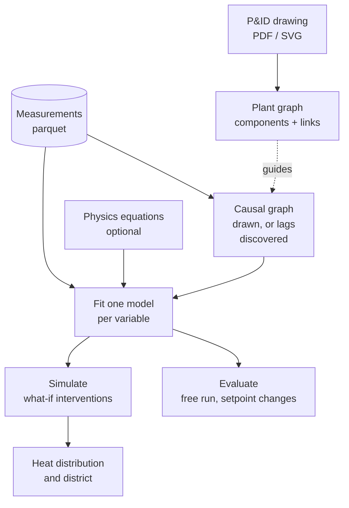

# Intelligent Digital Twin — Technical documentation

This site explains how the **Intelligent Digital Twin** app works: the science behind each step, the equations, the file formats and the code. It is written for engineers and researchers who know data centers and heat networks but are not necessarily machine-learning experts, and for developers (human or AI agents) who change the code.

Every chapter explains the logic first, in plain engineering language, with equations, tables and diagrams. The real source code sits behind toggle blocks — click **"Source code: …"** to expand one. The code is included straight from the repository, so it is always the code that runs.

---

## What the application does

The app is built for **DC2HEAT**: using the waste heat of data centers for district heating. A data center turns almost all of its electrical power into low-temperature heat. Whether that heat is worth recovering depends on two things nobody can read off a datasheet: *how much heat, at what temperature, at which hour*, and *what happens inside the data center if we change how it is operated* (a warmer cooling setpoint gives warmer waste heat, but does the room stay within limits?).

The app answers the second question with a **causal digital twin** of the data center: a set of small models, one per measured variable, wired together along a **causal graph** (what influences what, and with which time delay). The models are learned from the data center's own measurements, optionally constrained by physics equations you write. Because the twin follows cause and effect rather than mere correlation, it can be used for **what-if** questions: change a setpoint, and the change propagates through the graph to every downstream variable.

The top bar has the whole twin first, then its three parts in the order the heat flows (from the source to the consumers). Each part has the same two pages, *Visualization and Scenarios* and *Structure and Modelling*:

| Section | What it covers |
|---|---|
| **Intelligent Digital Twin** | The three parts together: the Site map (the data center as heat source, heat sinks, buildings or whole drawn areas, with their temperature and power, and a Quick analysis), Heat Matching (the heat matched hour by hour, with what-if) and Operation (design options compared). |
| **Data Center** | The source: its data at a glance and what-if scenarios on its twin; its structure (P&ID drawing and causal graph) and, under it, the models trained and compared on it. |
| **Heat Distribution** | The path of the heat: extraction points in the data center (hall or condenser heat exchanger), recovery, heat pump, storage, delivery to the district; its own variables, drawing, models and plant models. |
| **District** | The demand: the district's heat demand and the weather that drives it, its drawing and causal graph, and its models and profiles. |

### The workflow

| Step | Where | What happens | Chapter |
|---|---|---|---|
| 1. Pick a project and a data center | Top bar (project), each page (data center) | Each data center is a dataset folder: measurements (parquet) plus everything built on them. | {doc}`architecture/data-and-privacy` |
| 2. Look at the data | Data Center → Visualization and Scenarios (Historical) | How much, which period, statistics, correlations and data-center KPIs. | {doc}`concepts/dashboard` |
| 3. Structure | Data Center → Structure and Modelling | Import the P&ID drawing; draw or load the causal graph; optionally let the data suggest the time lags of each link (Causal discovery). | {doc}`concepts/pid-extraction`, {doc}`concepts/causal-graph` |
| 4. Modelling | Data Center → Structure and Modelling, under the structure | Make each variable data-driven, physical or a profile; train one or several model kinds (linear, XGBoost, physics, symbolic, TabPFN) on the first part of the data and score them on the rest. | {doc}`concepts/models`, {doc}`concepts/evaluation` |
| 5. Scenarios | Data Center → Visualization and Scenarios (Scenarios) | Move levers and watch the KPIs; run the twin forward with interventions (set, shift or scale a variable) and compare against the baseline, with uncertainty bands. | {doc}`concepts/scenarios-simulation` |
| 6. Heat distribution and district | Heat Distribution, District: their two pages each | Draw and model each part; pick a plant model per unit (heat exchanger, heat pump, storage) as components from equations, data or both; shape the district's demand as a profile. | {doc}`concepts/components`, {doc}`concepts/district-demand` |
| 7. The whole twin | Intelligent Digital Twin | Place the sinks on the Site map and plan the heat network to them, with its costs; match the data center's heat against the demand, hour by hour, and ask what if. | {doc}`concepts/heat-distribution`, {doc}`concepts/district-demand`, {doc}`concepts/heat-network` |
| 8. Save the project | Top bar | Everything built on a dataset (graphs, equations, models, site) as one JSON file in the data folder. | {doc}`architecture/data-and-privacy` |

### Overview



### Where it runs

Everything runs **locally**, as one Python process (FastAPI) that also serves the web page. There is no cloud service, no telemetry and no upload of data or drawings. The process is designed to stay under a **2 GB** memory budget. See {doc}`architecture/overview`.

### Other help

| Where | What |
|---|---|
| In-app help: the **?** button, [What is this?](http://localhost:7600/#/help/about) (`#/help/about`) and [How to use](http://localhost:7600/#/help/guide) (`#/help/guide`) | The app explained for users, step by step; this site's {doc}`user-guide` follows it and links each step to its method |
| API reference: [`/api/docs`](http://localhost:7600/api/docs) on the running app (schema at `/api/openapi.json`) | Every HTTP endpoint with its fields, generated from the code; summarised in {doc}`architecture/api` |
| `AGENTS.md` at the root of the repository | The operating manual for developers and AI agents: layout, commands, module map, rules, recipes |

The links above assume the app runs on its default port 7600 (`app/start.sh`).

---

## How to read this documentation

- **Concepts** explains the methods: causal graph, models, evaluation, simulation, P&ID reading. Start here if you want to understand or audit the science.
- **Architecture** explains how the code is organised, the HTTP API and the files on disk.
- **Development** explains how to run, test and extend the app, including the conventions for AI agents.
- **Equations** use standard notation (LaTeX). $y_t$ is a variable at time step $t$; $y_{t-k}$ is the same variable $k$ steps earlier.
- **Toggle blocks** contain the real source code. If you only care about the method, ignore them.
- References like `backend/core/twin/fit.py:fit` mean *function `fit` in that file* (paths relative to `app/`).

```{toctree}
:maxdepth: 2
:caption: User guide

user-guide
```

```{toctree}
:maxdepth: 2
:caption: Concepts

concepts/dashboard
concepts/causal-graph
concepts/models
concepts/evaluation
concepts/scenarios-simulation
concepts/heat-distribution
concepts/components
concepts/district-demand
concepts/heat-network
concepts/simulated-heat-recovery
concepts/pid-extraction
concepts/datacenter-variables
```

```{toctree}
:maxdepth: 2
:caption: Architecture

architecture/overview
architecture/backend
architecture/frontend
architecture/api
architecture/mcp
architecture/data-and-privacy
```

```{toctree}
:maxdepth: 2
:caption: Development

development/development
development/testing
development/working-with-agents
```
