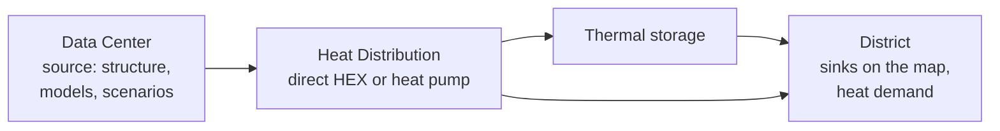

# User guide

This chapter walks through the app as a user sees it, in the order most people use it. It mirrors the in-app help and adds a link at each step to the chapter that explains the method. The in-app help is the **?** button at the top right, with [What is this?](http://localhost:7600/#/help/about) and [How to use](http://localhost:7600/#/help/guide). Its text lives in `app/web/src/pages/help/AboutPage.tsx` and `app/web/src/pages/help/guide.ts`.

The app opens on **Home** ([`#/home`](http://localhost:7600/#/home), also what an empty or unknown address opens; the house button right of the DC2HEAT logo brings you back). It says in a few lines what the app is, then shows the **system figure** over the whole width: the data center, the heat distribution and the district inside the whole twin, with time and weather acting on all three and the AI badges on what the twin optimises. Each part's pages sit as pill links right under its box, and the whole twin's pages at the figure's foot; hover a link (or focus it) for what the page shows. Under the figure: the project website [dc2heat.de](https://dc2heat.de/), *How to use* and *What is this?*, this documentation, the API reference (`/api/docs`) and the AI assistant page. Its texts live in `app/web/src/pages/help/HomePage.tsx`, `SystemFigure.tsx` and `home.ts`. The DC2HEAT logo's tooltip names the app and its version (now **1.3.0**), kept in one place: `version` in `app/web/package.json`.

---

## What the app is for

The Intelligent Digital Twin is a planning tool of the **DC2HEAT** project. It shows how much of a data center's waste heat could heat a district, and how changes inside the data center would change that heat.

- **The problem.** A data center turns almost all the electricity it uses into heat. Today most of that heat is blown into the air by chillers and cooling towers, while the town next door burns fuel to heat its houses. District heating can carry the waste heat to the houses, but three things get in the way. The heat is only lukewarm. It comes when the servers work, not when the houses need it. And every data center is built differently. Before anyone builds a connection, planners need to know how much heat there is, how hot it is, when it comes, and how much of the demand it would cover.
- **The digital twin.** A digital twin is a model of the real data center that you can ask "what if?". This one is learned from the data center's own measurements (temperatures, power, setpoints, weather) together with what is known about its physics. It is a **causal** model: it knows which quantity drives which, and how many hours later. Change a cause, such as a cooling setpoint, and the effects follow step by step.

The heat path the app follows, and the section of the top bar for each part:

| Section | Sub-pages | What it covers |
|---|---|---|
| **Intelligent Digital Twin** | Site Map · Heat Matching · Operation | The whole twin, made of the three parts: the site with its heat sinks, the heat matched hour by hour with what-if, and design options of the heat distribution compared |
| **Data Center** | Visualization and Scenarios · Structure and Modelling | The source: its data at a glance and what-if scenarios, its P&ID with the instruments and the causal links between them, and under it the models learned from its measurements |
| **Heat Distribution** | Visualization and Scenarios · Structure and Modelling | The link: heat taken at an extraction point, raised by a heat pump when it is not hot enough, buffered in a tank, delivered to the district; its own variables, drawing and models |
| **District** | Visualization and Scenarios · Structure and Modelling | The demand: the district's heat demand, its drawing and causal graph, and its models and profiles; its heat sinks are on the whole twin's Site map |

**The data centers in the app.** *Simulations* are simulated data centers with hourly data and known behaviour, and they are the best place to learn the app. *Simulation 1 · with heat exchangers* (`sim_1_modified`) also has two heat-recovery points (air-cooled: the hall's hot-aisle air and the chiller's condenser water); two plant cases with free cooling: *Simulation 1 · air cooled, free cooling* (`sim_1_air`: the cooling tower cools the chilled water through a plate heat exchanger when the weather allows, the chiller trims; the hall air and the condenser, which carries heat only while the chiller runs) and *Simulation 1 · water cooled* (`sim_1_water`: the same outdoor plant, but cold plates on facility water, which the tower cools all year, and rear doors for the rest; its facility water, about 50 °C, and the condenser). *Blank · inputs and outputs only* (`sim_blank`) is the place to draw a structure yourself: the data center has no built-in drawing, only its inputs and outputs (the IT load and the weather in; its IT and cooling electricity, the condenser water at the connection point and the heat to the environment out), with A1's simulated data under the generic names. *Recovery · air cooled* (`sim_recovery_air`) is the case to study heat recovery on: a 5 MW data center in Frankfurt (real weather of 2023 and 2024), all its electricity becomes heat, recovered or rejected, in every hour (PUE 1.21: IT, cooling, electrical losses and the building); its recovery heat exchanger, on the chilled water ahead of the chiller, takes the hall's heat up to the district loop's 4,333 kW as far as the loop's cold pipe lets it: all of it in winter, about 68 % in summer, when the pipe is warm and the free cooling and the chiller take the rest; it gives about 38,000 MWh of heat a year, about 28,000 MWh of it recovered, beside its own district's `Heat_Demand` of about 30,000 MWh (a seasonal district: in January about 1.5 times what the heat pump gives, in summer about 0.65 MW of the data center's 3.7), which that heat, lifted by the heat pump, covers about 75 % of in Heat Matching ([Simulated heat recovery](concepts/simulated-heat-recovery.md)). *District · heat demand* (`sim_district_heat`) is a separate simulation of a smaller district (some 5,500 MWh a year, on its own weather; sized for the 750 kW data center the recovery example started as), to match against it in Heat Matching. Real data centers, if this computer has any, are listed under *Real data centers*: their data are machine-local and not part of the app.

**One size on every screen.** The app is laid out for a window 1600 px wide and scaled to fit yours, so a laptop and a large screen show the same page, smaller or larger.

**Your data stays here.** The app runs on this computer: its server, the measurements and the trained models stay on this machine. The data of the real data centers is never sent anywhere and is not part of the code repository. A few things do use the internet, without sending any data: the Site map loads map tiles and looks up addresses and buildings with OpenStreetMap (satellite images come from Esri), and asks OpenStreetMap for the streets of the heat network only when you click *Load streets from OpenStreetMap*, every page loads its fonts from Google Fonts, TabPFN downloads its model weights once on first use, the Wärmeatlas import script downloads LEA's building data once, and this documentation site loads MathJax and Mermaid from a CDN. See {doc}`architecture/data-and-privacy` and {doc}`concepts/district-demand`.

---

## 1. Choose a data center

*Top bar, right, before ⤓ ⤒: the project. Each page, at the right of its sub-tabs: the data center.*

The **project** (top bar, right, before ⤓ Save project and ⤒ Open project) is one version of your data folder (Version 1, Version 2, …) or the Examples. It holds many data centers. Switching the project reloads the app; **Change data folder…** is in the same menu.

Each page picks its own **data center** among the project's, in the **Data center** menu under **Systems** at the right of the sub-tabs (beside it, **Case** picks all three systems at once; grouped Simulations, Testbed, Real data centers, and **Examples**: the app's own simulations, such as the air- and the water-cooled data center, in every project unless the project has its own copy; hover for the full name). An example's changes are kept with the example, in the app's own folder, not in the project. So the Dashboard can show one data center while Structure and Modelling works on another, in the same project. Choosing one re-opens only that page, without a reload; the choice is remembered per page in this browser, and a page you have not set yet opens on the last one you chose. Which causal graph a page draws is chosen on the page too (the **Graph file** menu).

New to the app? Start with **Simulation 1 · with heat exchangers**, which has everything filled in.

**Add a data center from a folder…** (at the end of the Data center menu, in one of your data folder's versions) takes a folder of a new data center or project: its data files (.parquet or .csv, also one folder down), its P&ID (a DEXPI .xml, an SVG or a PDF), and its dataset.json and causal graphs if it has them. The dialog lists what it found; *Add data center* copies it into the version open (the data as delivered, the rest next to it), reads the P&ID into its physical structure, makes a starter causal graph with every variable when there is none, and opens it. The folder itself is not changed, and an existing data center is never overwritten.

The top bar's right side has, in order: **Home** (the house), **Connect AI**, the project menu with **Save / Open project** beside it (chapter 9), the colour palette (three swatches), the light/dark toggle and **?** (help). They are pill buttons; Save and Open show only their icons until the bar has room for their names (hover for the name).

→ How datasets are organised on disk: {doc}`architecture/data-and-privacy`.

---

## 2. Visualization and Scenarios: look at the data first

*Data Center › Visualization and Scenarios* (`#/dc/dashboard`, also what `#/dc` opens), in **Historical** mode.

**What you see.** The data of the chosen data center at a glance. On top, the **data center KPIs** the columns allow, over the period picked for the time series (the card's title says which): PUE (IT + cooling, the full one when the facility's other power is chosen too: UPS and distribution losses, the building), ERF, ERE, the IT energy and the heat reused (with the share of the heat demand it covers). A row of KPI tiles shows up to five; the others open under it with *More figures* (on Heat Matching *More details*: the heat balance, the data center's heat, the heat pump, the storage and peaks, and the CO₂ with its factors). Under them, **Data overview** opens cards on how much data there is: rows, variables, the time span (first and last timestamp), the resolution (the usual time step), the completeness and the gaps. For the simulations they come from the known column names; for a real data center, open **Choose the KPI variables** under the KPIs and pick which variable is the IT power (electricity), the cooling power, the reused heat and the heat demand, and their unit; *Save KPI variables* keeps that choice in the data center's `dataset.json`. Then *Explore*, one card with a tab for each view (Time series, Daily profile, Weekly and monthly, Autocorrelation, Correlation, Distributions, Variables, Missing data, Recommendations and, for the data center, Edit data): the time series as one small chart per variable (the first year to start with, each with its distribution beside it, its line in the part's colour: red for the data center, orange for the heat distribution, blue for the district; the variable chips on the left have the colour of how each is modelled: blue data-driven, teal physical, orange profile, grey not modelled, as on Structure and Modelling), the **correlation matrix** of all variables with a scatter of one pair beside it, the **distributions** (a histogram per variable; click one to open it large, with each bar's range and rows and the variable's statistics), every variable with its descriptive statistics (role chips: green actuator or lever, orange heat; a heat exchanger's heat $Q$ is marked *calculated*), and the recommendations (*Prepare* on one opens it under *Edit data*); last, under *Edit data*, *Prepare variables* and *Aggregate data*.

**Historical or Scenarios.** The switch at the top right sets the mode. *Historical* is the measured data, as described here. *Scenarios* is the same page in amber, the colour the Scenarios page draws the simulated in. In place of the data center KPIs come the levers, a slider per **intervention variable**. These are ticked in the panel on the left, under the causal graph (setpoints and actuators have a green dot); clicking a variable on the graph ticks it, and a second click releases it. The step-through's what-if uses the same list, and the replay's plotted variables are picked above it (*Visualization variables*, where Historical has its variables). Moving one shifts it over the test period, and a moment later the twin (the trained linear model) runs with it and without it. The KPIs then show measured, the twin without a change, the twin with your levers, and the change between the last two. The change compares the twin with itself, so the model's own error does not count as an effect. Green means better (lower PUE, more heat reused), red worse; **Reset** puts the levers back. Nothing runs before you move a lever. Scenarios need a model of the system: without one, the page says to model it on *Structure and Modelling*. The browser remembers the mode.

**What to do.**

- Data with several files: pick the file in *Data file*.
- A data file too big to load (a delivered CSV of gigabytes) shows its variables and two choices: **Aggregate** it (e.g. to one hour) or keep **one period** (e.g. one day), with all or some variables. The file is read in chunks and the result is a new data file, opened at once.
- Click a column header of the variables table to sort by it; click again to reverse.
- In the panel on the left, under the causal graph: pick the period in the *Period* and *Month* menus (a year, a month of it, or both years); the KPI cards at the top follow it. Click a variable chip (or the variable in the graph) to add or remove its time series, double-click it to show only that one (again: all), or use *All* and *None*. Hover a chart to read its values (all charts share the cursor). **Rows / Tiles** (over the charts) puts them one under the other or side by side.
- *Explore* has more views than *Time series*: *Daily profile* (one variable's mean day with its 10 % and 90 % band), *Weekly and monthly* (side by side: one variable's mean by weekday and hour, and every variable's monthly means), *Autocorrelation* and *Missing data*.
- In the correlation matrix, hover a cell for its value and click it for the scatter of the two variables (or pick them in *X* and *Y*). *Similar together* puts strongly correlated variables next to each other.

**The numbers.** Completeness is the share of cells (rows × variables) that have a value. A gap is a time step longer than 1.5 × the median step. r is the Pearson correlation (+1 rise together, −1 opposite, 0 no linear relation); a crossed grey cell is a constant variable. The time series show at most 1 500 points per chart and the scatter 600, each the mean of a run of consecutive rows.

→ Every formula: {doc}`concepts/dashboard`.

---

(user-guide-structure)=
## 3. Structure and Modelling: the structure

*Data Center › Structure and Modelling* (`#/dc/pid`), at the top. Its models are under it (chapter 4).

**View and edit.** The page opens to view: the drawing, the slider to the causal graph, the variables shown, the zoom. **Edit** (top right) brings the tools that change the structure: *+ Variable* and *+ Add link*, *Edit construct*, *Causal discovery*, *Save as…* and *Import P&ID…*; *Done editing* hides them again. *Save* shows whenever there is something to save. The browser remembers the mode for each part.

**What you see.** The data center's P&ID (piping and instrumentation diagram): for the simulations a built-in drawing of an air-cooled data center (rack rows and the CRAH in the hall, water pipes only from the CRAH to the chiller and on to the cooling tower) or, with free cooling (`sim_1_air`) also its plate heat exchanger between the chilled water and the tower water; for a liquid-cooled one (`sim_1_water`), of its cold plates: rack water from the rack rows to the CDU, facility water from the CDU through the liquid cooling heat exchanger to the facility heat exchanger on the tower water, rear-door heat exchangers on the chilled water, and outside the same plant as the air-cooled one (tower, chiller, free-cooling plate heat exchanger), with no CRAH; or the real drawing. Where the hall's heat is taken from the warm water rather than the hot-aisle air (its $Q$ is computed with water's $c_p$, as in `sim_recovery_air`), the **Hall HEX** is drawn on that water: on the chilled-water return between the CRAH and the chiller, its three variables tapped there. Every variable in the data is on it, linked or not. Every variable is a plain circle on it (an abstraction, not an instrument of the drawing), tagged as on a P&ID (TT temperature, EQ energy, QT heat, …). On a built-in drawing a thin tap line leads from each to the equipment it measures (none for room air, weather and the clock). Thin arcs are the **causal links**, showing which variable influences which. Each variable has the colour of how its Modelling (below) makes it, and so has every link into it: blue data-driven, teal physical or semi-physical, orange a measurement or profile, grey not modelled (also an input taken from the data). Only an actuator or setpoint you can change in Scenarios sits in a square around its circle; a variable without data is marked *no data* under its name.

**What to do.**

- Pick the causal graph file in the menu at the top. For the simulations, choose where the heat is recovered (*Condenser HEX* or *Hall HEX*). The drawing, the causal graph and the Scenarios lists then show only that exchanger's three variables: inlet and outlet temperature and mass flow. Its heat $Q = \dot m\, c_p\, (T_{in} - T_{out})$ is calculated from them and shown as a small read-out next to the exchanger, not as an instrument (see {doc}`concepts/simulated-heat-recovery`). The other exchanger's variables and links stay in the graph file. Where a data center has both a drawn and a paper P&ID, switch between them with *Drawn P&ID* / *Paper P&ID*.
- Move the slider from *Topology* through *Graph in place* to *Causal graph*. The drawing fades out, the links fade in, and the instruments move into a circle.
- Click an instrument to see what influences it and what it influences. Click a link to edit its lag.
- **The legend** sits in the drawing's right margin, under the connection point, when there is one (an imported P&ID or an empty structure); on a built-in drawing it is in *Views, documents, changes and legend* above it.
- **The Variables bar** (above the drawing, its list a dropdown: *N of M shown*) lists every variable: tick the ones the drawing shows (a data center with many variables starts with only those already placed), search them, *Show all* / *Hide all*, and set the instruments' *Size*. The chips on top of the list keep only the variables made one way, as Modelling shows them: *Not modelled*, *Data-driven*, *Physical*, *Profile* (and *Calculated*, when there are calculated ones); click any combination on, and click again to take one off. They only filter the list: *Show these* / *Hide these* then act on the ones listed, so *Hide all*, then *Data-driven* and *Profile*, then *Show these* leaves only those on the drawing. A long name is drawn as a short label; the menu shows it next to the full name (a row under the pointer shows all of it), and the full name appears when the pointer rests on the instrument.
- **Several variables at once.** Press *Select* (next to the zoom) and drag a box around instruments, or hold Shift and drag, or Shift-click them one by one. A bar appears over the drawing:
  - *Group…* marks them as one variable: their mean, sum, minimum or maximum, for example the mean CPU utilisation of one rack. It is only a mark: no values are computed and the data is not changed. The group is drawn as stacked circles in the middle of its members, which are hidden; Save keeps it. Selecting the group lists its members and offers *Ungroup*. The Dashboard lists the groups and marks their members (*in …*).
  - **One variable dropped on another** (the drawing unlocked): a small menu at the drop says what they are to each other. *= the same*: they are one variable; the one with data stays, on the other's place and with its links (a column dropped on a generic name such as `IT_load` or `T_outdoor` is shown under that name from then on, and bound to it: `dataset.json` `names`). Two with data cannot be the same: combine them instead. *mean / sum / min / max of both* makes a group of the two, as *Group…* does. *Cancel* (or Escape) puts the dragged one back.
  - *Kind…* marks what they are: sensor, setpoint, actuator, meter, IT load, weather, time, calculated or status, shown in the variable's hover text and in the Variables list.
  - *How sure…* draws a green, amber or red ring.
  - *Hide* takes them off the drawing; *Delete…* removes those that are not delivered data.
- **Names shown.** A variable's own name (as in the data) can be long or cryptic. Select it and type a *Name shown* in the card that opens over the drawing's corner (close it with ×), or select several and use *Rename…* in the selection bar: find a text in their names and replace it (or tick *Pattern* for a regular expression, with `$1` for a part found); the bar says how many names change. The drawing, the Variables menu and the Dashboard show the new names, with the own name on hover; an empty name gives the own one back. The data, the graph files and the models keep the own names, so nothing that refers to a variable changes. The names are written at once to the data center's `dataset.json` (silver).
- **Documents** (above the drawing, in *Views, documents, changes and legend*) keeps what you know about the data center's physical structure: descriptions, equipment and sensor lists, schematics, any file (PDF, Word, Excel, pictures, text). Type a note of what it holds, choose whether it is about the whole data center or one view of the P&ID (e.g. Rack 1), then *Add a document…*. The note and the view can be changed later; click a name to open the file, *✕* removes it after a backup. The app keeps each file as it is, in the data center's silver folder, and does not open it: an assistant reads it with its own tools to build the constructs and the causal links, and can keep its own notes there too.
- **Changes** (above the drawing, in *Views, documents, changes and legend*) lists what was changed on the page and by whom, *you* or *AI* (an assistant over MCP): groups, marks, deletions, placements, links, saves. It is kept in this browser.
- The *Size* slider goes down to 15 %, and resting the pointer on an instrument shows its whole name. Clicking a name shows and selects it; **dragging a name onto the drawing** places the variable where you drop it. On a paper P&ID only the variables placed on the picture are drawn, nothing below it: one not placed yet waits in the menu, unticked. Tick it and it appears on the picture, in a free spot of the part you are looking at (zoomed in: there), or drag it to its spot. Placing is unsaved until *Save*, like a drag. The choice is remembered per data center in this browser.
- **Unsaved work survives a reload.** Every change (positions, links and lags, variables added with *+ Variable*, the heat-recovery choice) is kept in this browser as a draft, per data center and graph file, a moment after you make it. After a reload or a crash the page shows *Restored unsaved draft*: *Save* writes it to the graph file, *Discard* goes back to the last save. Only those two clear the draft. The fade slider, the *Picture* / *Construct* / *Variables* layers and *Lock* are remembered too. Construct edits are not in the draft yet: save them before reloading.
- *+ Add link* (in the menu): click the cause, then the effect. *+ Variable* opens a name field right under it (Enter or *Add*; Escape closes it) and places another data column, or a new name, on the drawing. Drag instruments to where they sit in the plant.
- **Causal discovery** (TempCaFe, Temporal Causal Feature Selection) opens a small menu: the method (PCMCI or PC), the significance level (alpha), the lags to test (from, to) and where to start. *Refine the drawn graph* finds in the data how many time steps each drawn link takes; a link with no evidence is drawn dashed. *Blind, no links* uses no drawn link as a prior: every pair of the drawn variables with data is tested, and the links among them are replaced by the ones found (links to variables without data stay). *Run* starts it; Escape or a click elsewhere closes the menu. Discovery only *suggests*: nothing is written until you save.
- **Import P&ID…** reads a PDF or SVG drawing, or a DEXPI file (the standard machine-readable P&ID format, read exactly), and shows the components, connections and pipe runs it found. You can then use it as this data center's P&ID.
- **Only part of the sheet:** after you choose the file, the import dialog shows its preview: drag over the plant, leaving out the legend, the tables and the title block (or press *Whole page*). Only that part is read: every line and text of it becomes digital, and the components, instruments and pipes are recognised on top. That part is also what is kept. *Select another area* reads again.
- **Zoom and lock the drawing:** the drawing always fits the screen, a tall P&ID too: scroll the page down a little and all of it is in view, where it stays while the page scrolls on. The mouse wheel over the drawing zooms it (so do the buttons in its corner), dragging the empty drawing moves it, at every zoom (zoomed in, down to the bottom of a tall P&ID), and *Fit* centres all of it again. The drawing opens locked, so the mouse wheel scrolls the page: click *Locked* to unlock it and edit. *Lock* freezes the drawing completely: no zoom (wheel or buttons), no panning, no dragging of instruments or shapes and no dropping of variables from the menu; a click still selects, to look at a variable or link. Click *Locked* to unlock. *Remove picture* deletes the P&ID picture after a backup.
- **Views inside the P&ID.** One part of the P&ID (a cooling unit, a room) can get a drawing of its own: above the drawing, in *Views, documents, changes and legend*, press *Mark an area as a view*, drag a box around that part, and name it. *Picture…* puts another drawing (a PDF's first page, an SVG or a PNG) inside the area, which takes the picture's shape. A PDF, SVG or DEXPI picture is also read like the P&ID itself: its lines, texts, components and instruments become the view's own construct, drawn in the *Construct* layer inside the view (a PNG stays a picture only). Under each view the list says what it has: no picture yet, its construct (how many shapes, components and instruments), or *picture only, no construct*, when the file was a PNG or a scan with nothing to read; after each upload the page says the same. Click the view's name (on the drawing or in the list), or double-click the view, to zoom onto it, and *Back to the whole P&ID* to see everything again. A view can hold views of its own: mark an area inside it. Each view has a level of detail, set in its *Show as* menu: *Box* (a plain blue box with its name), *Sheet underneath* (the P&ID as it is, with only the view's frame), *Its picture*, or *Auto* (the default: a box while the view is small on screen, its picture once you zoom in; the sheet underneath until it has a picture). *Views* in the layer bar shows every view at one level at once (*each its own* goes back to the views' own settings). Variables placed in a view are drawn at the view's scale (small on the whole P&ID, their usual size once you zoom in), and they are linked with every other variable as usual, inside the view or outside it. Views and their pictures are written at once (`site.json` and the data center's folder), like the P&ID picture; *✕* removes a view after a backup of its picture, and its variables stay where they are.
- **Values of a shape:** with *Edit construct*, click a component and add its values under *Values* (e.g. `capacity_kW` = 50). They show when the pointer rests on it.
- **Save to** *graph file* writes your changes to the file picked at the top. **Save as…** writes a new file instead, so you can compare graphs later in Modelling.

**The numbers.** The number on a link is its **lag**: how many time steps after the cause the effect shows (hours, for hourly data). An own-past marker **↻n** under an instrument means the variable also depends on its own past, up to *n* steps back.

→ The causal graph, lags and lag discovery: {doc}`concepts/causal-graph`. Reading drawings: {doc}`concepts/pid-extraction`.

---

## 4. Structure and Modelling: the models

*Data Center › Structure and Modelling* (`#/dc/pid`), scrolled down to **Modelling**: the models of the structure above, on its graph (the graph file picked there, the links as drawn; change the graph file above or below and the other follows). The heat distribution's Structure and Modelling has the same (chapter 7). Old links to `#/dc/train` open this page.

**What you see.** Two columns. On the left, scrolling on its own: the causal graph of the selected graph file (the selected heat exchanger's variables, as on Scenarios; click a variable for its results and its equation); once evaluated, **Structural equations · best model per variable**, the equation of the best model of each variable with the fitted physics and symbolic alternatives, in a small box that scrolls inside (hover its title for what each kind shows); then the *Connection points* and the *KPI variables* (folded). On the right the **results come first**: a bar with **Model…** and where the results stand (*The stored evaluation … (unchanged since)*, or once evaluated here *Evaluated on the test period: …*, each with *Evaluate again*; before any, *Evaluate on the test period*), the results of the variable you picked, the results table that compares every model for every variable, the rolling comparison and one setpoint change, model by model.

**The modelling window.** **Model…** opens it above the results: the variables in four columns, one per way of making a variable (or none), and under them each column's settings: the training, the equations and the profiles. It opens by itself when there is nothing to show without it (no saved models, or none evaluated), while training, and with a building handed over from the Site map; it then stays open. Click *Model…* again to close it: the results move up. The browser remembers it open or closed.

**What to do.**

- **Connection points**, in the left column under the causal graph (it closes with the graph): what this part must deliver to the rest of the twin, and how each of those variables is made here. The data center: its waste heat at each extraction point; the heat distribution: the data center's waste heat in and the district heat out (and, under *Plant models*, a component per unit: the heat distribution's Model on Heat Matching); the district: its demand and the network's supply and return (the Site map's settings until modelled). Each point folds on its title, open when something is missing: its name, its status (*Complete*, *Missing: …*, *Optional*) and, in small text, what it is about. Each point needs **both temperatures and the heat or the mass flow** ($Q = \dot m\, c_p\, \Delta T$ gives the other). That is the minimum for the twin (marked *needed for the twin*). The weather and the data center's inputs and outputs are *Optional* (for scenarios, its hover text says): they explain the heat and let you play scenarios, but Heat Matching does not need them (the district's outdoor temperature is the one must: its demand follows it). An optional box nothing makes yet says *optional · not made yet*; the heat or the flow that follows from the other three says *from ṁ·cₚ·ΔT*. The **weather** (outdoor temperature, humidity, sun: the minimal set that moves the three parts; wind is left out, a second-order effect) is shared by all three parts and always listed, under Variables too. A box says how its variable is made (*data-driven*, *physical*, *profile*, *measured*, *calculated*, *setting*); a missing one is red: model it under Variables, or, for a data center without heat-exchanger columns, pick them under *Columns of the waste heat*. Click a box to find its variable under Variables. Heat Matching runs each part's Model on these points (chapter 8). On the drawing above, the connection points are always there: the neighbour's box with the supply (red) and the return (blue). With an imported P&ID, or on a new structure without a drawing, they sit in a margin beside it, never over it, with their variables beside them to connect. The weather sits there too, in its box above the neighbour's, as on the built-in drawings: the outdoor temperature, humidity and solar radiation always (a variable with no data is red until you model it, for example from other columns under Variables). The data center also lists its other **inputs and outputs**, standard variables to model: the **IT load** that drives it (input), its **IT electricity** and **cooling electricity**, and the **heat to the environment** its cooling rejects (outputs). Nearly all the electricity becomes heat, recovered at the connection point or rejected, so the heat to the environment is about the IT and cooling electricity minus the heat recovered.
- **KPI variables** (the data center only), under the Connection points, folded: its title says what PUE uses now (e.g. `PUE = (ITE_Ener + HVAC_Ener) / ITE_Ener`); click it to open it (the browser remembers it). which of its variables are the **IT power**, the **cooling power**, the **reused heat** (one or more, summed; *+ add* adds another) and the **heat demand**, and the **power unit**. Each row shows the variable the KPIs use now, also one found by default (the simulations' names, or the heat of the chosen heat-recovery point); pick another to change it. Under them each KPI is written with the bound names: PUE = (IT + cooling) / IT, ERF = reused / (IT + cooling), ERE = (IT + cooling − reused) / IT, each with an ⓘ that opens what it means; a KPI whose variables are missing says what it needs. **Save KPI variables** writes them to `dataset.json` (`kpi`) at once: the same choice as *Choose the KPI variables* on the Visualization, whose KPIs follow.
- **KPI variables** (button in the bar over the drawing, on every part): marks the variables the KPIs use with a halo and their role under the name (IT power, cooling power, reused heat; the hover text says which KPIs each feeds), and writes the formulas of PUE, ERF and ERE with those names under the bar. Click a KPI to mark only its variables (again to mark all); click its ⓘ to read what it means. A reused heat calculated from its water (the heat exchanger's $Q = \dot m c_p \Delta T$) marks the supply, return and flow it comes from. Press it again to hide it.
  The heat distribution's and the district's are fixed (`lib/partKpis.ts`). The heat distribution's: the heat pump's **COP** (Σ Q_hp / Σ P_el_hp), the **waste heat used** (Σ (Q_hex + Q_hp − P_el_hp) / Σ Q_dc: what reaches the district of the data center's waste heat) and its **electricity use** (Σ P_el_hp × Δt). The district's: the **demand covered** (Σ (Q_hex + Q_hp) / Σ of the buildings' demand), the **energy used** (the demand × Δt) and the **CO₂ saved** against gas heating (the heat delivered had a gas boiler made it, 0.201 kg CO₂ per kWh of gas at 90 % efficiency, minus the heat pump's grid electricity at 0.38 kg CO₂ per kWh).
- **The new form on the other parts.** For a framed data center (the *Box* examples) and the blank one, the heat distribution's and the district's structures are drawn the same way: their drawing inside a box of their own, the weather (and the heat pump's electricity) above it, the neighbours on the margins with the connection points' variables beside them: the data center's water on the heat distribution's left, the district's on its right, the heat distribution's on the district's left. The other examples keep their drawings with the neighbours drawn in.
- In the training settings (*Model…* opens the modelling window; click its *Data-driven* column to open them, *Train the models*), tick the **model kinds** (*Model*: linear regression, XGBoost, physics with your equations, symbolic regression, TabPFN) and the **structures** (*Structure*):
  - *Causal graph*: each variable is predicted from its parents in the graph, at the graph's lags.
  - *All vs all*: each variable is predicted from every variable at lags 1 to max lag. This is a check of what the graph may miss.
- Pick the *Causal graph* file and set the *Max lag (all vs all)*. Then move the **split** slider. The models learn from the data up to "Train until …" and are tested on the rest, the **test period**. Beside *Train N models* the page estimates how long training takes, and says what is missing.
- **Variables**, in the modelling window: the graph's variables (the data center's also every data column, as on its drawing; the heat distribution's and the district's only their graph's), each made one way, in four columns:
  - *Data-driven*: learned from the data on the causal graph (each variable from its parents), by the model kinds ticked under Train.
  - *Physical and semi-physical*: an equation per variable, with coefficients learned from the data (semi-physical) or fixed numbers only (physical).
  - *Measurement or profile*: a measured input, or a total over a period shaped by the clock and the weather.
  - *Not modelled*: left out of the models.

  Drag a variable to another column, or pick its approach with the arrow on it; hover a column's title for what it means. A dashed variable has no data. Where a variable cannot go, its menu greys the column out with the reason, and the column says why while you drag: one without data is never data-driven, and an input (no causes in the graph) is neither data-driven nor physical until you link a cause to it in the graph above. Each structure starts its variables in one column: the data center's in *Data-driven*, the heat distribution's in *Physical and semi-physical*; the district models only its heat demand, as a *Profile*, and starts every other variable *Not modelled*. A variable that cannot be there starts elsewhere: one without data is never data-driven, and an input stays from the data. An equation of a variable moved out of Physical is kept but not trained; moved back, it is there again. *Not modelled* also holds the inputs (marked *from data*) and the calculated columns, beside the variables left out (faded). Inputs are taken from the data and not predicted, and the graph decides what is one: a variable without causes in it (no parents but its own past), the actuators and weather-like columns. An input can be given a profile instead (weather is typically one); dropped back on *Not modelled*, it is taken from the data again. A *calculated* column, such as a heat exchanger's heat $Q$, is computed from other variables and never modelled. *Select all* / *None* models every data column, or none. *+ Add variable* puts a data column that is not in the selected graph file into it, as a variable without links (the file is saved, every link kept); place it and link it on the drawing above. Which column a variable is in is kept in this browser per data center and structure.
- A click on a column (but *Not modelled*), on its title or anywhere but on a variable, opens its settings under the columns, one at a time, in its colour; another click closes them: the training (Data-driven: the model kinds, structures, causal graph, max lag, split and **Train**), the equations (Physical and semi-physical) and the profiles (Measurement or profile). They start closed. A variable moved to a column opens its settings. Click a variable to find it on the causal graph (left) and select it on the drawing above, and to see its results (above the results table) and its equation (left); a click on a variable does not open or close its column's settings. Double-click it to scroll up to it on the drawing. Each profile is folded: click its variable to open it.
- **Results of one variable.** Pick a variable, on the drawing above, on the causal graph, in the results table (a click on its row) or in the columns, and *Results · \<variable\>* appears above the results table (a pick in the table brings it into view); its row in the table turns the accent colour, and its equation is marked in the box on the left, which scrolls to it (the page stays where it is). The card lists every saved model of it with its kind, the free run's MAE (in the variable's unit), WAPE, R², MASE and nMAE, the best first and marked *best*, each with *Inspect* (its fit up close). A variable with no results says why: an input taken from the data, calculated (the heat exchanger's $Q$), no data, not modelled, a profile, no saved model yet, or not evaluated yet (with *Evaluate*).
- **Results of a column.** Open the *Data-driven* column in the modelling window: under *Train the models* every variable of the column is listed with its best data-driven model and its scores. Click a name to pick the variable; *Inspect* opens the fit. The *Physical and semi-physical* column lists the physics model's scores the same way, under its equations, once a physics model is saved.
- **Physical and semi-physical**: the equations of that column, trained as the *Physics* model kind. Write a variable's right-hand side, e.g. `a * In_Temp[t-1] + b`. `Name[t-1]` is the data one step back, and any other name is a coefficient learned from the data. *+ Add equation* adds a row and moves its variable to this column; removing a row moves it back. Under each equation, *+ term* adds a coefficient times a variable, and *+ constant to learn* adds a constant. The **equation library** has ready equations for heat exchangers, heat rejection, heat pumps and storage, rooms and pipes, and pumps and fans.
- **Measurement or profile**: one profile generator per variable of that column, each folded until you click its variable, starting *Constant*. The district's heat demand starts *Residential*. To make a building's profile, add the building as a heat sink on the Site map (a Wärmeatlas building comes with its annual demand and hot-water share) and press its **∿** button in the heat-sink list (unsaved site changes are saved first): the district's Modelling opens with that building's profile on top, for a look (kept with the building, not given to a variable), and **← Back to the site map** returns. Or pick it under *Start from* → *Buildings and areas of the site map* (each listed with its MWh/a, or all of them together): the profile then holds that annual demand, in MWh. Nothing is applied by itself. *Total* and *Units* show thousand separators (12,000); type with or without them. Kept in this browser per data center and structure for now: the models do not use profiles yet; Heat Matching's district Model uses the heat demand's. A total over a period (per *day*, *week*, *month* or *year*), of any quantity and unit (*in*: kWh, MWh, m³, ...; the curve is that per hour), becomes a curve, so that the period holds exactly that total: *One total* for everything, or *Per unit × units*. Change the total and the profile is rebuilt to it. It is not only demand: *Start from* a standard profile, this app's residential heating + hot water, a data center's waste heat (IT load, nearly flat), cooling on warm days, the BDEW gas standard load profiles for single-family and multi-family households, offices (public bodies, banks, insurers) and retail (DE_HEF03, DE_HMF03, DE_GKO03, DE_GHA03; coefficients and weekday factors from the BDEW/VKU/GEODE guideline "Abwicklung von Standardlastprofilen Gas", 27 March 2026), office hours, or a constant. The standard view is simple: *Start from* a profile, set its *Total*, *in* which unit and *per* which period, and *Show* a day, a week or a year. **Shape it yourself** (closed until you open it) holds the rest: *One total* or *Per unit × units*, and each part's shaping. Each part (e.g. space heating and hot water, with their shares) is drawn as its **average day** in the unit per hour (kW for kWh): drag a point to reshape the day, grab a line to move the whole curve up or down, and the total (and the parts' shares) follow its height, as on the sinks' typical day. *Day of week* has a bar per weekday; the *Month* bars show what each month of the year holds (mostly the weather's doing), and dragging one gives that month more or less, the others making up the rest of the total. Each part also has its *Outdoor temperature*: none, more below a heating limit (heating degree-days), more above a cooling limit (cooling degree-days), a straight line (more or less per °C warmer), or a BDEW sigmoid (any of the four) on the allocation temperature (the day and the three before it, weighted 1, ½, ¼, ⅛). *Show* a day, a week or a year from a date: a shorter span is its part of the period that holds the total. The outdoor temperature is the typical Frankfurt year for now, so the curve is smooth: real weather would make it vary day to day.
- Press **Train N models**. The models are saved and tested. Symbolic regression and TabPFN take a few minutes.
- Nothing is computed by itself: models saved earlier are tested when you press **Evaluate on the test period** (TabPFN can take a minute the first time). Each evaluation is kept beside the models (`models/evaluation.json`). When the page opens again and the saved models and the levers are unchanged, it shows that evaluation at once, with its window: *The stored evaluation of the N saved models (unchanged since)*, and *Evaluate again* beside it. *Recovery · air cooled* comes with one (its district's is made by its `make.py`), so its results show without evaluating. Retrain a model and the stored one no longer counts: press Evaluate again.

**The numbers.**

| Column | Meaning |
|---|---|
| nMAE | Mean absolute error as a share of the variable's typical size (mean absolute value); lower is better. Green up to 5 %, amber up to 15 %, red above. |
| One step | Predicting the next step from the real past |
| Free run | The model runs on its own predictions over the whole test period, fed only with the inputs taken from the data: the honest test for what-if questions |
| After setpoints | The error in a window after each setpoint change (you choose the window). Below the table you can look at one change and see each model against the measurement. |
| Best | The winning model per variable: LR linear, XGB XGBoost, PHY physics, SR symbolic, TPF TabPFN |

**Rolling comparison.** Under the results table, once a structure has saved models: pick a **variable** (one the models predict), tick the models to compare (the saved ones and **Chronos-2**, the pretrained forecaster, which starts unticked: tick it to include it; a run takes about a minute), the **rolling** and an **intervention** (a variable *shift*ed, *scale*d or *set*, e.g. `Out_Temp` + 3, over the year), and press **Roll and compare**. Each model is rolled over the data's last year the same way: **Day-ahead**, each day from the measured history before it, as an operator forecasts; **Free run**, the whole year on its own predictions (Chronos-2: each day from the measured year before, up to the same date, with the year's weather). Then once more with the intervention. The table gives each model's error per step (in % of the measured mean), its year's energy against the measured, its correlation, and how much the intervention changes its year (*With …*); the charts show the year's daily means, without and with it. Chronos-2 sees only the outdoor temperature and the calendar: an intervention on another variable does not reach it (the table says so). For a fair comparison give the trained models Chronos-2's inputs: the prepared variables `Out_Temp_mean24` (*rolling_mean* of `Out_Temp`, 24 steps) and `Is_Weekend` (*is_weekend*) with `Out_Temp` in their graph, and their own past (`[t-1]`, `[t-24]`); an intervention on `Out_Temp` then moves its 24 h mean too, for every model.

→ The model kinds: {doc}`concepts/models`. The scores: {doc}`concepts/evaluation`.

---

## 5. Visualization and Scenarios: what if?

*Data Center › Visualization and Scenarios* in **Scenarios** mode (the switch at the top right). It used to be the *Scenarios* tab; old links to `#/dc/scenarios` open this page in Scenarios mode. On top are the KPIs with the levers (chapter 2), below them the tools described here.

**What you see.** On the left is the causal graph of the trained model. Click a variable to intervene on it, and it lights up with everything it affects. There are two modes, *Step-through (replay)* and *Long period simulation*. Both use the **linear model trained on the causal graph** under Modelling on Structure and Modelling, so train that first.

**What to do.**

- **Step-through.** Pick the variables to plot in the panel on the left, under *Visualization variables*. *Period* and *Month* above them are the same as in Historical; picking a year or a month moves the replay's window to it. Play the measured data, change the speed or the window, or drag the time slider. Then pause. The intervention variables are the ones ticked under *Intervention variables* in the same panel (or clicked on the causal graph; a second click releases one); the KPI sliders above use the same list. Type constant values for them and the number of steps, and press **Run What-If**. **Step Forward** reveals the prediction one step at a time, next to what really happened, and *Exit What-If* ends it. *Re-prepare* re-trains the linear model with another train split.
- **Long period simulation** (a year on the simulated data). Choose the horizon and the variables to plot (the selected heat exchanger's $Q$ is offered as *calculated*: computed from the predicted inlet, outlet and flow). Use *+ Add intervention* to add set to, shift by or scale by ×, each with a from / to date window (a variable clicked on the causal graph is added too). Then press **Run**.

**The numbers.** The simulation runs 50 times with random noise. The band is the 5 %–95 % range of those runs, and the line in it is the median. Blue is the baseline (nothing changed), red your scenario, and grey what was measured. The line "mean: actual · baseline · scenario · change" sums up the effect over the horizon.

**The KPIs of a run.** Under each run, a table gives the data center's KPIs (PUE, ERF, ERE and the energies) over the run's steps: measured, the twin without a change and the twin with your overrides or interventions, and the change between the last two (green better, red worse; a long period run without an intervention shows measured against the twin only). They are worked out exactly as on the Visualization, from the KPI variables: a KPI variable the twin predicts (or calculates, like the heat exchanger's $Q$) takes the twin's series, the median of the 50 runs in the long period simulation; one it does not model keeps its measured values. Without KPI variables the page says where to choose them: *Choose the KPI variables* in Historical mode, or *KPI variables* in the Modelling sidebar of *Structure and Modelling*.

→ How a run works, what set/shift/scale do and the limits: {doc}`concepts/scenarios-simulation`.

### The same page for the heat distribution and the district

*Heat Distribution › Visualization and Scenarios* (`#/heat/dashboard`) and *District › Visualization and Scenarios* (`#/district/dashboard`) are this page, one module, on one part only:

- **Its own variables.** The heat distribution shows each heat exchanger's heat $Q$, inlet and outlet temperatures and flow (`dataset.json` `heat_source`); the district its heat demand (`kpi.heat_demand`) and the weather that drives it. Variables of the part's own saved causal graph that have data are added. The charts, correlations, statistics and the causal graph on the left (the part's graph file) show only these.
- **Its own KPIs, on top in both modes.** The heat distribution: five tiles, each with a line saying how it is computed, and "needs X" when the data has no column for X. The **heat recovered** (Σ of every heat exchanger's $Q$ × Δt, MWh), the **electricity consumption** (Σ P_el_hp × Δt), the **mean source temperature** (the mean of each heat exchanger's inlet temperature, weighted by its heat), the **mean sink temperature** (the mean of T_dh_supply, the supply to the district) and the heat pump's **COP** (Σ Q_hp / Σ P_el_hp). The variables are the same as under the *KPI variables* button of its Structure (`lib/partKpis.ts`). The district: its heat demand, the peak and the mean.
- **Scenarios.** The part's own twin (the linear model trained under its Structure and Modelling) over the test period. Its levers are what that twin takes from the data; for the district that includes the outdoor temperature, so a colder winter is a scenario. Move a lever and the KPI tiles on top switch to the twin with your levers, with the measured value and the twin without a change beside them (green better, red worse); *Reset* brings the measured KPIs back. The replay and the long period simulation below show the part's variables only.

The integrated case, all parts together, is on *Intelligent Digital Twin › Heat Matching* (chapter 8).

---

## 6. District: who takes the heat

*Intelligent Digital Twin › Site Map* (`#/twin/map`, the overview of everything; old links to `#/district/map` open it). Old links to the removed *District › Heat demand* (`#/district/demand`) open *District › Structure and Modelling*, where the district's heat demand is a profile (chapter 8).

**What you see.** The **Site map** shows the data center (red bubble) and the heat sinks (blue) on an OpenStreetMap map. A bigger bubble means more power and a deeper colour means hotter. A dashed outline is a whole district as one heat sink.

**What to do.**

- Site map: the panel's cards open and close on their titles; the **Heat sinks** card holds the heat demand from the Wärmeatlas too, and its list of heat sinks opens with *Show list* and scrolls in the card. Search an address. Use **Pick another building** for the data center, **+ Buildings** to add buildings that take heat, or **+ Area (district)** to draw a district corner by corner: its Wärmeatlas buildings load by themselves as points, and their summed heat demand is the district's demand, used by the Quick analysis and the other pages (the card lists each district's buildings and MWh/a; a district with a demand of its own keeps it, **Use** takes its buildings'). Edit the data center's name, temperature and power and a heat sink's name (its row in the list shows what it counts as: its yearly demand, its peak and its supply, from its profile in the district's Modelling), then **Save site** (it stays at the bottom of the panel). Until then the edits are kept in this browser: another page, or a reload, and back, they are still there (not yet in the site the other pages read). The bin beside **Save site** discards them, after asking whether to save them instead (**Save them** / **Discard them** / **Cancel**); with nothing unsaved it resets what this browser keeps for the app (every data center's unsaved map edits, Heat Matching's last year, the case and data centers last picked; saved sites, project files, your own cases and the theme stay) and starts again on Case 1. Leaving the page with unsaved edits asks once per edit: **Save a project file** (recommended: the edits go into a new project file, the saved site, an example such as *Blank* too, stays as it is, and *Open project* loads them again), **Keep in this browser**, or **Discard**. Under the Wärmeatlas buildings, once they are loaded, **Heat sinks within** draws a circle of that radius around the data center, in 100 m steps up to 1 km (the 2 × 2 km the Wärmeatlas loads at most). It lists what is inside, nearest first: the heat sinks with distance, temperature and power, and the loaded buildings with distance and annual demand, each with **+** to add it, or **Add all within**. Buildings outside the circle fade on the map. Click a row to show it on the map. It is a planning aid and is not saved; the map keeps its zoom. Coming back to the Site map (from another page, or after a reload) shows it where you left it. The **Heat sinks** card follows right under it. **Profile of all** gives every heat sink the same profile (a standard one, e.g. a BDEW profile or office hours; *No profile* by default), its annual demand staying its own; each sink's own select overrides it (*as all* by default). Hover a heat sink, or a loaded Wärmeatlas building, to see its profile: its name, the year's MWh and the twelve months as bars. Double-click a sink (a single click stays the map's) and its card stays open, bigger, with **Its profile in Modelling →** and **Remove from the district**; click a Wärmeatlas building to add it; **Profiles in Modelling →** in the Heat sinks card opens them all there (unsaved map edits are saved first). **Hide list** closes the list of sinks; drag the panel's right edge to make it wider or narrower (double-click: back). The chosen profiles are used in the sinks' profiles in the district's Modelling; the whole twin's Heat matching uses their heat-demand curves in its district *Calculation*.
- Site map, Frankfurt: **Load heat demand in view** draws the buildings of the view (at most 2 × 2 km) coloured by their modelled heat demand from the Wärmeatlas Hessen (© LEA Hessen; imported once with `scripts/import_waermeatlas.py`, read locally). Click a building to add it as a heat sink with that demand, or **Add all in view**. **Non-residential correction** scales the offices, shops and schools you add; its ⓘ says why. See {doc}`concepts/district-demand`.
- **Quick analysis**: a card of the panel, under the heat sinks (a click on its title opens it), says what the data center gives the heat sinks over one typical year, and follows every edit (a moved data center, its kW and °C, a sink added, removed, switched off or given another profile; unsaved edits count). It shows the **heat delivered** (MWh/yr: the data center's waste heat the heat exchanger passes, plus the heat pump's electricity, which becomes heat too; so 30 kW of waste heat, 263 MWh a year, can deliver about 300 MWh at 60 °C) and the share of the sinks' demand it covers, the **CO₂ saved** (t/yr, against gas, minus the heat pump's grid electricity: the factors of Heat Matching; under it, as a grove, the number of trees that take up as much CO₂ in a year, at about 20 kg per grown tree, one tree icon a round number of trees; its info names the CO₂ factors used), the **electricity needed** (the heat pump's, and the data center's own when its data has it) and the sinks' **demand** (MWh/yr, its peak kW, the network's supply and return), with the twelve months as bars (demand and recovered). Its data center: **On the map** (the Data center card's *Waste heat* kW at its *Supply temperature* °C, flat all year) or **As in Heat Matching** (once Heat Matching has run in this browser: its own year, every figure from that one run and per year, with the date it last ran in the line under the switch; its models, period, heat pump and storage; the sinks on the map count under *On the map*. Before that: the heat Heat Matching takes from the data center, its Model's free run or its measured columns at the first extraction point, or the Calculation). It opens on *On the map*; *As in Heat Matching* when you pick it. The sinks' demand is each one's own profile (its annual demand and hot-water share, or the chosen standard profile) on the typical Frankfurt weather; the matching is Heat Matching's built-in formulas (heat exchanger, the parts switched on there), hourly, with the network's supply on Heat Matching's heating curve at its defaults (the sinks' supply at −12 °C outside and below, 15 K less at 15 °C and above), a heat pump sized as the heat network's (50 % of the sinks' peak hour, larger until it gives 75 % of the year's heat, at most what the data center's heat allows at its COP: the largest hour of its heat × COP/(COP − 1)) and a tank that holds an hour of the smaller of it and the sinks' peak. For *Recovery · air cooled* on the map: 21,957 MWh delivered, 72.6 % of the demand, 5,441 MWh of electricity, 2,836 t CO₂ saved; for the 5 MW example *Recovery · air cooled* (its 150 buildings around the European Central Bank, together the generated demand of 2024, 30,223 MWh) *As in Heat Matching* shows Heat Matching's numbers: 75.8 % covered, 22,737 MWh delivered and 3,430 t CO₂ saved. **Open in Heat Matching →** saves the site and opens the detailed view on the same data center and sinks. **Show in the forest**, under the trees, draws the forest they make (a hectare of Hessian forest takes up about 12.5 t of CO₂ a year as it grows, as much as about 620 grown trees) as soccer fields side by side (105 × 68 m each, the pitch FIFA recommends), a green block captioned "≈ N soccer fields · X ha of forest" with the heat as an equivalent in average households (9 MWh a year each), in the Frankfurter Stadtwald for a site in or by Frankfurt, else in the nearest forest, and flies there; **Hide the forest** takes it away and goes back; **Place the area** puts it where you click next. The pitch lines show from zoom 14; above 2,500 fields the block is drawn as one area, and a forest bigger than the whole Stadtwald (about 4,800 ha) says so. For *Recovery · air cooled* on the map: about 320 soccer fields of forest (about 230 ha). The factors and their sources: {doc}`concepts/district-demand`.
- **Heat distribution**: a card of the panel, under the Quick analysis: how the data center's heat would reach the buildings. **Plan the heat network** loads the streets stored with the data center and plans a network on them: a transmission line from the data center along the streets to a heat-pump station, and from the station distribution pipes under the streets and house connections into the buildings it can supply (those with the most demand per metre of pipe, within 500 m of the station along the streets, while the largest heat pump the data center's heat allows still gives 75 % of the network's yearly heat; a branch with less than 1.5 MWh per metre and year is left out, and the rest grows again). The heat pump is sized to half the network's peak hour, a gas peak boiler covers the hours above it; the network's supply follows a heating curve, so the COP is each hour's. The card shows the buildings supplied (of all, the MWh a year sold, the share of the data center's heat used), the pipes (km: to the station, under the streets, into the buildings), the heat pump (MW, its seasonal COP: the year's heat over its electricity, the gas peak boiler), the heat density and the losses, and under *Investment and payback* the investment (after the BEW grant, when there is a funding gap), the **NPV** over 20 years, the **break-even** year (the first year the discounted cash flow adds up to zero or more, with the simple payback: the year the undiscounted flows have paid the investment back) and the **cost of heat** (the heat price at which the network just pays). On the map the plan has its own layer: the line to the station amber and dashed, the pipes under the streets red (thicker for a bigger DN), the house connections thin, the supplied buildings outlined red; hover a pipe for its DN, metres, kW, buildings, MWh a year and €/m. Drag the round **HP** station and the plan follows; **Plan again** puts it back where the plan places it. **On the map** hides or shows the plan. **Costs and assumptions…** opens every investment item (each pipe size with its metres and €/m; a pipe too small for its load is said in red), the BEW grant (the investment grant first, the operating aid for what of the funding gap is left), the typical year (heat pump, boiler, losses, electricity), the cumulative cash flow as a chart, the cash flows by year, and every assumption with its source, to change (*Back to the defaults*). Your assumptions and a moved station are kept in this browser, not in the site. For a data center without stored streets, *Plan the heat network* shows **Load streets from OpenStreetMap** instead, with the box it would send (the heat sinks plus 150 m); only that click asks OpenStreetMap, and the streets are not saved. For *Recovery · air cooled* with the defaults: 145 of the 150 buildings, 4.52 km of pipe, a 4.2 MW heat pump (seasonal COP 4.0), 17.5 M€, NPV +2.8 M€ at 5 %, break-even in year 19, 120 €/MWh. The hour shown is Frankfurt's clock. It is a fast estimate on the typical year. The method, the formulas and every default: {doc}`concepts/heat-network`.

→ The demand model, the map and the external services it uses: {doc}`concepts/district-demand`. The heat network and its costs: {doc}`concepts/heat-network`.

---

### Structure and Modelling

*District › Structure and Modelling* (`#/district/structure`): the same page as the data center's Structure and Modelling, for the district, with its own files (`district_structure/` in the data center's silver). Its causal graph is very simple. The heat distribution sets the supply temperature `T_dh_supply` by the outdoor one (its heating curve). What the buildings need sets the flow `m_dh` they draw: the weather, the hour of the day (daily habits), the number of units connected `n_units` (houses or flats), the supply temperature, and the flow's own past (buildings store heat). The return `T_dh_return` is what they leave of the water. The heat demand `Q_houses`, one variable for all buildings, is **calculated** from the water, $Q = \dot m \cdot c_p \cdot (T_{supply} - T_{return})$, so it causes nothing: its links only come in. It sits on the red supply where it leaves the heat distribution: the heat the district asks of it. The flow `m_dh` is measured on the return, as a district heat meter has it. Modelling's equation library has this formula first (*From the water*), then the estimates from the weather for a district without flow data.

**Named as the data.** The starting variables take the data center's own column names where it has one: the outdoor temperature, humidity and hour (here `Out_Temp`, `Out_Hum`, `Hour`) and the demand (`dataset.json` `kpi.heat_demand`, here `Heat_Demand`). So the starting graph has data to show, learn lags from and model. The heat distribution does the same: its weather, its demand `Q_demand`, and the data center's side of the heat exchanger the data center uses (`site.json` `hex_option`: `T_dc_supply`, `T_dc_return`, `m_dc`). A calculated column such as the HEX's $Q$ is never a graph node, so `Q_hex` keeps its name. Until a part's graph is saved, its Visualization and Scenarios shows this starting graph on the left. The district's water comes from the heat distribution, drawn as a grey box on the left, under the same names as on the heat distribution's side (`T_dh_supply`, `T_dh_return`, `m_dh`).

**One logic for all three parts.** Every structure has the same **Weather** box at the top, above the neighbouring part's box (the heat distribution's on the data center, the data center's or the heat distribution's on the other two), with the same variables in the same places: `T_outdoor`, `humidity`, `solar_radiation` and `hour` (the minimal weather that moves the three parts: wind is left out, but **+ Variable** adds it), exogenous, to be loaded from the weather and the clock (the data center shows its own weather columns there). A neighbouring part is a grey box where the two connect: the heat distribution at the right of the data center and at the left of the district, the data center and the district on either side of the heat distribution. Each part is drawn and modelled on its own; the Intelligent Digital Twin puts their models or calculations together. **+ Variable** also offers the data center's weather columns, which have data for Causal discovery and the models. Under it, **Modelling** has the district's equation library: demand from the outdoor temperature, with wind, buildings that store heat, and a daily profile.

## 7. Heat Distribution: Structure and Modelling

*Heat Distribution › Structure and Modelling* (`#/heat/structure`) is the same page as {ref}`the data center's Structure and Modelling <user-guide-structure>`, for the heat distribution. Old links to `#/heat/components` open it. It has its own picture, graph file and layout, kept apart from the data center's P&ID (in the data center's silver, `heat_structure/`).

**What you see.** A drawing of the heat distribution. The data center's water reaches the heat exchanger and the heat pump (evaporator, compressor, condenser) **in parallel**, through a supply and a return header. Their district-side water fills the storage tank, which feeds the district. Hand valves (no actuator, no variable) sit on each branch and at the tank's outlet. Every variable sits at the part it measures, with a tap line onto it, as on the data center's drawing:
- the heat the data center supplies (`Q_dc`) and the district's demand (`Q_demand`, with `T_outdoor`);
- the water on both sides of every part: supply and return temperature, mass flow;
- the heat pump's electricity and COP, and its load `hp_load`, an **actuator** (0 % off, 100 % full power, drawn as a square);
- the tank's energy and its top and bottom temperatures.

It starts with the causal links of the physics, one step back. For example, the weather drives the demand, the heat pump's load covers what the heat exchanger does not, the COP falls with the lift, and the tank keeps its energy (its own past). Slide right to see them; edit or delete any of them. Once you save, the page shows your graph.

**What to do.** The same as on the data center's P&ID:
- drag the variables, or add and delete them (**+ Variable**);
- draw the causal links (**+ Add link**) and fade the drawing into them;
- import a drawing of your own (**Import P&ID…**), mark views and edit the construct;
- **Save** writes the heat distribution's graph file and layout.

**+ Variable** also offers the data center's data columns. A column added here has data, so **Causal discovery** learns the lags of its links from the data center's data. Links to variables without data are skipped and said so. *Delete* takes a column off this drawing; the data stays.

**Modelling, under the structure.** Scroll on: the same as the data center's Modelling (chapter 4), on this structure. It has the same models, buttons and evaluation, and its causal graph stays at the top left while you scroll. It is the graph drawn above, with the graph file picked there: change one and the other follows, and a variable added below goes onto the drawing. The data center's *Structure and Modelling* has the same under its P&ID. Only the **equation library** differs, because the systems differ. Here it has the heat pump's COP (Carnot), heat and electricity, the heat exchanger, the tank's energy balance, a loop's return temperature and the district's demand. The heat distribution's equations and models are its own (`heat_structure/`). Training reads the saved graph, so save the structure first. Nothing trains or evaluates by itself.

It is one module with the data center's page: a change to that page changes both. Only the setup differs: whose files, the built-in drawing with its spots and taps, and the variables it starts with (`pages/heat/structure`).

## 8. Intelligent Digital Twin: does it match?

The **Intelligent Digital Twin**, the whole twin, is the first button of the track in the middle of the top bar, its name in the colours of the three parts it is made of, red to blue (Data Center red, Heat Distribution orange, District blue). The parts follow in the order the heat flows (›), each showing its colour in its icon, and a raised pill slides under the page's tab. Each part's pages use its colour for their buttons, selected tabs, sliders and the line under the top bar: the Data Center red, the Heat Distribution orange, the District blue; the whole twin's pages, Home and Help keep the palette's. At the far left the DC2HEAT logo (its tooltip names the app and its version) and, right of it, the house button to Home.

### Heat Matching

*Intelligent Digital Twin › Heat Matching* (`#/twin/matching`; old links to `#/heat/flow` open it).

**The three systems.** What the match is made of, each picked on its own: the folder at the top right of each part's box, next to *Model ›*, lists its models first and then its systems (*Data center: model and system*, *Heat distribution: model and system*, *District: demand and system*); the pickers right of the sub-tabs pick the systems too: the **Data center**, the **Heat distribution** (whose units and plant models run: the data center's own or another dataset's) and the **District** (whose demand: the data center's own district, or another dataset with a measured demand, e.g. *District · heat demand*). Picking one here picks it for its section too. The same three pickers sit at the right of the sub-tabs on every page (*Data center*, *Heat distribution*, *District*), the page's own outlined: each changes only its system, for all of its pages (the data center's also for the whole twin's pages). Hover one, or open it, to see its dataset and the model it runs. Before them, **Case** picks all three at once with their models: the examples' cases (*Blank · start from scratch*: the blank data center with nothing placed on the map yet, which opens on Frankfurt; it stays blank: its map shows no example data centers (switch them on in the layer control, top right), *Save as project* keeps your edits in a new project file, and the bin clears what this browser keeps of them; *Case 1 · Recovery, trained models*, *Case 2 · … physical models*, *Case 3 · … measured district*, *Case 4 · Box*), and your own (*Save the three as a case…* keeps the datasets and models as they are now, in this browser; *Remove* takes one off).

**Weather.** A click on the weather band over the heat flow (or *Weather…* under *What if…*) opens the weather window: the outdoor temperature every part runs on, from the data, from another dataset, generated from a mean and its swings over the year and the day, or from a file (a CSV with one temperature per hour), and shifted. The band says which.

**What if.** At the top, the key figures, then the heat flow. Under it, **the year**: the outdoor temperature (top) and the heat (the data center's, the district's demand, what is delivered; below), daily means on one time axis, with the week the heat flow shows as a band on both. Click or drag on either chart to move it (the other follows; with the charts focused, the arrow keys too); the week's means stand above the charts. In the foot of each part's box, its card: whether it runs its **Model** or its **Calculation**; which model (the data center's trained model, the heat distribution's heat pump model, its plant model or the built-in formula, the district's demand) is picked in the box's folder, top right: the district's **Demand from** (its own profile or measured demand, its own trained model, another dataset's demand, or the **Foundation model**, see below); each is kept in that part's own `site.json` (`twin_model`; the heat pump's in `heat_components`), so a saved project keeps one per system. **More options** opens the rest as a panel over the page under it (where its Model comes from, its numbers and *Settings*; on a narrow screen the cards sit under the diagram and open in place). Under them, **What if…** opens the levers: the **outdoor temperature** shift makes the whole year warmer or colder, and under each part's box its lever: **IT load** makes the data center's waste heat smaller or larger, **Heat demand** makes the district's demand smaller or larger. Under the weather, the **temperatures**: the network's **supply** and **return** (the Site map's at first), **Supply follows the outdoor temperature** (a heating curve: the winter supply at −12 °C outside and below, the **summer supply** at 15 °C and above, straight in between, so the supply moves with the weather and with it the heat exchanger's chance and the heat pump's lift and COP), and the data center's **source** water warmer or cooler (K); *As on the Site map* puts them back. Without a heating curve the district's temperatures are the Site map's, fixed, which is why they show 70 / 40 °C in every week. With the weather shifted, and every part reacts: the demand (a profile runs on the weather, measured data by how it followed the weather in the data), the data center's waste heat and its water (its calculation runs on the weather, its data by its fitted slope), and so the heat pump's COP. The KPI tiles, among them the **CO₂ saved** against gas heating, the diagram and the charts follow at once. **Weather from** and **Heat demand from** (in *What if…*, under the shift) take the weather or the demand from another dataset instead, e.g. the district simulation *District · heat demand* (`sim_district_heat`): the district's demand becomes it, and the data center's Model runs on it, so its learned pattern says how much heat it delivers for that weather and demand; which of its trained models runs is chosen under the Data center card's switch (*Trained model*). To try it: open *Recovery · air cooled*, Heat Matching (it opens with XGB · Causal graph for the data center, the 5 MW heat pump (`hp_5mw`) and the district's own trained model), then *What if…* → *Weather from* and *Heat demand from* District · heat demand.

**What you see.** A flow diagram in three columns: **Data center** | **Heat distribution** (the direct heat exchanger, the thermal storage and the heat pump, stacked) | **District heat**, with the mean flows of the selected week or day. Each connection is a pair of lines, the supply (hot) and the return (cool), labelled with their temperatures; ≈ marks a return temperature that is assumed rather than measured. Over the three columns, the weather they share (the window means of the outdoor temperature, humidity and sun). The key figures are above the diagram, the three cards in the feet of its boxes, and *What if…*, the year and the chart of the selected week or day below it.

**What to do.**

- Click an **extraction point** in the data center box: an air-cooled data center's hall heat exchanger (hot-aisle air) or condenser heat exchanger (cooling water), a water-cooled one's liquid cooling heat exchanger (rack water) or condenser.
- **Each part runs its *Model* or a *Calculation*.** The Model is what the part's own Structure and Modelling delivers at its **connection points** (both temperatures and the heat or the mass flow; the card links there); the Calculation is the page's simple formulas. A Model that cannot run yet is greyed out, with the reason under it (for example, no plant model picked).
- **Data center**: its Model takes each column from the trained model's free run where it has it, else as measured (*More options* lists which; the box's folder, top right, picks the trained model that runs and is kept in the data center's `site.json`; *LR · Causal graph* when none is kept). A data center with no heat source in its data (none set, saved or recognised by its column names) runs on the Site map's: its waste heat kW at its supply temperature, flat (the point *Site*). *Calculation* uses formulas, shown under *More options* with their numbers under its *Settings* (*Compare with the Model* draws the Model's heat next to it). *Scale (× data centers)* multiplies the heat.
- **Heat distribution**: under *More options*, switch the **Heat exchanger**, the **Heat pump** and the **Thermal storage** on or off (a chip each); the choice is saved for the data center. With both paths on, the heat goes direct when the source is hot enough and through the heat pump otherwise; with both off nothing is delivered. Its Model runs the **plant models** picked under Heat Distribution › Structure and Modelling › Connection points (a component per unit, the built-in formula for the rest). Under *Settings*: *Use physical formulas* (an approach and a Carnot COP; off: a usable share and a fixed COP), the heat pump's capacity and its **time constant** (h: after a start or a higher load its output rises by 1 − e^(−Δt/τ) per step, 0.5 h by default), the storage capacity and standing loss. The equations every unit runs, its plant model's or the built-in ones, open under *Equations* next to its plant model in Heat Distribution › Structure and Modelling.
- **Foundation model** (in the district box's folder): Chronos-2, a pretrained time-series forecaster (Amazon, 120 M parameters), on the district's measured demand (its own, or the dataset picked as the District). It knows nothing of houses: it is given a history of the demand with its weather and the weather of the next 24 h, and forecasts them; the level, the daily shape and how the demand follows the cold come from that history. A year is its 365 days, each forecast on its own. **Day-ahead on the measured demand**: each day from the measurement before it, as an operator would forecast it (close to the measurement, which it needs). **A year from the weather**: each day from the measured year before the period up to the same hour of the year, with the weather on screen, so the *What if…* outdoor shift or another dataset's weather gives another year. On *District · heat demand* (2023 as the history, 2024 predicted): day-ahead 6.4 % off per hour and 5,524 against 5,566 MWh; from 2024's weather 18 % off per hour and 5,371 MWh, and 3 K warmer 15 % less (a linear heat signature: 33 % off, last year as it was: 45 %). Its inputs are the outdoor temperature, its 24 h mean and the weekend (`foundation.SHARED_INPUTS`, the same steps as the prepared variables, so a trained model can be given exactly the same). A run takes half a minute to a minute; the weights (~0.5 GB) download once, the data stays on the machine. Hourly data with an `Out_Temp` column only. The logic: `app/backend/core/foundation.py`.
- **District heat**: its Model is the demand as District › Structure and Modelling makes it (its profile, the measured column when it is not modelled, or its own trained model's free run on the shared weather when one is picked in its box's folder); *Calculation* generates it from the Site map's heat sinks. *More options* gives its rows: the energy over the year (or the test period), the peak, and the supply and return temperatures (from the Site map).
- Pick the week or day on the year (click, drag or the arrow keys), or step through them with the slider or ‹ › of the chart under it.

**The numbers.**

| Tile | Meaning |
|---|---|
| Coverage | Share of the district demand met, and the hours fully met |
| Heat delivered | Delivered against the demand (MWh) |
| HP electricity | What the heat pump uses (MWh) |
| SPF | Heat-pump heat ÷ electricity over the period |
| Unmet | Demand that stays uncovered (MWh), with the share of the data center's heat used |
| Surplus | Recoverable heat that nobody takes (MWh) |
| CO₂ saved | The heat delivered had a gas boiler made it, minus the heat pump's grid electricity (t) |

→ The matching step by step, the COP and the exact KPI definitions: {doc}`concepts/heat-distribution`.

---

### Operation

*Intelligent Digital Twin › Operation* (`#/twin/planning`): design options of the heat distribution side by side over the same period (heat pump size, storage tank, heat exchanger on or off), each with its key figures, and how the chosen one runs. It uses the heat matching's default settings; *Data center heat from* takes the data center's heat as measured or from one of its trained models.

At the top left, the plant the page runs on, small: Heat Matching's flow diagram as it last drew it (or, when defined here, a sketch: the data center at its extraction point, the heat pump and the storage with their sizes, the district); beside it the key figures and the heat pump's settings (its size, time constant, storage and loss, the COP, the prices, the look-ahead, *Optimise for*). The design options below are folded away while the plant is Heat Matching's (*Define here* opens them). **Runs on** *Heat Matching* (the default once Heat Matching has run in this browser) takes what Heat Matching last ran: the data center's heat from the model picked there, the district's demand as it makes it (measured, a profile, a trained model, or Chronos-2 only if picked there), the network's supply, the heat pump's COP (*COP from: As on Heat Matching*) and its heat pump and storage; change them on Heat Matching. *Define here* turns that off: the data center's heat loaded here, the district's demand, the sizes of the design options. Beside the plant, the key figures of the best run (the cheapest, or the least CO₂, of every scenario and strategy) against the standard, heat-led on the first scenario: its cost, the CO₂ saved, the data center's heat delivered (the demand less the backup) and the backup heat, each with its change in % against heat-led.

**Heat pump operation**, at the top, runs that heat pump and tank (Heat Matching's, or the chosen option's, or the first option with a heat pump) under three control strategies on the same data, always over whole years: **Heat-led** (the heat pump follows the demand, a surplus charges the tank), **Price rule** (charge the tank in the day's cheap hours, else let it serve first) and **MPC (look-ahead)** (model predictive control: every hour it plans the next ones by dynamic programming over the tank's level and the heat pump's set point, for the least cost or CO₂, applies the first hour, then plans again; the plant runs every plan). **Scenarios** (six to start with: as set above, storage of 4 h, wider price swings, storage of 8 h with wider swings, *Demand ×2* and *Data center heat ×2*; add, rename, remove; an empty field takes the value set above) each give the heat-led cost and the price rule's and the MPC's change against it. Besides the plant's own settings each scenario has two what-ifs, **Demand (×)** and **DC heat (×)**: the district's demand or the data center's heat times a factor (empty: 1). The key figures beside the plant pick the best case only among the scenarios at the prices set above and without such a what-if (another price spread is a market to expect, a what-if is not a plant to pick). Bars show what each strategy saves against heat-led per scenario (€ and %), or, under *Backup avoided*, how much backup heat it avoids (every strategy meets the same demand: the heat pump gives that much more, the data center's heat plus its own electricity; a saving bought with more backup shows below zero). Click a scenario (its row or bars) for the same **by month** (the look-ahead pays most in spring and summer, when the midday solar dip is deep and the demand leaves the heat pump room to shift, and with a bigger tank), every strategy **per year** (cost, CO₂, the heat pump's electricity, the backup heat), the running hours and starts, and a week or a month (click a month's bars): the heat pump's heat, the tank's level and the price. To play: the heat pump's size and time constant τ, the storage and its **Storage model**: *Energy* (kWh with a standing loss in %/h) or *With temperature* (a tank with one temperature between *Empty at* and *Full at* °C: it cools towards *Around the tank* with its *Storage time constant*, charges and discharges at most *Max. charge* / *Max. discharge* kW, and serves the network only above its supply temperature; the heat pump charges it 5 K above the tank's temperature, at a lower COP, and the MPC weighs that; the week's chart then shows the tank's °C per strategy against the network's supply), the **COP from** the Carnot formula (η_C) or a heat pump plant model, the price spread, fees and levies (0.10 €/kWh by default: with the synthetic year's spot, the heat network's 179 €/MWh), the backup's heat price (0.076 €/kWh: the network's peak boiler, gas and CO₂ at 95 %), the look-ahead and *Optimise for* cost or CO₂. **Price and CO₂ from**: *SMARD* (the default where its files are there) takes the real day-ahead price of the DE/LU zone hour by hour, plus *Fees and levies* (*Price spread* scales its swings around its mean), and the grid's CO₂ of the generation mix (each source's generation times its direct emissions, as the group's `pyest` package: lignite 1,097, hard coal 838, gas 369, biomass 86 g/kWh, renewables and nuclear 0; imports left out); hours without market data take the synthetic year's, and the strategies' text says how many. To have it, put SMARD's CSV downloads (smard.de → *Großhandelspreise* and *Realisierte Erzeugung*, Germany, hourly) into `app/data/_market/elec_price/` and `app/data/_market/elec_generation/` (or the folder `IDT_MARKET_DATA` names); nothing else to do. *Synthetic year*: a day-ahead year shaped like the German market (a solar dip at noon, deepest in spring, negative at sunny weekend noons, evening peaks in winter), the same every year. **Data center cooling avoided**: pick the data center's cooling concept (*Wet cooling tower*, *Dry cooler*, *Adiabatic cooler*, *Hybrid cooler*; *Not counted*, the default, leaves every number as it was). Every kWh of heat the heat pump takes from the data center (its heat less its electricity) is then credited with the electricity the data center's cooling would have spent on it at that hour, at the same price and CO₂: cost and CO₂ are net of it, the MPC plans with it (it charges the tank where cooling is dearest, on warm afternoons), a key figure and a column per year show it in MWh of electricity. The concepts are those of a standalone data center model (its cooling only, not its load profile): the rejector's water is 5 K above the wet bulb (wet tower; wet bulb after Stull 2011 from the outdoor temperature and humidity), 8 K above the air (dry cooler), the same with the air cooled 70 % of the way to the wet bulb above 25 °C (adiabatic) or dry below 15 °C and wet above (hybrid); it free-cools chilled water at 6.67/12 °C as far as it reaches, a chiller at 0.45 of Carnot (condenser 5 K above the rejector's water, at least 25 °C, COP at most 10) lifts the rest. Nothing in the cold; on warm days about 0.15 kWh per kWh with a wet tower, more with a dry cooler. It counts only where the heat pump takes the heat before the cooling does: in the hot aisle (Heat Matching's extraction point *Hall HEX*, the standalone model's `hp_airside`) or from the liquid cooling's loop (*Liquid cooling HEX*; then with the loop's own temperatures instead of the chilled water's: its return as measured at the point, its supply 10 K below, so a warm-water loop free-cools most of the year and saves little). At the condenser the cooling runs as before; the page then says so and offers no choice. It needs the outdoor temperature: Heat Matching saves it with its setup (run it once more if the choice is missing); *Define here* takes the district's. The strategies only differ where the heat pump could make more than the demand: that surplus is what the tank stores. When the data center's heat stays below the demand all year (a small data center for its district, e.g. the *Box* examples), all three run the same and a note says so. The data center's heat is taken at its heat point with the most heat. The runs go to a background worker. The logic: `app/web/src/pages/twin/operation.ts`.

## 9. Save or open a project

*Top bar, right, beside the project menu: ⤓ Save project and ⤒ Open project (on narrower screens only the icons show; hover for the name).*

- **Save project** writes one file into your data folder, `status/<data center>/<data center>-project-<date>_<time>.json` (`POST .../project/save`), a new one at every save, so the saved states are a history; the top bar says where. It holds everything you built for this data center: site, heat sinks and demand, P&ID layout, causal graphs, equations and trained models. The measurement files are not in it, but it is **not free of measured data**: a TabPFN model keeps up to 1000 measured rows per variable, the stored evaluation keeps the measured curves after each setpoint change, and the plant graph read from the P&ID drawing (`pid_plant.json`) is included. Share a project of a real data center only where its data and drawing may be shared.
- **Open project** loads such a file (pick it in the file dialog, e.g. from `status/<data center>/`) into the **same** data center after you confirm. What was there before is kept in a backup (`.backup/<time>/` in the dataset folder).

→ What a project file contains: {doc}`architecture/data-and-privacy`.

---

## Where to go next

- The **technical documentation** (this site) is linked from the help pages (*Technical documentation ↗*) and served by the app at `/docs/` once it has been built.
- The **HTTP API** of the running app is documented interactively at [`/api/docs`](http://localhost:7600/api/docs), see {doc}`architecture/api`.
